# AI filmmaking camera control with Seedance 2.5 and three.js: the pill pipeline

**Direct the camera of an AI film made with Seedance 2.5, with a 3D camera you wrote in code.** 137 filmmaking camera moves: dolly, crane, orbit, whip pan, FPV, one-takes, action and famous shots. The move, speed, framing and cuts come from your code, not from the model's guess. The model still makes the people and the place.

<p align="center">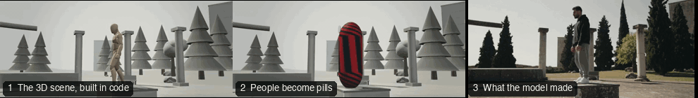</p>

The trick is one sentence: **a reference video carries two things, where the camera goes and how the bodies move, and the model copies both. So give it a camera to follow and nobody to copy.** Every person and product in the 3D clip is a striped pill. The pill gives the model the place, the size, the facing and the timing, and has no body to copy. The prompt says what everything really is.

**Run it on Tein:** Seedance 2.5 is generated through [Tein](https://tein.ai). [Sign up at tein.ai](https://tein.ai), create an API key, and use the Tein MCP or API (setup in [docs/tein-endpoint.md](docs/tein-endpoint.md), the full reference in [docs/tein/](docs/tein/)). This repo never stores a key.

This repo is the whole pipeline: the three.js engine, **137 templates** with their code, pill clips, prompts and Seedance results, the 24 places, what we learned, and the Tein setup for generating the videos.

**Words used here.**

| Word | Meaning |
|---|---|
| Pill | A striped capsule or pin, as tall as the person it stands for. It replaces a person in the 3D clip. It has no limbs. |
| Pill clip | The grey 3D clip you render: set, pills and the camera move. This is the reference video. |
| Template | One camera move or shot as a small code file, with its pill clip, prompts and results. |
| Draft | A 480p preview made with `draft: true`. It costs less, and can be finalized later. |
| Sketch route | Sending a contact sheet of drawn frames instead of the video. |

Tein (tein.ai) hosts Seedance 2.5 and runs the gallery this repo grew from. You need your own Tein account and key; this repo never stores one. Made by Sirio Berati, TEIN AI.

## How it works

| 1. Build the move in code | 2. People become pills | 3. The model makes the shot |
|---|---|---|
| A grey 3D set and a camera path, written in three.js (no Blender). One small file per template. | Each person is a striped pill, as tall as they are, with a white dot where their eyes face. No body to copy. | The pill clip goes to the model with your photo and a prompt. It returns the real shot, keeping the same camera move. |

## See it

Every card: the 3D pill clip on top, what Seedance made from it below. Click one for its code, its prompt and how it was sent.

<table>
<tr><td width="50%"><a href="templates/CAM06-Orbit/">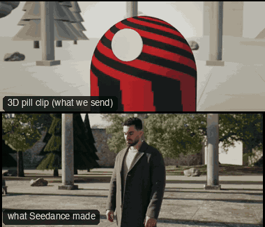</a><br><sub><b>CAM06-Orbit: Orbit</b></sub></td><td width="50%"><a href="templates/CAM05-DollyZoom/">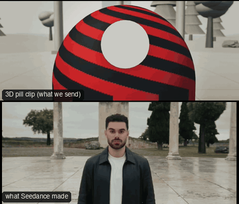</a><br><sub><b>CAM05-DollyZoom: Dolly zoom</b></sub></td></tr>
<tr><td width="50%"><a href="templates/CAM16-FPV/">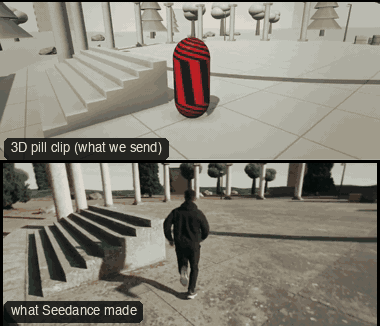</a><br><sub><b>CAM16-FPV: FPV drone</b></sub></td><td width="50%"><a href="templates/CAM28-BarrelRoll/">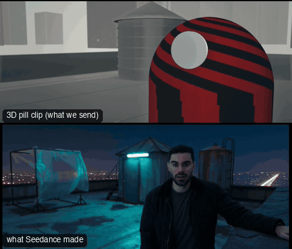</a><br><sub><b>CAM28-BarrelRoll: Barrel roll</b></sub></td></tr>
<tr><td width="50%"><a href="templates/CAM21-PanReveal/">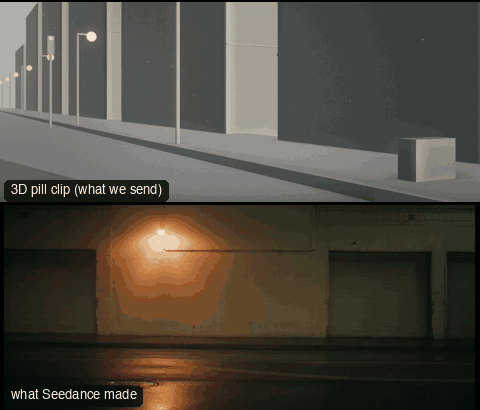</a><br><sub><b>CAM21-PanReveal: Pan reveal</b></sub></td><td width="50%"><a href="templates/CAM25-ArcAndRise/">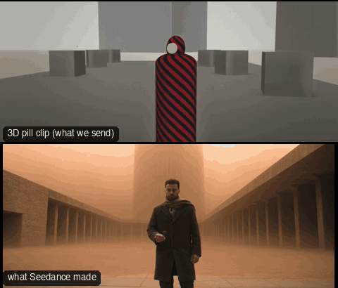</a><br><sub><b>CAM25-ArcAndRise: Arc and rise</b></sub></td></tr>
<tr><td width="50%"><a href="templates/CAM42-DroneDive/">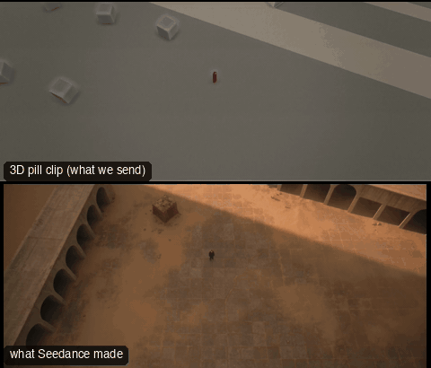</a><br><sub><b>CAM42-DroneDive: Drone dive</b></sub></td><td width="50%"><a href="templates/OBJ02-OrbitHero/">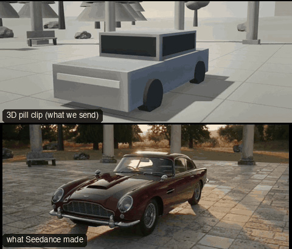</a><br><sub><b>OBJ02-OrbitHero: Hero orbit (object)</b></sub></td></tr>
<tr><td width="50%"><a href="templates/OBJ16-ProductSpin/">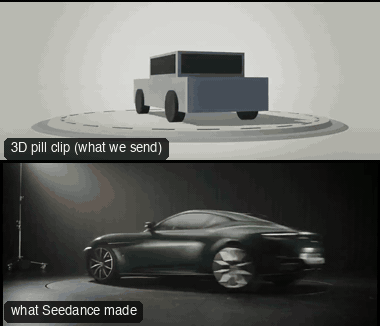</a><br><sub><b>OBJ16-ProductSpin: Product spin</b></sub></td><td width="50%"><a href="templates/ACT01-BulletTimeOrbit/">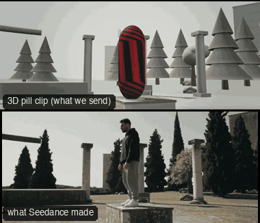</a><br><sub><b>ACT01-BulletTimeOrbit: Bullet-time orbit</b></sub></td></tr>
<tr><td width="50%"><a href="templates/ACT05-ParkourTrack/">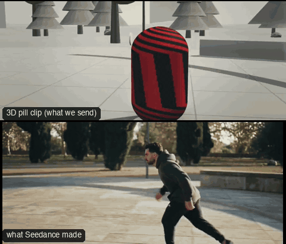</a><br><sub><b>ACT05-ParkourTrack: Parkour track</b></sub></td><td width="50%"><a href="templates/ONE04-OrbitPushRack/">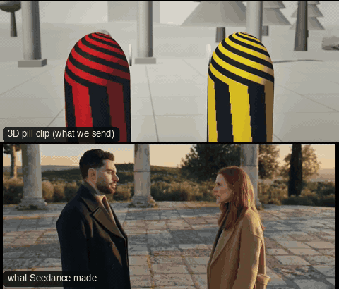</a><br><sub><b>ONE04-OrbitPushRack: Orbit, push, rack</b></sub></td></tr>
<tr><td width="50%"><a href="templates/SC04-CarInterior/">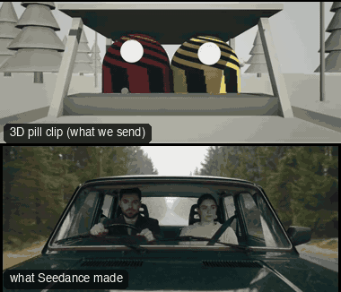</a><br><sub><b>SC04-CarInterior: Car interior</b></sub></td><td width="50%"><a href="templates/SC03-StreetWalkTalk/">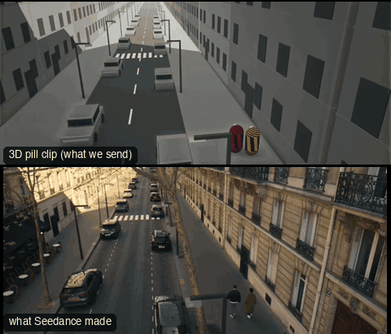</a><br><sub><b>SC03-StreetWalkTalk: Street walk-and-talk</b></sub></td></tr>
<tr><td width="50%"><a href="templates/FAM01-Booth360/">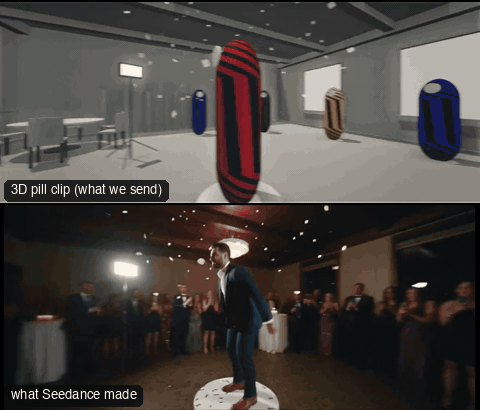</a><br><sub><b>FAM01-Booth360: 360 booth spin</b></sub></td><td width="50%"><a href="templates/FAM02-ExplosionWalk/">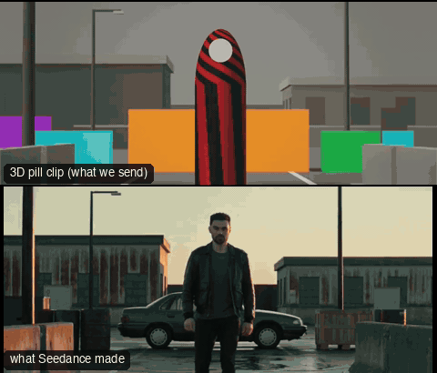</a><br><sub><b>FAM02-ExplosionWalk: Walk away from the explosion</b></sub></td></tr>
<tr><td width="50%"><a href="templates/FAM04-LeapOfFaith/">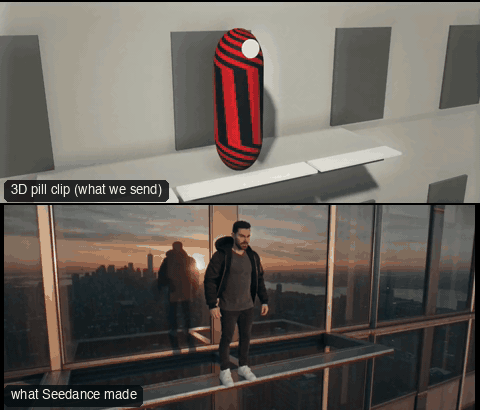</a><br><sub><b>FAM04-LeapOfFaith: Leap of faith</b></sub></td><td width="50%"><a href="templates/PRD06-Glambot/">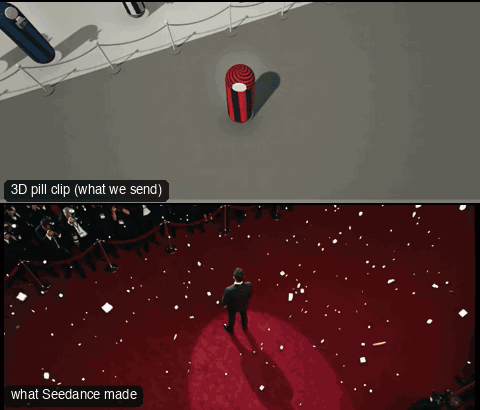</a><br><sub><b>PRD06-Glambot: Glambot</b></sub></td></tr>
<tr><td width="50%"><a href="templates/SHOW01-TheHandoff/">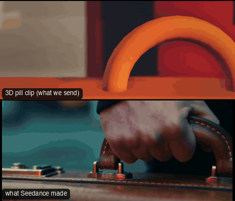</a><br><sub><b>SHOW01-TheHandoff: The Handoff</b></sub></td><td width="50%"><a href="templates/SC07-AlleyFight/">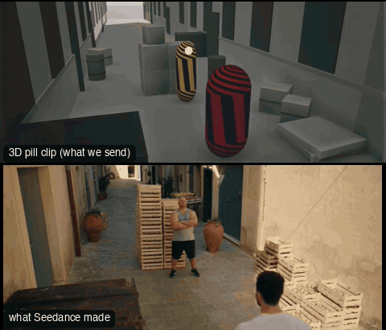</a><br><sub><b>SC07-AlleyFight: Alley fight</b></sub></td></tr>
</table>

All 137 templates, with a preview each: [templates/INDEX.md](templates/INDEX.md).

## The same move, six inputs

One move (an orbit round a walking man) sent six ways. The pill is the one that keeps the camera exact and the people natural.

| What we sent | What the model made |
|---|---|
| 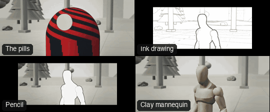 | 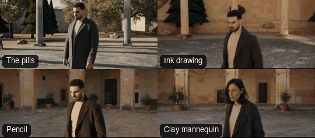 |

Why each one was kept or dropped: [docs/variants.md](docs/variants.md) and [docs/failure-ladder.md](docs/failure-ladder.md).

## Two routes: the video, and the sketch

The pill **video** is the exact route: every cut lands on the frame. The **sketch** route draws the same scene as a contact sheet of frames: cheaper and more natural, but a sheet has no clock, so cuts drift by about half a second.

<p align="center">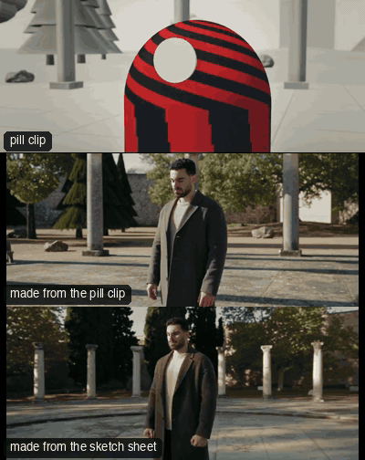</p>

<p align="center">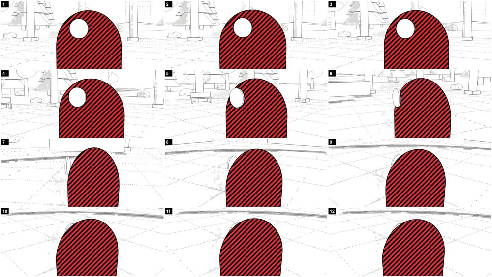<br><sub>The contact sheet that was sent for the sketch route.</sub></p>

The numbers, and when to use which: [docs/why/why-video-first-sheet-second.md](docs/why/why-video-first-sheet-second.md).

## Try it in ten minutes

You need Node 22.12 or newer, ffmpeg, and network access once (Remotion downloads a headless Chrome on the first render). The first install and render take a few minutes.

```bash
cd engine/cinematic && npm install
tools/render-pill.sh CAM06-Orbit        # a 7 s, 24 fps, 21:9 pill clip, written to .work/out/pill/
```

The `pill.mp4` files in this repo are smaller gallery copies (mostly 960 wide); the render script above makes the full 1280x534 clip, and `sent.json` records the size that was sent.

Open `templates/CAM06-Orbit/`: `template.ts` is the shot as code, `prompts/` holds the prompts (`sent.json` says which are the text that was sent and which are recovered or rebuilt copies), and `sent.json` holds the references in order and the settings. Send it as a draft through Tein's Seedance 2.5 (see [docs/tein-endpoint.md](docs/tein-endpoint.md)): the pill clip is `reference_video`, your photo is `reference_image`. Judge the draft against the pill clip before you finalize anything.

**Build your own template** in about 12 lines: [docs/build-your-own-template.md](docs/build-your-own-template.md).

## Use it with Tein's MCP or API

Generating a video goes through Tein's Seedance 2.5, either as the Tein MCP or as the API. Both need a Tein key from tein.ai; this repo never stores one. The setup is in [docs/tein-endpoint.md](docs/tein-endpoint.md): getting a key, the two MCP servers, the request for a template, drafts and finalizing, limits and costs. A separate helper project (an MCP and a skill that guide a beginner through all of this) is not part of this repo.

## What is in the repo

| Folder | What it holds |
|---|---|
| `engine/cinematic/` | The renderer: three.js inside Remotion, the stand-ins, the rigs, the checks. The CC0 rig is in `public/kit/`. |
| `templates/<ID>/` | One folder per template: `template.ts`, `pill.mp4`, `preview.gif`, `prompts/`, `sent.json`, `README.md`, `reproduce.md`, and the sketch sheet where that route was used. 75 pill clips use the single capsule and 62 the pin (a head on a slim body); each README says which. |
| `docs/` | The method, the why pages, every rule, the failures and fixes, the prompt anatomy, the Seedance and Tein notes, costs, QA. Start with [docs/idea.md](docs/idea.md). |
| `tools/seedance/` | The sketch-sheet maker, the prompt builders and gates, and the video checks (camera, cuts, framing, speech, mouth). |
| `answers/` | 137 questions about the method, each answered with its evidence and a status; 4 are marked UNPROVEN. |
| `environments/` | The 24 place references and their moods. |
| `skills/cinematic-previs/` | The skill behind the engine's checks: the camera and cut rulebook and the stills-first QA loop. |
| `gallery/` | The one-page gallery: open `gallery/index.html`, nothing to install. |

Large result videos are release downloads, not files in git: download `camera-control-results.zip` from the [v0.1.0 release](https://github.com/sirioberati/ai-filmmaking-camera-control-seedance-2-5/releases/tag/v0.1.0) and unzip it at the repo root to get `release-media/`. The whole clone is about 440 MB. What does not work yet, and what was never tested: [docs/known-limits.md](docs/known-limits.md).

## Things that matter most

- Name every stand-in in the prompt and say no pill ever appears in the result.
- Rebuild the set in words. Without it the model copies the grey cones, boxes and spheres.
- Move the camera in every clip you send, and hold every shot and every camera effect for 2 seconds or more. The locked-off templates (CAM01, CAM26, CAM29, CAM30, CAM46, FAM03, the ANG family) are kept as camera studies, not as templates to send. A few older templates have shots under 2 s; they were built before the rule.
- A conversation needs exact spoken lines in their own block near the top of the prompt.
- Never finalize a draft until the draft is right.

## Licence and credits

Code, prompts, notes and the pill clips are MIT ([LICENSE](LICENSE)). The rig is CC0 by Quaternius. Remotion has its own licence: free for individuals and small companies, a company licence for larger for-profit teams. Read [NOTICE.md](NOTICE.md) before you use this at work: it also covers the camera presets, the faces in the examples and the brand marks in the product shots.

Made by Sirio Berati. Rendered with three.js and Remotion. Examples made with Seedance 2.5.
