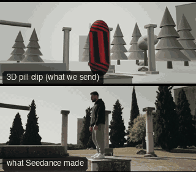

# ACT01-BulletTimeOrbit: Bullet-time orbit



Family: Action.

**What it says.** Time stops for this one moment: we walk round it while the world hangs.

**Use it for.** The peak of a leap, a hit or a near miss that the story turns on; once per film.

**Camera numbers.** 28 mm, full shot with the block in it, world clock eased to 0.02 over 0.3 s at the apex, held 3.8 s while the camera orbits 180° (about 47°/s), eased back to real time for the landing.

**Avoid.** Freezing a pose that tells nothing: freeze the instant before the outcome, not after it.

## The three.js code

This is an excerpt of the template (15 lines, from `engine/cinematic/src/templates/action.ts`). `template.ts` in this folder is the same code with its imports. The helpers it calls (`make`, the actors, the rigs, the set and the post chain) are in `engine/cinematic/src`, so it does not run on its own: render it with `tools/render-pill.sh`.

```ts
import * as THREE from "three";
import { planner, scenePiece, speedRamp, type KitWorld, type SceneSpec, type ShotDef } from "../kit/stage";
import type { Act, Actor, ActorSpec, PathKey } from "../kit/actors";
import { around, lag, leadRoom, rig, type Subj } from "../kit/rigs";
import { aimFor, frameFor, frameHeight, SENSOR_H } from "../framer";
import { GREY, clay } from "../kit/clay";
import { broadTree, building, column, ground, pine, scatter } from "../kit/props";
import { buildLab } from "./lab";
import { clamp, lerp, ramp } from "../util";
import type { Piece } from "../piece";
import type { Cam } from "../shots";
import type { Marks } from "../marks";
import { CAMERA_INFO, type TemplateInfo } from "./cameras";

make({ id: "ACT01-BulletTimeOrbit", name: "Bullet-time orbit", says: "Time stops for this one moment: we walk round it while the world hangs.", use: "The peak of a leap, a hit or a near miss that the story turns on; once per film.", numbers: "28 mm, full shot with the block in it, world clock eased to 0.02 over 0.3 s at the apex, held 3.8 s while the camera orbits 180° (about 47°/s), eased back to real time for the landing.", avoid: "Freezing a pose that tells nothing: freeze the instant before the outcome, not after it." },
    [human("ALEX", "Alex", "ochre", A1.keys, A1.acts)],
    (P, W) => {
      const A = P("ALEX"), m0 = A(0), mm = 28, B = body(A.actor);
      const cam = (t: number): Cam => {
        const m = A(t), b = B(W(t)), mid = b.waist.clone().lerp(b.eye, 0.25);
        const deg = 70 - 180 * ramp(t, 1.55, 5.75);
        const d = (1.25 * frameHeight(m, "FS") * mm) / SENSOR_H;
        const pos = mid.clone().add(around(m0, deg).multiplyScalar(d));
        pos.y = 1.55 + 1.1 * ramp(t, 1.05, 2.0) - 1.45 * ramp(t, 5.5, 6.6);
        return { pos, target: aimFor(pos, mid, mm, [0, 0.08]), mm };
      };
      return [{ start: 0, end: 8, label: "28mm  BULLET-TIME ORBIT 180", rig: "VIRTUAL CAMERA ARRAY · ORBIT", subject: "ALEX", size: "FS", stop: 4, cam, flags: ["compound", "centre", "whip"], cut: "Opens the template", note: "PAN exempt: the tilt follows the drop to the landing. Clock 1 → 0.02 at the apex, held through the orbit, back to 1 for the landing" }];
    },
    { build: labWithBlock(0, -1.45, 1.4, 1.0, 1.2), clock: clock1 }),
```

**Make it yours.** Change shot size: FS. The actor `path` entries say where the pill stands and walks, and the numbers after `rig.` set the move (distance, angle, rise, start and end time).

## The videos

The stand-in in `pill.mp4` is the **capsule** (the single striped capsule of the first gallery clips). Render the other with `--standin pin`.

| What | File |
|---|---|
| The 3D pill clip, the reference video | `pill.mp4` |
| The contact sheet (sketch route) | `sketch-sheet.jpg` |
| What Seedance made from the pill clip (480p draft) | `release-media/ACT01-BulletTimeOrbit/result.mp4` (release asset) |
| What Seedance made from the contact sheet | `release-media/ACT01-BulletTimeOrbit/sketch-output.mp4` (release asset) |
| Camera only, no subject | `release-media/ACT01-BulletTimeOrbit/plate.mp4` and what it made: `release-media/ACT01-BulletTimeOrbit/plate-made.mp4` |
| The same move in other looks (ink, pencil, ghost, plate, boxes, clay, hand) | `release-media/ACT01-BulletTimeOrbit/looks/` |
| Another take from the same template | `release-media/ACT01-BulletTimeOrbit/ink-sketch-ink-sheet.mp4` |
| Another take from the same template | `release-media/ACT01-BulletTimeOrbit/ink-sketch-ink2-act01.mp4` |
| Another take from the same template | `release-media/ACT01-BulletTimeOrbit/ink-sketch-ink3-act01.mp4` |
| Another take from the same template | `release-media/ACT01-BulletTimeOrbit/sketch-blur-sheet.mp4` |
| Another take from the same template | `release-media/ACT01-BulletTimeOrbit/sketch-cam-sheet.mp4` |
| Another take from the same template | `release-media/ACT01-BulletTimeOrbit/sketch-opt-sheet.mp4` |
| Another take from the same template | `release-media/ACT01-BulletTimeOrbit/video-cam-video.mp4` |

## The prompt

One file per send. `sent.json` says, for each, whether it is the text that was sent, a recovered copy, or a rebuilt copy (`prompt.provenance`):

- `prompts/camera-only-sketch.txt`
- `prompts/camera-only-video-1.txt`
- `prompts/camera-only-video-2.txt`
- `prompts/ink-sketch-recovered-sheet.txt`
- `prompts/sketch-recovered-sheet.txt`
- `prompts/sketch.txt`
- `prompts/video-1.txt`
- `prompts/video-2.txt`
- `prompts/video-recovered-video.txt`

Keep the lines that say what the pills are and that the set is to be rebuilt as real. Change the person, the place and the light. These prompts come from the gallery runs and many predate the checks in `tools/seedance/`, so rebuild one with the gates before you reuse it.

## How it was sent

`sent.json` holds, for each send: the references in order with their roles, the settings, the credits and the outcome. Request ids are not kept; where one was known, a short hash is stored.

- **video #1**: 8 s, draft (480p preview), 21:9; references: @video1 = pill clip (the 3D blockout), @image1 = person photo (face reference); confirmed: no receipt.
- **video #2**: 8 s, draft (480p preview), 21:9; references: @video1 = pill clip (the 3D blockout), @image1 = person photo (face reference); confirmed: yes; 1166.4 credits.
- **video #3**: 8 s, draft (480p preview), 21:9; references: @video1 = pill clip (the 3D blockout), @image1 = person photo (face reference); confirmed: yes; 1166.4 credits.
- **sketch #1**: 8 s, draft (480p preview), 21:9; references: @image1 = person photo (face reference), @image2 = contact sheet of the pill (a few frames on one image); confirmed: yes; 977.6 credits.
- **sketch #2**: 8 s, draft (480p preview), 21:9; references: @image1 = person photo (face reference), @image2 = pill contact sheet (the sketch route); confirmed: yes; 977.6 credits.
- **sketch #3**: 8 s, draft (480p preview), 21:9; references: @image1 = person photo (face reference), @image2 = pill contact sheet (the sketch route); confirmed: yes; 977.6 credits.
- **sketch #4**: 8 s, draft (480p preview), 21:9; references: @image1 = person photo (face reference), @image2 = pill contact sheet (the sketch route); confirmed: yes; 977.6 credits.
- **camera-only-video #1**: 8 s, draft (480p preview), 21:9; references: @video1 = pill clip (the 3D blockout), @image1 = person photo (face reference); confirmed: no receipt.
- **camera-only-video #2**: 8 s, draft (480p preview), 21:9; references: @video1 = pill clip (the 3D blockout), @image1 = person photo (face reference); confirmed: yes; 1166.4 credits.
- **camera-only-sketch #1**: 8 s, draft (480p preview), 21:9; references: @image1 = person photo (face reference), @image2 = contact sheet of the pill (a few frames on one image); confirmed: yes; 977.6 credits.
- **ink-sketch #1**: 8 s, draft (480p preview), 21:9; references: @image1 = person photo (face reference), @image2 = pill contact sheet (the sketch route); confirmed: yes; 977.6 credits.
- **ink-sketch #2**: 8 s, draft (480p preview), 21:9; references: @image1 = person photo (face reference), @image2 = pill contact sheet (the sketch route); confirmed: yes; 977.6 credits.
- **ink-sketch #3**: 8 s, draft (480p preview), 21:9; references: @image1 = person photo (face reference), @image2 = pill contact sheet (the sketch route); confirmed: yes; 977.6 credits.

See `reproduce.md` to render it and send it yourself.
