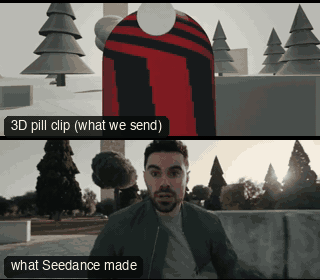

# ACT02-Snorricam: Snorricam



Family: Action.

**What it says.** We are strapped to them: they hold still and the world lurches; panic, flight, a body out of control.

**Use it for.** Flight in terror, drunkenness, a breakdown; a short burst inside a chase.

**Camera numbers.** 18 mm, 1.4 m arm off the chest, the rig rides the body's own bounce (the run's measured 18 cm) so the figure holds still in frame; lean into turns (v·ω/g).

**Avoid.** A long lens or a long arm: the subject must fill the frame so the world, not the body, moves.

## The three.js code

This is an excerpt of the template (21 lines, from `engine/cinematic/src/templates/action.ts`). `template.ts` in this folder is the same code with its imports. The helpers it calls (`make`, the actors, the rigs, the set and the post chain) are in `engine/cinematic/src`, so it does not run on its own: render it with `tools/render-pill.sh`.

```ts
import * as THREE from "three";
import { planner, scenePiece, speedRamp, type KitWorld, type SceneSpec, type ShotDef } from "../kit/stage";
import type { Act, Actor, ActorSpec, PathKey } from "../kit/actors";
import { around, lag, leadRoom, rig, type Subj } from "../kit/rigs";
import { aimFor, frameFor, frameHeight, SENSOR_H } from "../framer";
import { GREY, clay } from "../kit/clay";
import { broadTree, building, column, ground, pine, scatter } from "../kit/props";
import { buildLab } from "./lab";
import { clamp, lerp, ramp } from "../util";
import type { Piece } from "../piece";
import type { Cam } from "../shots";
import type { Marks } from "../marks";
import { CAMERA_INFO, type TemplateInfo } from "./cameras";

make({ id: "ACT02-Snorricam", name: "Snorricam", says: "We are strapped to them: they hold still and the world lurches; panic, flight, a body out of control.", use: "Flight in terror, drunkenness, a breakdown; a short burst inside a chase.", numbers: "18 mm, 1.4 m arm off the chest, the rig rides the body's own bounce (the run's measured 18 cm) so the figure holds still in frame; lean into turns (v·ω/g).", avoid: "A long lens or a long arm: the subject must fill the frame so the world, not the body, moves." },
    [human("ALEX", "Alex", "ochre", PATH2, undefined, { look: [-3, 1.6, -10], lookFrom: 2.0, lookTo: 3.7 })],
    (P) => {
      const A = P("ALEX").actor, mm = 18, ARM = 1.42;
      const G = gaitClock(A, PATH2[0].t - 1, 9);
      const jogW = (sp: number) => THREE.MathUtils.smoothstep(sp, 2.4, 3.4) * (1 - THREE.MathUtils.smoothstep(sp, 5.4, 6.2));
      const cam = (t: number): Cam => {
        const g = G(t), w = jogW(g.sp), row = jogRow(g.cyc);
        const v = STAND.map((s, i) => lerp(s, row[i], w)), mean = STAND.map((s, i) => lerp(s, JOG_MEAN[i], w));
        const root = A.pos(t), yaw = A.yaw(t);
        const chest = local(root, yaw, v[3], v[4], v[5]);
        const pos = local(chest, yaw, 0, 0.1, ARM);
        const bob = chest.clone().sub(local(root, yaw, mean[3], mean[4], mean[5]));
        const eye = local(root, yaw, mean[0], mean[1], mean[2]).add(bob);
        const turn = ((A.yaw(t + 0.1) - A.yaw(t - 0.1) + Math.PI * 3) % (Math.PI * 2) - Math.PI) / 0.2;
        const roll = clamp(Math.atan((g.sp * turn) / 9.81) * 0.35, -0.12, 0.12) + 0.015 * Math.sin(g.cyc * Math.PI * 2) * w;
        return { pos, target: aimFor(pos, eye, mm, [0, 0.4]), mm, roll };
      };
      return [{ start: 0, end: 7.25, label: "18mm  SNORRICAM · CHEST RIG", rig: "BODY MOUNT · SNORRICAM", subject: "ALEX", size: "MWS", stop: 2.8, cam, flags: ["enters-moving", "compound", "centre", "whip"], cut: "Opens the template", note: "PAN exempt: the rig turns with the body, so the world swings while the runner holds still" }];
    },
    { motes: { center: [0, 2, 2], size: [36, 5, 20], count: 260 } }),
```

**Make it yours.** Change shot size: MWS. The actor `path` entries say where the pill stands and walks, and the numbers after `rig.` set the move (distance, angle, rise, start and end time).

## The videos

The stand-in in `pill.mp4` is the **capsule** (the single striped capsule of the first gallery clips). Render the other with `--standin pin`.

| What | File |
|---|---|
| The 3D pill clip, the reference video (a re-render: the clip that was uploaded was not kept) | `pill.mp4` |
| What Seedance made from the pill clip (480p draft) | `release-media/ACT02-Snorricam/result.mp4` (release asset) |

## The prompt

One file per send. `sent.json` says, for each, whether it is the text that was sent, a recovered copy, or a rebuilt copy (`prompt.provenance`):

- `prompts/video.txt`

Keep the lines that say what the pills are and that the set is to be rebuilt as real. Change the person, the place and the light. These prompts come from the gallery runs and many predate the checks in `tools/seedance/`, so rebuild one with the gates before you reuse it.

## How it was sent

`sent.json` holds, for each send: the references in order with their roles, the settings, the credits and the outcome. Request ids are not kept; where one was known, a short hash is stored.

- **video #1**: 8 s, draft (480p preview), 21:9; references: @video1 = pill clip (the 3D blockout), @image1 = person photo (face reference); confirmed: yes; 1093.5 credits.

See `reproduce.md` to render it and send it yourself.
