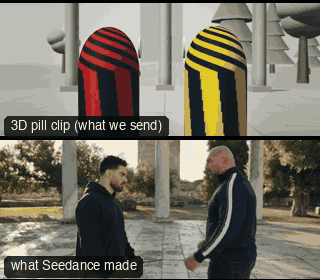

# ACT03-CrashZoomFight: Crash zoom and whip (fight)



Family: Action.

**What it says.** That one landed: the zoom slams in on the hit and the whip throws us after the body.

**Use it for.** The decisive blow of a fight, comedy violence, a shock beat; once per sequence.

**Camera numbers.** Handheld 35 mm two-shot; crash zoom 35 → 85 mm in 0.2 s as the cross lands in the chest; hold 1 s on fist and head while the legs go; whip 0.28 s down with the fall, landing on 45 mm; cut to a low 24 mm wide on the same side of the line.

**Avoid.** Zooming before the blow lands (it telegraphs), or whipping to a frame that is not composed.

## The three.js code

This is an excerpt of the template (27 lines, from `engine/cinematic/src/templates/action.ts`). `template.ts` in this folder is the same code with its imports. The helpers it calls (`make`, the actors, the rigs, the set and the post chain) are in `engine/cinematic/src`, so it does not run on its own: render it with `tools/render-pill.sh`.

```ts
import * as THREE from "three";
import { planner, scenePiece, speedRamp, type KitWorld, type SceneSpec, type ShotDef } from "../kit/stage";
import type { Act, Actor, ActorSpec, PathKey } from "../kit/actors";
import { around, lag, leadRoom, rig, type Subj } from "../kit/rigs";
import { aimFor, frameFor, frameHeight, SENSOR_H } from "../framer";
import { GREY, clay } from "../kit/clay";
import { broadTree, building, column, ground, pine, scatter } from "../kit/props";
import { buildLab } from "./lab";
import { clamp, lerp, ramp } from "../util";
import type { Piece } from "../piece";
import type { Cam } from "../shots";
import type { Marks } from "../marks";
import { CAMERA_INFO, type TemplateInfo } from "./cameras";

make({ id: "ACT03-CrashZoomFight", name: "Crash zoom and whip (fight)", says: "That one landed: the zoom slams in on the hit and the whip throws us after the body.", use: "The decisive blow of a fight, comedy violence, a shock beat; once per sequence.", numbers: "Handheld 35 mm two-shot; crash zoom 35 → 85 mm in 0.2 s as the cross lands in the chest; hold 1 s on fist and head while the legs go; whip 0.28 s down with the fall, landing on 45 mm; cut to a low 24 mm wide on the same side of the line.", avoid: "Zooming before the blow lands (it telegraphs), or whipping to a frame that is not composed." },
    [
      human("ALEX", "Alex", "ochre", [{ t: 0, at: [-0.5, 0], yaw: Math.PI / 2 }, { t: 1.5, at: [-0.5, 0], yaw: Math.PI / 2 }, { t: 2.3, at: [-0.35, 0], yaw: Math.PI / 2 }],
        [clip("Hit_Head", 1.27, 1.75, 0.08), ...strike("Punch_Cross", 2.3, 6.0, 0.45, 0.7)]),
      human("SAM", "Sam", "slate", lying(0.5, 0, -Math.PI / 2, DEATH_LIFT, KO3),
        [...strike("Punch_Jab", 1.1, 2.45, 0.6, 0.06), clip("Hit_Chest", 2.6, 2.8, 0.04), clip("Death01", KO3, undefined, 0.12)]),
    ],
    (P) => {
      const S = P("SAM"), B = body(S.actor), A = body(P("ALEX").actor);
      const pos = V(0.05, 1.5, 3.3);
      // the two-shot's centre, the blow (Alex's fist at Sam's jaw), and the body on the floor
      const pair = (t: number) => A(t).eye.lerp(B(t).eye, 0.5).add(V(0, -0.25, 0));
      const hit = (t: number) => V(0.36, 1.38, 0).lerp(B(t).eye, 0.45);
      const zoom = (t: number): Cam => {
        const k = ramp(t, 2.42, 2.62), mm = 35 * Math.pow(85 / 35, k);
        return reaim({ pos: pos.clone(), target: aimFor(pos, pair(t), 35, [0, 0]), mm }, hit(t), [0, 0], k);
      };
      const floor = (t: number) => { const b = B(t); return b.waist.lerp(b.eye, 0.35); };
      const onFloor = (t: number): Cam => ({ pos: pos.clone(), target: aimFor(pos, floor(t), 45, [0.05, -0.05]), mm: 45 });
      const low = V(2.6, 0.35, 2.4);
      return [
        { start: 0, end: 5, label: "35>85mm  CRASH ZOOM · WHIP TO FALL", rig: "HANDHELD", subject: "SAM", size: "MWS", sizeEnd: "WS", stop: 2.8, pair: ["ALEX", "SAM"],
          cam: rig.whip(zoom, onFloor, 3.62, 0.28), flags: ["whip", "compound", "short-side"], cut: "Opens the template", note: "Crash zoom 2.42–2.62 as the cross lands; whip 3.62–3.90 with the fall" },
        { start: 5, end: 7.5, label: "24mm  LOW WIDE · STANDING OVER", rig: "TRIPOD", subject: "ALEX", size: "FS", stop: 4, pair: ["ALEX", "SAM"],
          cam: () => ({ pos: low.clone(), target: aimFor(low, V(0.35, 0.8, 0), 24, [0, 0.05]), mm: 24 }), flags: ["centre"], cut: "CUT on the stillness after the fall: same side of the line, low and wide" },
      ];
    }),
```

**Make it yours.** Change rig: `rig.whip`; lens: 24 mm, 45 mm; shot size: FS, MWS. The actor `path` entries say where the pill stands and walks, and the numbers after `rig.` set the move (distance, angle, rise, start and end time).

## The videos

The stand-in in `pill.mp4` is the **capsule** (the single striped capsule of the first gallery clips). Render the other with `--standin pin`.

| What | File |
|---|---|
| The 3D pill clip, the reference video (a re-render: the clip that was uploaded was not kept) | `pill.mp4` |
| What Seedance made from the pill clip (480p draft) | `release-media/ACT03-CrashZoomFight/result.mp4` (release asset) |

## The prompt

One file per send. `sent.json` says, for each, whether it is the text that was sent, a recovered copy, or a rebuilt copy (`prompt.provenance`):

- `prompts/video.txt`

Keep the lines that say what the pills are and that the set is to be rebuilt as real. Change the person, the place and the light. These prompts come from the gallery runs and many predate the checks in `tools/seedance/`, so rebuild one with the gates before you reuse it.

## How it was sent

`sent.json` holds, for each send: the references in order with their roles, the settings, the credits and the outcome. Request ids are not kept; where one was known, a short hash is stored.

- **video #1**: 8 s, draft (480p preview), 21:9; references: @video1 = pill clip (the 3D blockout), @image1 = person photo (face reference); confirmed: yes; 1166.4 credits.

See `reproduce.md` to render it and send it yourself.
