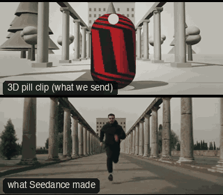

# ACT04-SprintDollyZoom: Sprint dolly zoom



Family: Action.

**What it says.** They run and the world chases them: the far end looms closer the harder they run.

**Use it for.** A flight from something enormous, a run toward a deadline, the moment a chase turns hopeless.

**Camera numbers.** Camera car leading the runner (5.2 m/s); 24 → 85 mm over 5.6 s while it pulls back from 3.5 to 12 m in proportion, hip high and level, so the runner holds a full shot and the far gate grows 3.5×.

**Avoid.** Keying the lens and the distance apart, or a background with no lines: it needs a far shape to loom.

## The three.js code

This is an excerpt of the template (11 lines, from `engine/cinematic/src/templates/action.ts`). `template.ts` in this folder is the same code with its imports. The helpers it calls (`make`, the actors, the rigs, the set and the post chain) are in `engine/cinematic/src`, so it does not run on its own: render it with `tools/render-pill.sh`.

```ts
import * as THREE from "three";
import { planner, scenePiece, speedRamp, type KitWorld, type SceneSpec, type ShotDef } from "../kit/stage";
import type { Act, Actor, ActorSpec, PathKey } from "../kit/actors";
import { around, lag, leadRoom, rig, type Subj } from "../kit/rigs";
import { aimFor, frameFor, frameHeight, SENSOR_H } from "../framer";
import { GREY, clay } from "../kit/clay";
import { broadTree, building, column, ground, pine, scatter } from "../kit/props";
import { buildLab } from "./lab";
import { clamp, lerp, ramp } from "../util";
import type { Piece } from "../piece";
import type { Cam } from "../shots";
import type { Marks } from "../marks";
import { CAMERA_INFO, type TemplateInfo } from "./cameras";

make({ id: "ACT04-SprintDollyZoom", name: "Sprint dolly zoom", says: "They run and the world chases them: the far end looms closer the harder they run.", use: "A flight from something enormous, a run toward a deadline, the moment a chase turns hopeless.", numbers: "Camera car leading the runner (5.2 m/s); 24 → 85 mm over 5.6 s while it pulls back from 3.5 to 12 m in proportion, hip high and level, so the runner holds a full shot and the far gate grows 3.5×.", avoid: "Keying the lens and the distance apart, or a background with no lines: it needs a far shape to loom." },
    [human("ALEX", "Alex", "ochre", runPath(new THREE.LineCurve3(V(0, 0, -33.4), V(0, 0, 60)), [[-1.6, 0], [-0.2, 5.2], [7.2, 5.2]]))],
    (P) => [{ start: 0, end: 6.5, label: "24>85mm  DOLLY ZOOM · SPRINT", rig: "CAMERA CAR · DOLLY ZOOM", subject: "ALEX", size: "FS", stop: 4, cam: (t) => {
      // the lens and the distance driven together (distance ∝ focal length), the camera at hip height and level, so the
      // runner holds a full shot and only the space behind changes
      const A = P("ALEX"), m = A(t), k = ramp(t, 0.45, 6.05), mm = 24 * Math.pow(85 / 24, k);
      const mid = m.top.clone().lerp(m.sole, 0.5), d = (frameHeight(m, "FS") * mm) / SENSOR_H;
      const pos = mid.clone().add(around(A(0), 0).multiplyScalar(d)).add(V(0, -0.15, 0));
      return { pos, target: aimFor(pos, mid, mm, [0, 0]), mm };
    }, flags: ["enters-moving", "exits-moving", "compound", "centre"], cut: "Opens the template" }],
    { build: buildAvenue, motes: { center: [0, 2.5, -10], size: [12, 5, 70], count: 260 } }),
```

**Make it yours.** Change shot size: FS. The actor `path` entries say where the pill stands and walks, and the numbers after `rig.` set the move (distance, angle, rise, start and end time).

## The videos

The stand-in in `pill.mp4` is the **capsule** (the single striped capsule of the first gallery clips). Render the other with `--standin pin`.

| What | File |
|---|---|
| The 3D pill clip, the reference video (a re-render: the clip that was uploaded was not kept) | `pill.mp4` |
| The contact sheet (sketch route) | `sketch-sheet.jpg` |
| What Seedance made from the pill clip (480p draft) | `release-media/ACT04-SprintDollyZoom/result.mp4` (release asset) |
| What Seedance made from the contact sheet | `release-media/ACT04-SprintDollyZoom/sketch-output.mp4` (release asset) |
| Another take from the same template | `release-media/ACT04-SprintDollyZoom/ink-sketch-ink-act04.mp4` |

## The prompt

One file per send. `sent.json` says, for each, whether it is the text that was sent, a recovered copy, or a rebuilt copy (`prompt.provenance`):

- `prompts/ink-sketch-recovered-sheet.txt`
- `prompts/video.txt`

Keep the lines that say what the pills are and that the set is to be rebuilt as real. Change the person, the place and the light. These prompts come from the gallery runs and many predate the checks in `tools/seedance/`, so rebuild one with the gates before you reuse it.

## How it was sent

`sent.json` holds, for each send: the references in order with their roles, the settings, the credits and the outcome. Request ids are not kept; where one was known, a short hash is stored.

- **video #1**: 7 s, draft (480p preview), 21:9; references: @video1 = pill clip (the 3D blockout), @image1 = person photo (face reference); confirmed: yes; 947.7 credits.
- **ink-sketch #1**: 7 s, draft (480p preview), 21:9; references: @image1 = person photo (face reference), @image2 = pill contact sheet (the sketch route); confirmed: yes; 855.4 credits.

See `reproduce.md` to render it and send it yourself.
