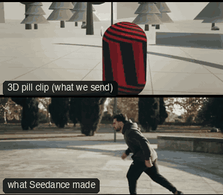

# ACT05-ParkourTrack: Parkour track



Family: Action.

**What it says.** We run with them and see the whole body solve the obstacle: skill, speed, flow.

**Use it for.** Chases on foot, parkour, any action where the body's line through the set is the point.

**Camera numbers.** 35 mm full shot side-on, a real tracking-vehicle move (track_alongside_1, E.T. dataset) scaled to 5 m off; the rig does not hop with the runner (height smoothed over 1.4 s).

**Avoid.** Cutting the move into pieces: one side-on take shows that the stunt was real.

## The three.js code

This is an excerpt of the template (12 lines, from `engine/cinematic/src/templates/action.ts`). `template.ts` in this folder is the same code with its imports. The helpers it calls (`make`, the actors, the rigs, the set and the post chain) are in `engine/cinematic/src`, so it does not run on its own: render it with `tools/render-pill.sh`.

```ts
import * as THREE from "three";
import { planner, scenePiece, speedRamp, type KitWorld, type SceneSpec, type ShotDef } from "../kit/stage";
import type { Act, Actor, ActorSpec, PathKey } from "../kit/actors";
import { around, lag, leadRoom, rig, type Subj } from "../kit/rigs";
import { aimFor, frameFor, frameHeight, SENSOR_H } from "../framer";
import { GREY, clay } from "../kit/clay";
import { broadTree, building, column, ground, pine, scatter } from "../kit/props";
import { buildLab } from "./lab";
import { clamp, lerp, ramp } from "../util";
import type { Piece } from "../piece";
import type { Cam } from "../shots";
import type { Marks } from "../marks";
import { CAMERA_INFO, type TemplateInfo } from "./cameras";

make({ id: "ACT05-ParkourTrack", name: "Parkour track", says: "We run with them and see the whole body solve the obstacle: skill, speed, flow.", use: "Chases on foot, parkour, any action where the body's line through the set is the point.", numbers: "35 mm full shot side-on, a real tracking-vehicle move (track_alongside_1, E.T. dataset) scaled to 5 m off; the rig does not hop with the runner (height smoothed over 1.4 s).", avoid: "Cutting the move into pieces: one side-on take shows that the stunt was real." },
    [human("ALEX", "Alex", "ochre", A5.keys, [clip("ClimbUp_1m", A5.tc, A5.tc + 0.67, 0.12), clip("NinjaJump_Idle_Loop", A5.te + 0.02, A5.tl - 0.1, 0.1), clip("Roll", A5.tl - 0.04, A5.tl + 0.68, 0.12)])],
    (P) => [{ start: 0, end: 7, label: "35mm  TRACKING · CLIMB, DROP, ROLL", rig: "TRACKING VEHICLE · REMOTE HEAD", subject: "ALEX", size: "FS", stop: 4, cam: (() => {
      // the vehicle's path is a real operator's (track_alongside_1); the remote head keeps the body framed, a beat behind
      const S = P("ALEX"), B = body(S.actor), F = rig.filmPath("track_alongside_1", settle(S), { size: "FS", mm: 35, deg: -25, rise: -1.4 }, 0);
      return (t: number): Cam => { const c = F(t), p = lag((x) => { const b = B(x); return b.waist.lerp(b.eye, 0.15); }, t, 0.3); return { ...c, target: aimFor(c.pos, p, c.mm, [leadRoom(c.pos, S(t), 0.18)[0], 0]) }; };
    })(), flags: ["enters-moving", "exits-moving", "compound", "whip"], cut: "Opens the template", note: "PAN exempt: the head follows the drop off the block" }],
    { build: (k) => {
      labWithBlock(A5.block.x, A5.z, A5.block.w, 1.0, 1.4)(k);
      // set dressing: the lamp post at the end of the run-out stands in the swing of the runner's arm; move it off the lane
      for (const o of k.scene.children) if (Math.abs(o.position.x - 16.5) < 0.05 && Math.abs(o.position.z - 2) < 0.05) o.position.z += 1.2;
    } }),
```

**Make it yours.** Change rig: `rig.filmPath`; lens: 35 mm; shot size: FS. The actor `path` entries say where the pill stands and walks, and the numbers after `rig.` set the move (distance, angle, rise, start and end time).

## The videos

The stand-in in `pill.mp4` is the **capsule** (the single striped capsule of the first gallery clips). Render the other with `--standin pin`.

| What | File |
|---|---|
| The 3D pill clip, the reference video (a re-render: the clip that was uploaded was not kept) | `pill.mp4` |
| What Seedance made from the pill clip (480p draft) | `release-media/ACT05-ParkourTrack/result.mp4` (release asset) |

## The prompt

One file per send. `sent.json` says, for each, whether it is the text that was sent, a recovered copy, or a rebuilt copy (`prompt.provenance`):

- `prompts/video.txt`

Keep the lines that say what the pills are and that the set is to be rebuilt as real. Change the person, the place and the light. These prompts come from the gallery runs and many predate the checks in `tools/seedance/`, so rebuild one with the gates before you reuse it.

## How it was sent

`sent.json` holds, for each send: the references in order with their roles, the settings, the credits and the outcome. Request ids are not kept; where one was known, a short hash is stored.

- **video #1**: 7 s, draft (480p preview), 21:9; references: @video1 = pill clip (the 3D blockout), @image1 = person photo (face reference); confirmed: yes; 1020.6 credits.

See `reproduce.md` to render it and send it yourself.
