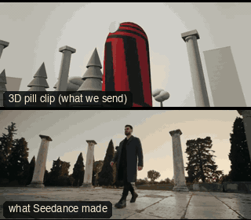

# ACT06-HeroLowArc: Hero low arc



Family: Action.

**What it says.** Here they come: bigger than life, and time bends round them.

**Use it for.** The hero's entrance, the walk to the fight, the team reveal.

**Camera numbers.** 21 mm, lens 0.45 m off the ground, medium-wide looking up about 30°; an 80° arc round the front at a steady 9°/s; world clock eased to 0.3 for 1.5 s at the middle of the arc.

**Avoid.** Speed-ramping a walk with nothing else moving: the dust and the camera must keep real time to sell it.

## The three.js code

This is an excerpt of the template (10 lines, from `engine/cinematic/src/templates/action.ts`). `template.ts` in this folder is the same code with its imports. The helpers it calls (`make`, the actors, the rigs, the set and the post chain) are in `engine/cinematic/src`, so it does not run on its own: render it with `tools/render-pill.sh`.

```ts
import * as THREE from "three";
import { planner, scenePiece, speedRamp, type KitWorld, type SceneSpec, type ShotDef } from "../kit/stage";
import type { Act, Actor, ActorSpec, PathKey } from "../kit/actors";
import { around, lag, leadRoom, rig, type Subj } from "../kit/rigs";
import { aimFor, frameFor, frameHeight, SENSOR_H } from "../framer";
import { GREY, clay } from "../kit/clay";
import { broadTree, building, column, ground, pine, scatter } from "../kit/props";
import { buildLab } from "./lab";
import { clamp, lerp, ramp } from "../util";
import type { Piece } from "../piece";
import type { Cam } from "../shots";
import type { Marks } from "../marks";
import { CAMERA_INFO, type TemplateInfo } from "./cameras";

make({ id: "ACT06-HeroLowArc", name: "Hero low arc", says: "Here they come: bigger than life, and time bends round them.", use: "The hero's entrance, the walk to the fight, the team reveal.", numbers: "21 mm, lens 0.45 m off the ground, medium-wide looking up about 30°; an 80° arc round the front at a steady 9°/s; world clock eased to 0.3 for 1.5 s at the middle of the arc.", avoid: "Speed-ramping a walk with nothing else moving: the dust and the camera must keep real time to sell it." },
    [human("ALEX", "Alex", "ochre", A6)],
    (P) => [{ start: 0, end: 8, label: "21mm  LOW ARC · SPEED RAMP", rig: "STEADICAM · LOW MODE", subject: "ALEX", size: "MWS", stop: 2.8, cam: (t) => {
      // an arc round the front at a held size; the move is eased over a longer span than the shot so it never stalls in it
      const A = P("ALEX"), m = A(t), deg = lerp(40, -40, clamp((t + 0.5) / 9));
      const c = frameFor(m, { size: "MWS", mm: 21, from: around(A(0), deg), rise: -1.19 });
      const pos = m.eye.clone().add(c.pos.clone().sub(m.eye).multiplyScalar(1.12));
      return { pos, target: aimFor(pos, m.eye, 21, [0, 0.45]), mm: 21 };
    }, flags: ["compound", "centre", "enters-moving", "exits-moving"], cut: "Opens the template", note: "Clock 0.3 from 3.3 to 4.8 s" }],
    { clock: clock6 }),
```

**Make it yours.** Change lens: 21 mm; shot size: MWS. The actor `path` entries say where the pill stands and walks, and the numbers after `rig.` set the move (distance, angle, rise, start and end time).

## The videos

The stand-in in `pill.mp4` is the **capsule** (the single striped capsule of the first gallery clips). Render the other with `--standin pin`.

| What | File |
|---|---|
| The 3D pill clip, the reference video (a re-render: the clip that was uploaded was not kept) | `pill.mp4` |
| What Seedance made from the pill clip (480p draft) | `release-media/ACT06-HeroLowArc/result.mp4` (release asset) |

## The prompt

One file per send. `sent.json` says, for each, whether it is the text that was sent, a recovered copy, or a rebuilt copy (`prompt.provenance`):

- `prompts/video.txt`

Keep the lines that say what the pills are and that the set is to be rebuilt as real. Change the person, the place and the light. These prompts come from the gallery runs and many predate the checks in `tools/seedance/`, so rebuild one with the gates before you reuse it.

## How it was sent

`sent.json` holds, for each send: the references in order with their roles, the settings, the credits and the outcome. Request ids are not kept; where one was known, a short hash is stored.

- **video #1**: 8 s, draft (480p preview), 21:9; references: @video1 = pill clip (the 3D blockout), @image1 = person photo (face reference); confirmed: yes; 1166.4 credits.

See `reproduce.md` to render it and send it yourself.
