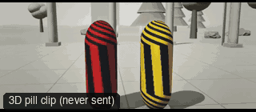

# ACT07-FightCoverage: Fight coverage



Family: Action.

**What it says.** Who hits whom, in order: a wide for the geography, then closer as the fight decides itself.

**Use it for.** Any short exchange of blows: master, the pair of overs, an insert on the blow that matters.

**Camera numbers.** 28 mm handheld master (real operator drift, handheld_drift_1), a 50 mm OTS on Alex, an 85 mm insert on the jab, a 32 mm single on Sam for the knockdown, all from one side of the line; cut on the start of each blow, never during it.

**Avoid.** Cutting before a blow completes, or crossing the line: the audience loses who is hitting.

## The three.js code

This is an excerpt of the template (23 lines, from `engine/cinematic/src/templates/action.ts`). `template.ts` in this folder is the same code with its imports. The helpers it calls (`make`, the actors, the rigs, the set and the post chain) are in `engine/cinematic/src`, so it does not run on its own: render it with `tools/render-pill.sh`.

```ts
import * as THREE from "three";
import { planner, scenePiece, speedRamp, type KitWorld, type SceneSpec, type ShotDef } from "../kit/stage";
import type { Act, Actor, ActorSpec, PathKey } from "../kit/actors";
import { around, lag, leadRoom, rig, type Subj } from "../kit/rigs";
import { aimFor, frameFor, frameHeight, SENSOR_H } from "../framer";
import { GREY, clay } from "../kit/clay";
import { broadTree, building, column, ground, pine, scatter } from "../kit/props";
import { buildLab } from "./lab";
import { clamp, lerp, ramp } from "../util";
import type { Piece } from "../piece";
import type { Cam } from "../shots";
import type { Marks } from "../marks";
import { CAMERA_INFO, type TemplateInfo } from "./cameras";

make({ id: "ACT07-FightCoverage", name: "Fight coverage", says: "Who hits whom, in order: a wide for the geography, then closer as the fight decides itself.", use: "Any short exchange of blows: master, the pair of overs, an insert on the blow that matters.", numbers: "28 mm handheld master (real operator drift, handheld_drift_1), a 50 mm OTS on Alex, an 85 mm insert on the jab, a 32 mm single on Sam for the knockdown, all from one side of the line; cut on the start of each blow, never during it.", avoid: "Cutting before a blow completes, or crossing the line: the audience loses who is hitting." },
    [
      human("ALEX", "Alex", "ochre", [{ t: 0, at: [-0.5, 0], yaw: Math.PI / 2 }, { t: 1.8, at: [-0.5, 0], yaw: Math.PI / 2 }, { t: 2.3, at: [-0.43, 0], yaw: Math.PI / 2 }, { t: 6, at: [-0.43, 0], yaw: Math.PI / 2 }],
        [clip("Hit_Head", 1.38, 1.85, 0.08), ...strike("Punch_Cross", 2.3, 3.5, 0.45, 0.1), clip("Punch_Jab", 3.6, 4.2, 0.1), ...strike("Punch_Cross", 4.3, 6.6, 0.1, 0.7)]),
      human("SAM", "Sam", "slate", lying(0.5, 0, -Math.PI / 2, KNOCK_LIFT, KO7),
        [...strike("Punch_Jab", 1.2, 2.45, 0.6, 0.1), clip("Hit_Chest", 2.55, 3.6, 0.1), clip("Hit_Head", 3.78, KO7 - 0.03, 0.08), clip("Hit_Knockback", KO7, undefined, 0.03)]),
    ],
    (P) => {
      const S = P("SAM"), B = body(S.actor), A = body(P("ALEX").actor);
      const drift = rig.filmPath("handheld_drift_1", P("ALEX"), { size: "FS", mm: 28, deg: 90, rise: -0.6 }, 0);
      const master = (t: number): Cam => { const c = drift(t); return { ...c, target: aimFor(c.pos, A(t).waist.lerp(B(t).waist, 0.5).add(V(0, 0.1, 0)), c.mm, [0, 0]) }; };
      const ots2 = rig.ots(S, P("ALEX"), 50, -1, 2.6, 2.0), aim2 = A(2.3).eye;
      const ins = V(-0.8, 1.5, 2.95);
      const single = V(-0.5, 1.55, 2.6);
      const down = (t: number) => { const b = B(t); return b.waist.lerp(b.eye, 0.4); };
      return [
        { start: 0, end: 2.25, label: "28mm  WIDE MASTER · HANDHELD", rig: "HANDHELD", subject: "ALEX", size: "FS", stop: 4, pair: ["ALEX", "SAM"], cam: master, flags: ["compound", "centre", "enters-moving", "exits-moving"], cut: "Opens the template: the jab lands in the wide" },
        { start: 2.25, end: 3.55, label: "50mm  OTS · SAM ON ALEX", rig: "HANDHELD", subject: "ALEX", size: "MS", stop: 2.8, ots: "SAM", pair: ["ALEX", "SAM"], cam: (t) => { const c = ots2(t); return { ...c, target: aimFor(c.pos, aim2, 50, [-0.3, 0.42]) }; }, cut: "CUT on Alex starting the cross" },
        { start: 3.55, end: 4.25, label: "85mm  INSERT · THE JAB LANDS", rig: "TRIPOD", subject: "SAM", size: "INSERT", stop: 2, cam: () => ({ pos: ins.clone(), target: aimFor(ins, V(0.4, 1.52, 0), 85, [0.25, 0]), mm: 85 }), flags: ["short-side"], cut: "CUT on the jab's start, tight on where it lands" },
        { start: 4.25, end: 7.25, label: "32mm  SINGLE · SAM GOES DOWN", rig: "HANDHELD", subject: "SAM", size: "MWS", sizeEnd: "WS", stop: 2.8, pair: ["ALEX", "SAM"],
          cam: (t) => { const c: Cam = { pos: single.clone(), target: aimFor(single, B(t).eye, 32, [0.25, 0.45]), mm: 32 }; return reaim(c, down(t), [0.1, -0.1], ramp(t, 4.62, 5.25)); }, flags: ["compound", "whip", "short-side", "enters-moving"], note: "PAN exempt: the head follows the body down", cut: "CUT on the final cross's start: Sam's single takes him down" },
      ];
    }),
```

**Make it yours.** Change rig: `rig.filmPath`, `rig.ots`; lens: 28 mm, 32 mm, 85 mm; shot size: FS, MS, MWS. The actor `path` entries say where the pill stands and walks, and the numbers after `rig.` set the move (distance, angle, rise, start and end time).

## The videos

The stand-in in `pill.mp4` is the **capsule** (the single striped capsule of the first gallery clips). Render the other with `--standin pin`.

| What | File |
|---|---|
| The 3D pill clip, the reference video | `pill.mp4` |

No Seedance result is included: the copyright filter blocked every attempt at the fight coverage.

## The prompt

One file per send. `sent.json` says, for each, whether it is the text that was sent, a recovered copy, or a rebuilt copy (`prompt.provenance`):

- `prompts/video-1.txt`
- `prompts/video-2.txt`
- `prompts/video-3.txt`
- `prompts/video-4.txt`

Keep the lines that say what the pills are and that the set is to be rebuilt as real. Change the person, the place and the light. These prompts come from the gallery runs and many predate the checks in `tools/seedance/`, so rebuild one with the gates before you reuse it.

## How it was sent

`sent.json` holds, for each send: the references in order with their roles, the settings, the credits and the outcome. Request ids are not kept; where one was known, a short hash is stored.

- **video #1**: 8 s, draft (480p preview), 21:9; references: @video1 = pill clip (the 3D blockout), @image1 = person photo (face reference); confirmed: yes.
- **video #2**: 8 s, draft (480p preview), 21:9; references: @video1 = pill clip (the 3D blockout), @image1 = person photo (face reference); confirmed: yes.
- **video #3**: 8 s, draft (480p preview), 21:9; references: @video1 = pill clip (the 3D blockout); confirmed: yes.
- **video #4**: 8 s, draft (480p preview), 21:9; references: @video1 = pill clip (the 3D blockout), @image1 = person photo (face reference); confirmed: yes.

See `reproduce.md` to render it and send it yourself.
