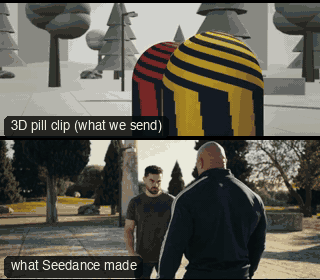

# ACT08-FallDrop: Fall drop



Family: Action.

**What it says.** We go down with them: the floor comes up, and the one left standing towers.

**Use it for.** A knockout, a death, a collapse; the end of a fight from the loser's level.

**Camera numbers.** 35 → 28 mm; the camera falls 1.45 m to 0.24 m off the floor in 0.75 s with a gravity ease, a beat behind the body, and lands 1.6 m from the head.

**Avoid.** Dropping before the body does: the camera follows the fall, it never leads it.

## The three.js code

This is an excerpt of the template (17 lines, from `engine/cinematic/src/templates/action.ts`). `template.ts` in this folder is the same code with its imports. The helpers it calls (`make`, the actors, the rigs, the set and the post chain) are in `engine/cinematic/src`, so it does not run on its own: render it with `tools/render-pill.sh`.

```ts
import * as THREE from "three";
import { planner, scenePiece, speedRamp, type KitWorld, type SceneSpec, type ShotDef } from "../kit/stage";
import type { Act, Actor, ActorSpec, PathKey } from "../kit/actors";
import { around, lag, leadRoom, rig, type Subj } from "../kit/rigs";
import { aimFor, frameFor, frameHeight, SENSOR_H } from "../framer";
import { GREY, clay } from "../kit/clay";
import { broadTree, building, column, ground, pine, scatter } from "../kit/props";
import { buildLab } from "./lab";
import { clamp, lerp, ramp } from "../util";
import type { Piece } from "../piece";
import type { Cam } from "../shots";
import type { Marks } from "../marks";
import { CAMERA_INFO, type TemplateInfo } from "./cameras";

make({ id: "ACT08-FallDrop", name: "Fall drop", says: "We go down with them: the floor comes up, and the one left standing towers.", use: "A knockout, a death, a collapse; the end of a fight from the loser's level.", numbers: "35 → 28 mm; the camera falls 1.45 m to 0.24 m off the floor in 0.75 s with a gravity ease, a beat behind the body, and lands 1.6 m from the head.", avoid: "Dropping before the body does: the camera follows the fall, it never leads it." },
    [
      human("ALEX", "Alex", "ochre", [{ t: 0, at: [0, 1.0], yaw: Math.PI }], [...strike("Punch_Cross", 1.5, 4.6, 0.6, 0.9)]),
      human("SAM", "Sam", "slate", lying(0, 0, 0, DEATH_LIFT, D8), [clip("Hit_Chest", 1.75, D8 - 0.08, 0.08), clip("Death01", D8, undefined, 0.08)]),
    ],
    (P) => {
      const S = P("SAM"), sam = S.actor, B = body(sam), eye = (t: number) => B(t).eye;
      const C0 = V(1.3, 1.62, -2.3), C1 = V(0.9, 0.24, -2.95);
      const drop = (t: number): Cam => {
        const k = ramp(t, 2.95, 3.75), e = k * k * (1.6 - 0.6 * k);
        const pos = C0.clone().lerp(C1, e), mm = 35 * Math.pow(28 / 35, e);
        const a = ramp(t, 2.95, 3.9);
        // the operator's aim rides the head a beat behind it, never ahead of the fall
        return { pos, target: aimFor(pos, lag(eye, t, 0.35), mm, [lerp(0.28, 0.32, a), lerp(0.2, -0.4, a)]), mm };
      };
      return [{ start: 0, end: 7.5, label: "35>28mm  FALL DROP TO THE FLOOR", rig: "TECHNOCRANE · DROP", subject: (t) => (t < 3.3 ? "SAM" : "ALEX"), focus: (t) => ["SAM", "ALEX", ramp(t, 4.6, 5.6)], size: "MWS", sizeEnd: "WS", stop: 2.8, cam: drop, flags: ["compound", "short-side", "whip"], cut: "Opens the template", note: "Drop 2.95–3.75 a beat behind the fall, then a rack from the head on the floor to the one standing; PAN exempt: the head follows the fall" }];
    }),
```

**Make it yours.** Change shot size: MWS. The actor `path` entries say where the pill stands and walks, and the numbers after `rig.` set the move (distance, angle, rise, start and end time).

## The videos

The stand-in in `pill.mp4` is the **capsule** (the single striped capsule of the first gallery clips). Render the other with `--standin pin`.

| What | File |
|---|---|
| The 3D pill clip, the reference video (a re-render: the clip that was uploaded was not kept) | `pill.mp4` |
| What Seedance made from the pill clip (480p draft) | `release-media/ACT08-FallDrop/result.mp4` (release asset) |

## The prompt

One file per send. `sent.json` says, for each, whether it is the text that was sent, a recovered copy, or a rebuilt copy (`prompt.provenance`):

- `prompts/video.txt`

Keep the lines that say what the pills are and that the set is to be rebuilt as real. Change the person, the place and the light. These prompts come from the gallery runs and many predate the checks in `tools/seedance/`, so rebuild one with the gates before you reuse it.

## How it was sent

`sent.json` holds, for each send: the references in order with their roles, the settings, the credits and the outcome. Request ids are not kept; where one was known, a short hash is stored.

- **video #1**: 8 s, draft (480p preview), 21:9; references: @video1 = pill clip (the 3D blockout), @image1 = person photo (face reference); confirmed: yes; 1166.4 credits.

See `reproduce.md` to render it and send it yourself.
