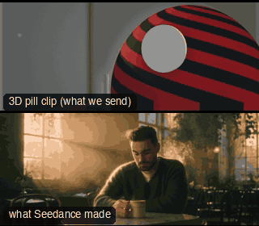

# ANG06-MediumCloseUp: Medium close-up



**What it says.** Close enough to read the face, far enough to keep the body language.

**Use it for.** Interviews, the heart of a scene, reaction shots.

**Camera numbers.** 65 mm, MCU from the chest up at about 2.5 m.

**Avoid.** Letting the shoulders crop awkwardly: the edge falls at the chest.

## The three.js code

This is an excerpt of the template (2 lines, from `engine/cinematic/src/templates/angles.ts`). `template.ts` in this folder is the same code with its imports. The helpers it calls (`make`, the actors, the rigs, the set and the post chain) are in `engine/cinematic/src`, so it does not run on its own: render it with `tools/render-pill.sh`.

```ts
import * as THREE from "three";
import { aimFor } from "../framer";
import { framed, rig } from "../kit/rigs";
import type { Cam } from "../shots";
import { ALEX, V, make as baseMake } from "./cameras";
import { stageFor } from "./studios";
import type { Piece } from "../piece";
import { LOCATIONS, ENVIRONMENTS } from "./locations";

make({ id: "ANG06-MediumCloseUp", name: "Medium close-up", says: "Close enough to read the face, far enough to keep the body language.", use: "Interviews, the heart of a scene, reaction shots.", numbers: "65 mm, MCU from the chest up at about 2.5 m.", avoid: "Letting the shoulders crop awkwardly: the edge falls at the chest." },
    [stand(0, 0)], hold("65mm  MEDIUM CLOSE-UP", "TRIPOD", "MCU", (P) => rig.locked(P("ALEX"), { size: "MCU", mm: 65, deg: 22 }, 3))),
```

> **Locked camera.** This template does not move the camera. It is kept as a study of the shot, not as a template to send: the drafts made from four locked ANG clips were stiff (see `docs/why/why-no-static-shots.md`).

## The videos

The stand-in in `pill.mp4` is the **capsule** (the single striped capsule of the first gallery clips). Render the other with `--standin pin`.

| What | File |
|---|---|
| The 3D pill clip, the reference video | `pill.mp4` |
| Another take from the same template | `release-media/ANG06-MediumCloseUp/b-ang06-m.mp4` |
| Another take from the same template | `release-media/ANG06-MediumCloseUp/b-ang06.mp4` |

## The prompt

One file per send. `sent.json` says, for each, whether it is the text that was sent, a recovered copy, or a rebuilt copy (`prompt.provenance`):

- `prompts/b-ang06-m.txt`
- `prompts/b-ang06.txt`

> At least one file here is a rebuilt copy: the prompt that was sent was not kept. Treat it as an example of the wording, not a record.

Keep the lines that say what the pills are and that the set is to be rebuilt as real. Change the person, the place and the light. These prompts come from the gallery runs and many predate the checks in `tools/seedance/`, so rebuild one with the gates before you reuse it.

## How it was sent

`sent.json` holds, for each send: the references in order with their roles, the settings, the credits and the outcome. Request ids are not kept; where one was known, a short hash is stored.

- **video #1**: 6 s, draft (480p preview), 21:9; references: @video1 = coarse blockout clip (grey clay set, striped capsule/pin stand-in); carries camera, framing, size and timing; no sound, @image1 = Alex's face photo: identity only (features, hair, beard), @audio1 = the author's voice recording (not included): timbre, pace and accent for Alex's spoken line; confirmed: yes; 874.8 credits.
- **video #2**: 6 s, draft (480p preview), 21:9; references: @video1 = coarse blockout clip (grey clay set, striped capsule/pin stand-in); carries camera, framing, size and timing; no sound, @image1 = Alex's face photo: identity only (features, hair, beard), @image2 = ONE panel of the environment contact sheet (panel 1); prompt says: "@image2 is a mood reference only: one photograph that shows the colour palette, the quality of the light, the haze, glow, softness and film feel.", @audio1 = the author's voice recording (not included): timbre, pace and accent for Alex's spoken line; confirmed: yes; 874.8 credits.

See `reproduce.md` to render it and send it yourself.
