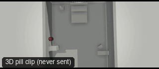

# ANG11-BirdsEye: Bird's-eye (straight down)



**What it says.** We are above it all, looking straight down at someone crossing the ground.

**Use it for.** Detachment, fate, a map of a movement, an overhead insert.

**Camera numbers.** 24 mm from 14 m directly above, locked, a person walking across the frame about 6 m.

**Avoid.** Letting it run long without a reason: it gets abstract.

## The three.js code

This is an excerpt of the template (3 lines, from `engine/cinematic/src/templates/angles.ts`). `template.ts` in this folder is the same code with its imports. The helpers it calls (`make`, the actors, the rigs, the set and the post chain) are in `engine/cinematic/src`, so it does not run on its own: render it with `tools/render-pill.sh`.

```ts
import * as THREE from "three";
import { aimFor } from "../framer";
import { framed, rig } from "../kit/rigs";
import type { Cam } from "../shots";
import { ALEX, V, make as baseMake } from "./cameras";
import { stageFor } from "./studios";
import type { Piece } from "../piece";
import { LOCATIONS, ENVIRONMENTS } from "./locations";

make({ id: "ANG11-BirdsEye", name: "Bird's-eye (straight down)", says: "We are above it all, looking straight down at someone crossing the ground.", use: "Detachment, fate, a map of a movement, an overhead insert.", numbers: "24 mm from 14 m directly above, locked, a person walking across the frame about 6 m.", avoid: "Letting it run long without a reason: it gets abstract." },
    [ALEX([{ t: 0.3, at: [-3.5, 0.5] }, { t: 6.3, at: [3.5, -0.5] }])],
    hold("24mm  BIRD'S-EYE", "DRONE · DOWN", "WS", (P) => (t: number): Cam => { void P; const pos = V(0, 14, 0.4); return { pos, target: V(0, 0, 0), mm: 24 }; }, 7)),
```

> **Locked camera.** This template does not move the camera. It is kept as a study of the shot, not as a template to send: the drafts made from four locked ANG clips were stiff (see `docs/why/why-no-static-shots.md`).

## The videos

The stand-in in `pill.mp4` is the **pin** (a head on a slim body). Render the other with `--standin capsule`.

| What | File |
|---|---|
| The 3D pill clip, the reference video | `pill.mp4` |

No Seedance result is included: locked-off angle: no camera motion, so the no-static-shots rule skips it.

The pill clip was rendered for this repo with the current engine. It has not been sent to Seedance, so there is no prompt yet: write one from `docs/prompt-anatomy.md` and the neighbouring templates' prompts.

## The prompt

No prompt was recorded for this template.

## How it was sent

`sent.json` holds, for each send: the references in order with their roles, the settings, the credits and the outcome. Request ids are not kept; where one was known, a short hash is stored.


See `reproduce.md` to render it and send it yourself.
