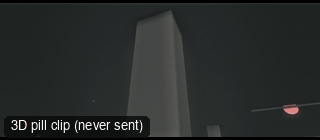

# ANG12-WormsEye: Worm's-eye (ground level)



**What it says.** The camera lies on the ground and the person towers over it.

**Use it for.** Power, threat, a child's view, a dramatic entrance.

**Camera numbers.** 18 mm at 0.12 m off the ground, 2 m from the feet, the aim 40 degrees up at the face.

**Avoid.** Hiding the face: the eyes should still be readable.

## The three.js code

This is an excerpt of the template (3 lines, from `engine/cinematic/src/templates/angles.ts`). `template.ts` in this folder is the same code with its imports. The helpers it calls (`make`, the actors, the rigs, the set and the post chain) are in `engine/cinematic/src`, so it does not run on its own: render it with `tools/render-pill.sh`.

```ts
import * as THREE from "three";
import { aimFor } from "../framer";
import { framed, rig } from "../kit/rigs";
import type { Cam } from "../shots";
import { ALEX, V, make as baseMake } from "./cameras";
import { stageFor } from "./studios";
import type { Piece } from "../piece";
import { LOCATIONS, ENVIRONMENTS } from "./locations";

make({ id: "ANG12-WormsEye", name: "Worm's-eye (ground level)", says: "The camera lies on the ground and the person towers over it.", use: "Power, threat, a child's view, a dramatic entrance.", numbers: "18 mm at 0.12 m off the ground, 2 m from the feet, the aim 40 degrees up at the face.", avoid: "Hiding the face: the eyes should still be readable." },
    [stand(0, 0)],
    hold("18mm  WORM'S-EYE", "GROUND MOUNT", "MS", (P) => () => { const m = P("ALEX")(0), c = framed(m, { size: "FS", mm: 18, deg: 8 }); const pos = c.pos.clone().setY(0.12); return { pos, target: m.eye.clone().add(V(0, 0.15, 0)), mm: 18 }; })),
```

> **Locked camera.** This template does not move the camera. It is kept as a study of the shot, not as a template to send: the drafts made from four locked ANG clips were stiff (see `docs/why/why-no-static-shots.md`).

## The videos

The stand-in in `pill.mp4` is the **pin** (a head on a slim body). Render the other with `--standin capsule`.

| What | File |
|---|---|
| The 3D pill clip, the reference video | `pill.mp4` |

No Seedance result is included: locked-off angle: no camera motion, so the no-static-shots rule skips it.

The pill clip was rendered for this repo with the current engine. It has not been sent to Seedance, so there is no prompt yet: write one from `docs/prompt-anatomy.md` and the neighbouring templates' prompts.

## The prompt

No prompt was recorded for this template.

## How it was sent

`sent.json` holds, for each send: the references in order with their roles, the settings, the credits and the outcome. Request ids are not kept; where one was known, a short hash is stored.


See `reproduce.md` to render it and send it yourself.
