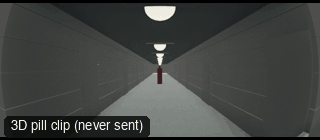

# ANG24-Peephole: Peephole



**What it says.** We are on the other side of the door, watching someone arrive.

**Use it for.** A thriller, a doorstep, a character who should not open the door.

**Camera numbers.** 5 mm fisheye at 1.5 m height looking out, the visitor walking in from 8 m to 2 m over 6 s.

**Avoid.** Showing the visitor's face too soon: let them grow.

## The three.js code

This is an excerpt of the template (3 lines, from `engine/cinematic/src/templates/angles.ts`). `template.ts` in this folder is the same code with its imports. The helpers it calls (`make`, the actors, the rigs, the set and the post chain) are in `engine/cinematic/src`, so it does not run on its own: render it with `tools/render-pill.sh`.

```ts
import * as THREE from "three";
import { aimFor } from "../framer";
import { framed, rig } from "../kit/rigs";
import type { Cam } from "../shots";
import { ALEX, V, make as baseMake } from "./cameras";
import { stageFor } from "./studios";
import type { Piece } from "../piece";
import { LOCATIONS, ENVIRONMENTS } from "./locations";

make({ id: "ANG24-Peephole", name: "Peephole", says: "We are on the other side of the door, watching someone arrive.", use: "A thriller, a doorstep, a character who should not open the door.", numbers: "5 mm fisheye at 1.5 m height looking out, the visitor walking in from 8 m to 2 m over 6 s.", avoid: "Showing the visitor's face too soon: let them grow." },
    [ALEX([{ t: 0.3, at: [0, -9], yaw: Math.PI }, { t: 6.6, at: [0, -2.2], yaw: Math.PI }])],
    () => [{ start: 0, end: 7, label: "5mm  PEEPHOLE", rig: "DOOR MOUNT", subject: "ALEX", size: "WS", stop: 4, cam: withFish((): Cam => ({ pos: V(0, 1.55, 3.2), target: V(0, 1.4, -6), mm: 5 }), 1), cut: "Opens the template" }]),
```

> **Locked camera.** This template does not move the camera. It is kept as a study of the shot, not as a template to send: the drafts made from four locked ANG clips were stiff (see `docs/why/why-no-static-shots.md`).

## The videos

The stand-in in `pill.mp4` is the **pin** (a head on a slim body). Render the other with `--standin capsule`.

| What | File |
|---|---|
| The 3D pill clip, the reference video | `pill.mp4` |

No Seedance result is included: locked-off angle: no camera motion, so the no-static-shots rule skips it.

The pill clip was rendered for this repo with the current engine. It has not been sent to Seedance, so there is no prompt yet: write one from `docs/prompt-anatomy.md` and the neighbouring templates' prompts.

## The prompt

No prompt was recorded for this template.

## How it was sent

`sent.json` holds, for each send: the references in order with their roles, the settings, the credits and the outcome. Request ids are not kept; where one was known, a short hash is stored.


See `reproduce.md` to render it and send it yourself.
