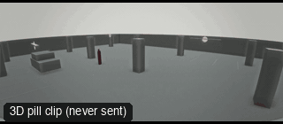

# ANG25-SecurityCam: Security camera



**What it says.** Nobody is meant to see this: a camera in a corner, a person who thinks they are alone.

**Use it for.** Surveillance, found footage, a crime seen afterwards.

**Camera numbers.** 12 mm half-fisheye from a corner 3.6 m up, looking down 30 degrees, a person crossing the room.

**Avoid.** Cutting from it to a clean shot without a reason.

## The three.js code

This is an excerpt of the template (3 lines, from `engine/cinematic/src/templates/angles.ts`). `template.ts` in this folder is the same code with its imports. The helpers it calls (`make`, the actors, the rigs, the set and the post chain) are in `engine/cinematic/src`, so it does not run on its own: render it with `tools/render-pill.sh`.

```ts
import * as THREE from "three";
import { aimFor } from "../framer";
import { framed, rig } from "../kit/rigs";
import type { Cam } from "../shots";
import { ALEX, V, make as baseMake } from "./cameras";
import { stageFor } from "./studios";
import type { Piece } from "../piece";
import { LOCATIONS, ENVIRONMENTS } from "./locations";

make({ id: "ANG25-SecurityCam", name: "Security camera", says: "Nobody is meant to see this: a camera in a corner, a person who thinks they are alone.", use: "Surveillance, found footage, a crime seen afterwards.", numbers: "12 mm half-fisheye from a corner 3.6 m up, looking down 30 degrees, a person crossing the room.", avoid: "Cutting from it to a clean shot without a reason." },
    [ALEX([{ t: 0.3, at: [-5, 1] }, { t: 6.7, at: [4.5, -3] }])],
    () => [{ start: 0, end: 7, label: "12mm  SECURITY CAMERA", rig: "WALL MOUNT", subject: "ALEX", size: "WS", stop: 4, cam: withFish((): Cam => ({ pos: V(7, 3.6, 8), target: V(-0.5, 0.6, -1), mm: 12 }), 0.6), cut: "Opens the template", flags: ["enters-moving", "exits-moving"] }]),
```

> **Locked camera.** This template does not move the camera. It is kept as a study of the shot, not as a template to send: the drafts made from four locked ANG clips were stiff (see `docs/why/why-no-static-shots.md`).

## The videos

The stand-in in `pill.mp4` is the **pin** (a head on a slim body). Render the other with `--standin capsule`.

| What | File |
|---|---|
| The 3D pill clip, the reference video | `pill.mp4` |

No Seedance result is included: locked-off angle: no camera motion, so the no-static-shots rule skips it.

The pill clip was rendered for this repo with the current engine. It has not been sent to Seedance, so there is no prompt yet: write one from `docs/prompt-anatomy.md` and the neighbouring templates' prompts.

## The prompt

No prompt was recorded for this template.

## How it was sent

`sent.json` holds, for each send: the references in order with their roles, the settings, the credits and the outcome. Request ids are not kept; where one was known, a short hash is stored.


See `reproduce.md` to render it and send it yourself.
