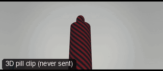

# ANG32-GroundLevelWalk: Ground level walk



**What it says.** We see where they are going by their feet, and nothing of their face.

**Use it for.** A mysterious walker, a hit, a delivery, a character we should not know yet.

**Camera numbers.** 24 mm, 0.2 m off the ground, following a walk from behind at 2.5 m, the shoes and legs only.

**Avoid.** Cutting to the face right after: keep the withholding going.

## The three.js code

This is an excerpt of the template (3 lines, from `engine/cinematic/src/templates/angles.ts`). `template.ts` in this folder is the same code with its imports. The helpers it calls (`make`, the actors, the rigs, the set and the post chain) are in `engine/cinematic/src`, so it does not run on its own: render it with `tools/render-pill.sh`.

```ts
import * as THREE from "three";
import { aimFor } from "../framer";
import { framed, rig } from "../kit/rigs";
import type { Cam } from "../shots";
import { ALEX, V, make as baseMake } from "./cameras";
import { stageFor } from "./studios";
import type { Piece } from "../piece";
import { LOCATIONS, ENVIRONMENTS } from "./locations";

make({ id: "ANG32-GroundLevelWalk", name: "Ground level walk", says: "We see where they are going by their feet, and nothing of their face.", use: "A mysterious walker, a hit, a delivery, a character we should not know yet.", numbers: "24 mm, 0.2 m off the ground, following a walk from behind at 2.5 m, the shoes and legs only.", avoid: "Cutting to the face right after: keep the withholding going." },
    [ALEX([{ t: 0.3, at: [0, 7] }, { t: 7, at: [0, -2.6] }])],
    (P) => [{ start: 0, end: 7, label: "24mm  GROUND LEVEL WALK", rig: "GROUND MOUNT · DOLLY", subject: "ALEX", size: "FS", stop: 4, cam: rig.follow(P("ALEX"), { size: "MWS", mm: 24, deg: 180, rise: -1.45 }), cut: "Opens the template", flags: ["enters-moving", "exits-moving"] }]),
```

> **Locked camera.** This template does not move the camera. It is kept as a study of the shot, not as a template to send: the drafts made from four locked ANG clips were stiff (see `docs/why/why-no-static-shots.md`).

## The videos

The stand-in in `pill.mp4` is the **pin** (a head on a slim body). Render the other with `--standin capsule`.

| What | File |
|---|---|
| The 3D pill clip, the reference video | `pill.mp4` |

No Seedance result is included: locked-off angle: no camera motion, so the no-static-shots rule skips it.

The pill clip was rendered for this repo with the current engine. It has not been sent to Seedance, so there is no prompt yet: write one from `docs/prompt-anatomy.md` and the neighbouring templates' prompts.

## The prompt

No prompt was recorded for this template.

## How it was sent

`sent.json` holds, for each send: the references in order with their roles, the settings, the credits and the outcome. Request ids are not kept; where one was known, a short hash is stored.


See `reproduce.md` to render it and send it yourself.
