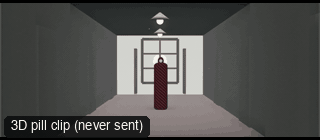

# ANG38-FramedShot: Frame within a frame



**What it says.** The person is held inside something else: a doorway, a gap, a pair of columns.

**Use it for.** Isolation, being trapped or watched, drawing the eye to one figure.

**Camera numbers.** 35 mm from 10 m, level, the person standing in the gap between two columns of the nave.

**Avoid.** A frame that is brighter than the subject: it pulls the eye away.

## The three.js code

This is an excerpt of the template (3 lines, from `engine/cinematic/src/templates/angles.ts`). `template.ts` in this folder is the same code with its imports. The helpers it calls (`make`, the actors, the rigs, the set and the post chain) are in `engine/cinematic/src`, so it does not run on its own: render it with `tools/render-pill.sh`.

```ts
import * as THREE from "three";
import { aimFor } from "../framer";
import { framed, rig } from "../kit/rigs";
import type { Cam } from "../shots";
import { ALEX, V, make as baseMake } from "./cameras";
import { stageFor } from "./studios";
import type { Piece } from "../piece";
import { LOCATIONS, ENVIRONMENTS } from "./locations";

make({ id: "ANG38-FramedShot", name: "Frame within a frame", says: "The person is held inside something else: a doorway, a gap, a pair of columns.", use: "Isolation, being trapped or watched, drawing the eye to one figure.", numbers: "35 mm from 10 m, level, the person standing in the gap between two columns of the nave.", avoid: "A frame that is brighter than the subject: it pulls the eye away." },
    [ALEX([{ t: 0, at: [0, -12.5], yaw: 0 }])],
    () => [{ start: 0, end: 6, label: "35mm  FRAME WITHIN A FRAME", rig: "TRIPOD", subject: "ALEX", size: "FS", stop: 6, cam: () => ({ pos: V(0, 1.5, -2), target: V(0, 1.3, -14), mm: 35 }), cut: "Opens the template" }]),
```

> **Locked camera.** This template does not move the camera. It is kept as a study of the shot, not as a template to send: the drafts made from four locked ANG clips were stiff (see `docs/why/why-no-static-shots.md`).

## The videos

The stand-in in `pill.mp4` is the **pin** (a head on a slim body). Render the other with `--standin capsule`.

| What | File |
|---|---|
| The 3D pill clip, the reference video | `pill.mp4` |

No Seedance result is included: locked-off angle: no camera motion, so the no-static-shots rule skips it.

The pill clip was rendered for this repo with the current engine. It has not been sent to Seedance, so there is no prompt yet: write one from `docs/prompt-anatomy.md` and the neighbouring templates' prompts.

## The prompt

No prompt was recorded for this template.

## How it was sent

`sent.json` holds, for each send: the references in order with their roles, the settings, the credits and the outcome. Request ids are not kept; where one was known, a short hash is stored.


See `reproduce.md` to render it and send it yourself.
