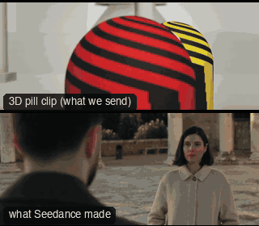

# CAM12-OTSPair: Over the shoulder (pair)



Family: Camera moves on people.

**What it says.** A conversation: whose turn it is, who holds the power.

**Use it for.** Dialogue coverage: master, then OTS pair, then singles.

**Camera numbers.** 75 mm both ways from about 3.5 m behind the shoulder (a long lens keeps the shoulder to about a quarter of the frame), both cameras on one side of the line, matched distance.

**Avoid.** Crossing the line between them, or a shoulder that fills half the frame.

## The three.js code

This is an excerpt of the template (6 lines, from `engine/cinematic/src/templates/cameras.ts`). `template.ts` in this folder is the same code with its imports. The helpers it calls (`make`, the actors, the rigs, the set and the post chain) are in `engine/cinematic/src`, so it does not run on its own: render it with `tools/render-pill.sh`.

```ts
import * as THREE from "three";
import { planner, scenePiece, type SceneSpec, type ShotDef } from "../kit/stage";
import type { ActorSpec } from "../kit/actors";
import { around, framed, lag, leadRoom, rig } from "../kit/rigs";
import { aimFor } from "../framer";
import { buildLab } from "./lab";
import type { Piece } from "../piece";

make({ id: "CAM12-OTSPair", name: "Over the shoulder (pair)", says: "A conversation: whose turn it is, who holds the power.", use: "Dialogue coverage: master, then OTS pair, then singles.", numbers: "75 mm both ways from about 3.5 m behind the shoulder (a long lens keeps the shoulder to about a quarter of the frame), both cameras on one side of the line, matched distance.", avoid: "Crossing the line between them, or a shoulder that fills half the frame." },
    [ALEX([{ t: 0, at: [-1.1, 0], yaw: Math.PI / 2 }], undefined, "SAM"), SAM([{ t: 0, at: [1.1, 0], yaw: -Math.PI / 2 }], undefined, "ALEX")],
    (P) => [
      { start: 0, end: 3.5, label: "75mm  OTS · ALEX ON SAM", rig: "STEADICAM", subject: "SAM", size: "MCU", stop: 2, ots: "ALEX", pair: ["ALEX", "SAM"], cam: rig.ots(P("ALEX"), P("SAM"), 75, 1, 3.6, 0.6), cut: "Opens the template" },
      { start: 3.5, end: 7, label: "75mm  REVERSE OTS · SAM ON ALEX", rig: "STEADICAM", subject: "ALEX", size: "MCU", stop: 2, ots: "SAM", pair: ["ALEX", "SAM"], reverse: 1, cam: rig.ots(P("SAM"), P("ALEX"), 75, -1, 3.6, 0.6), cut: "CUT to the reverse, same side of the line" },
    ]),
```

**Make it yours.** Change rig: `rig.ots`; shot size: MCU. The actor `path` entries say where the pill stands and walks, and the numbers after `rig.` set the move (distance, angle, rise, start and end time).

## The videos

The stand-in in `pill.mp4` is the **capsule** (the single striped capsule of the first gallery clips). Render the other with `--standin pin`.

| What | File |
|---|---|
| The 3D pill clip, the reference video (a re-render: the clip that was uploaded was not kept) | `pill.mp4` |
| What Seedance made from the pill clip (480p draft) | `release-media/CAM12-OTSPair/result.mp4` (release asset) |

## The prompt

One file per send. `sent.json` says, for each, whether it is the text that was sent, a recovered copy, or a rebuilt copy (`prompt.provenance`):

- `prompts/video.txt`

Keep the lines that say what the pills are and that the set is to be rebuilt as real. Change the person, the place and the light. These prompts come from the gallery runs and many predate the checks in `tools/seedance/`, so rebuild one with the gates before you reuse it.

## How it was sent

`sent.json` holds, for each send: the references in order with their roles, the settings, the credits and the outcome. Request ids are not kept; where one was known, a short hash is stored.

- **video #1**: 7 s, draft (480p preview), 21:9; references: @video1 = pill clip (the 3D blockout), @image1 = person photo (face reference); confirmed: yes; 1020.6 credits.

See `reproduce.md` to render it and send it yourself.
