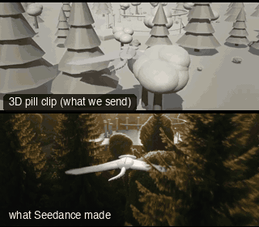

# CAM15-ChaseDrone: Chase drone



Family: Camera moves on people.

**What it says.** Speed and freedom: we fly with them.

**Use it for.** Flight, vehicles, big landscapes on the move; the geography wide in an action scene.

**Camera numbers.** 28 mm, 18–22 m behind and 5–7 m above, matched speed, banking into turns.

**Avoid.** Chasing too far back: the subject becomes a dot and the speed disappears.

## The three.js code

This is an excerpt of the template (3 lines, from `engine/cinematic/src/templates/cameras.ts`). `template.ts` in this folder is the same code with its imports. The helpers it calls (`make`, the actors, the rigs, the set and the post chain) are in `engine/cinematic/src`, so it does not run on its own: render it with `tools/render-pill.sh`.

```ts
import * as THREE from "three";
import { planner, scenePiece, type SceneSpec, type ShotDef } from "../kit/stage";
import type { ActorSpec } from "../kit/actors";
import { around, framed, lag, leadRoom, rig } from "../kit/rigs";
import { aimFor } from "../framer";
import { buildLab } from "./lab";
import type { Piece } from "../piece";

make({ id: "CAM15-ChaseDrone", name: "Chase drone", says: "Speed and freedom: we fly with them.", use: "Flight, vehicles, big landscapes on the move; the geography wide in an action scene.", numbers: "28 mm, 18–22 m behind and 5–7 m above, matched speed, banking into turns.", avoid: "Chasing too far back: the subject becomes a dot and the speed disappears." },
    [{ id: "GLIDER", name: "Glider", kind: "flyer", tint: "plum", span: 12, path: [{ t: 0, at: [-45, 7, 34] }, { t: 4, at: [-6, 5.5, 4] }, { t: 8, at: [36, 8, -26] }] }],
    (P) => [{ start: 0, end: 8, label: "28mm  CHASE DRONE", rig: "CHASE DRONE · GIMBAL", subject: "GLIDER", size: "WS", stop: 4, cam: rig.chase(P("GLIDER"), 21, 6, 28, 2, 0.9), cut: "Opens the template", flags: ["enters-moving", "exits-moving", "centre", "compound"], shadow: 40 }]),
```

**Make it yours.** Change rig: `rig.chase`; shot size: WS. The actor `path` entries say where the pill stands and walks, and the numbers after `rig.` set the move (distance, angle, rise, start and end time).

## The videos

The stand-in in `pill.mp4` is the **capsule** (the single striped capsule of the first gallery clips). Render the other with `--standin pin`.

| What | File |
|---|---|
| The 3D pill clip, the reference video (a re-render: the clip that was uploaded was not kept) | `pill.mp4` |
| The contact sheet (sketch route) | `sketch-sheet.jpg` |
| What Seedance made from the pill clip (480p draft) | `release-media/CAM15-ChaseDrone/result.mp4` (release asset) |
| What Seedance made from the contact sheet | `release-media/CAM15-ChaseDrone/sketch-output.mp4` (release asset) |
| Another take from the same template | `release-media/CAM15-ChaseDrone/ink-sketch-ink-cam15.mp4` |

## The prompt

One file per send. `sent.json` says, for each, whether it is the text that was sent, a recovered copy, or a rebuilt copy (`prompt.provenance`):

- `prompts/ink-sketch-recovered-sheet.txt`
- `prompts/video.txt`

Keep the lines that say what the pills are and that the set is to be rebuilt as real. Change the person, the place and the light. These prompts come from the gallery runs and many predate the checks in `tools/seedance/`, so rebuild one with the gates before you reuse it.

## How it was sent

`sent.json` holds, for each send: the references in order with their roles, the settings, the credits and the outcome. Request ids are not kept; where one was known, a short hash is stored.

- **video #1**: 8 s, draft (480p preview), 21:9; references: @video1 = pill clip (the 3D blockout); confirmed: yes; 1166.4 credits.
- **ink-sketch #1**: 8 s, draft (480p preview), 21:9; references: @image1 = pill contact sheet (the sketch route); confirmed: yes; 977.6 credits.

See `reproduce.md` to render it and send it yourself.
