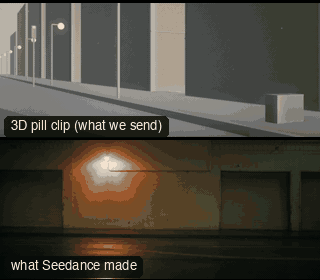

# CAM21-PanReveal: Pan reveal



**What it says.** We look away from the person, and the turn of the camera brings them in.

**Use it for.** Introducing someone who has been there all along; a hidden presence.

**Camera numbers.** Fixed position at 4 m, 40 mm, a 40 degree pan over 3.5 s from an empty wall of the plaza onto the person, then a held MS.

**Avoid.** Panning past the subject and coming back: land on them once.

## The three.js code

This is an excerpt of the template (3 lines, from `engine/cinematic/src/templates/cameras2.ts`). `template.ts` in this folder is the same code with its imports. The helpers it calls (`make`, the actors, the rigs, the set and the post chain) are in `engine/cinematic/src`, so it does not run on its own: render it with `tools/render-pill.sh`.

```ts
import * as THREE from "three";
import { smoother, ramp } from "../util";
import { aimFor } from "../framer";
import { framed, rig } from "../kit/rigs";
import type { Cam } from "../shots";
import { ALEX, SAM, V, make as baseMake } from "./cameras";
import { stageFor } from "./studios";
import type { Piece } from "../piece";

make({ id: "CAM21-PanReveal", name: "Pan reveal", says: "We look away from the person, and the turn of the camera brings them in.", use: "Introducing someone who has been there all along; a hidden presence.", numbers: "Fixed position at 4 m, 40 mm, a 40 degree pan over 3.5 s from an empty wall of the plaza onto the person, then a held MS.", avoid: "Panning past the subject and coming back: land on them once." },
    [stand(-3, -4, Math.PI * 0.85)],
    (P) => { const pos = V(2.5, 1.5, 3.5), m = P("ALEX")(0); return [{ start: 0, end: 7, label: "40mm  PAN REVEAL", rig: "TRIPOD · FLUID HEAD", subject: "ALEX", size: "MS", stop: 4, cam: rig.tiltReveal(pos, V(9, 1.5, -9), aimFor(pos, m.eye, 40, [0.15, 1 / 3]), 40, 0.8, 4.2, 0.4), cut: "Opens the template" }]; }),
```

**Make it yours.** Change rig: `rig.tiltReveal`; shot size: MS. The actor `path` entries say where the pill stands and walks, and the numbers after `rig.` set the move (distance, angle, rise, start and end time).

## The videos

The stand-in in `pill.mp4` is the **capsule** (the single striped capsule of the first gallery clips). Render the other with `--standin pin`.

| What | File |
|---|---|
| The 3D pill clip, the reference video | `pill.mp4` |
| Another take from the same template | `release-media/CAM21-PanReveal/pan-reveal-t.mp4` |
| Another take from the same template | `release-media/CAM21-PanReveal/pan-reveal-t2-final.mp4` |
| Another take from the same template | `release-media/CAM21-PanReveal/pan-reveal-t2.mp4` |
| Another take from the same template | `release-media/CAM21-PanReveal/pan-reveal-v2.mp4` |
| Another take from the same template | `release-media/CAM21-PanReveal/pan-reveal.mp4` |
| Another take from the same template | `release-media/CAM21-PanReveal/v10-cam21-m.mp4` |
| Another take from the same template | `release-media/CAM21-PanReveal/v10-cam21-t.mp4` |

## The prompt

One file per send. `sent.json` says, for each, whether it is the text that was sent, a recovered copy, or a rebuilt copy (`prompt.provenance`):

- `prompts/pan-reveal-p3.txt`
- `prompts/pan-reveal-t.txt`
- `prompts/pan-reveal-t2.txt`
- `prompts/pan-reveal-v2.txt`
- `prompts/pan-reveal.txt`
- `prompts/v10-cam21-m.txt`
- `prompts/v10-cam21-t.txt`

Keep the lines that say what the pills are and that the set is to be rebuilt as real. Change the person, the place and the light. These prompts come from the gallery runs and many predate the checks in `tools/seedance/`, so rebuild one with the gates before you reuse it.

## How it was sent

`sent.json` holds, for each send: the references in order with their roles, the settings, the credits and the outcome. Request ids are not kept; where one was known, a short hash is stored.

- **video #1**: 7 s, draft (480p preview), 21:9; references: @video1 = coarse blockout clip (grey clay set, striped capsule/pin stand-in); carries camera, framing, size and timing; no sound, @image1 = Alex's face photo: identity only (features, hair, beard), @image2 = whole environment contact sheet (4 panels, 2x2) as place/mood reference; prompt says: "@image2 is the reference for the real place and its mood: four photographs of the same location from different angles, laid out as a two by two contac"; confirmed: yes; 1020.6 credits.
- **video #2**: 7 s, draft (480p preview), 21:9; references: @video1 = coarse blockout clip (grey clay set, striped capsule/pin stand-in); carries camera, framing, size and timing; no sound, @image1 = Alex's face photo: identity only (features, hair, beard), @image2 = ONE panel of the environment contact sheet (panel 3); prompt says: "@image2 is a mood reference only: it shows the colour palette, the quality and temperature of the light, the haze, glow, softness and contrast, the te", @audio1 = the author's voice recording (not included): timbre, pace and accent for Alex's spoken line; confirmed: yes.
- **video #3**: 7 s, draft (480p preview), 21:9; references: @video1 = coarse blockout clip (grey clay set, striped capsule/pin stand-in); carries camera, framing, size and timing; no sound, @image1 = Alex's face photo: identity only (features, hair, beard); confirmed: yes; 1020.6 credits.
- **video #4**: 7 s, draft (480p preview), 21:9; references: @video1 = coarse blockout clip (grey clay set, striped capsule/pin stand-in); carries camera, framing, size and timing; no sound, @image1 = Alex's face photo: identity only (features, hair, beard), @audio1 = the author's voice recording (not included): timbre, pace and accent for Alex's spoken line; confirmed: yes; 1020.6 credits.
- **video #5**: 7 s, draft (480p preview), 21:9; references: @video1 = coarse blockout clip (grey clay set, striped capsule/pin stand-in); carries camera, framing, size and timing; no sound, @image1 = Alex's face photo: identity only (features, hair, beard), @image2 = ONE panel of the environment contact sheet (panel 3); prompt says: "@image2 is the reference for the real place and its mood: one photograph of the location the shot takes place in."; confirmed: yes; 1020.6 credits.
- **video #6**: 7 s, draft (480p preview), 21:9; references: @video1 = coarse blockout clip (grey clay set, striped capsule/pin stand-in); carries camera, framing, size and timing; no sound, @image1 = Alex's face photo: identity only (features, hair, beard), @image2 = ONE panel of the environment contact sheet (panel 2); prompt says: "@image2 is used only for the mood of the place: its colour palette, the quality of its light, haze and glow, and its film feel.", @audio1 = the author's voice recording (not included): timbre, pace and accent for Alex's spoken line; confirmed: yes; 1020.6 credits.
- **video #7**: 7 s, draft (480p preview), 21:9; references: @video1 = coarse blockout clip (grey clay set, striped capsule/pin stand-in); carries camera, framing, size and timing; no sound, @image1 = Alex's face photo: identity only (features, hair, beard), @audio1 = the author's voice recording (not included): timbre, pace and accent for Alex's spoken line; confirmed: yes; 1020.6 credits.

See `reproduce.md` to render it and send it yourself.
