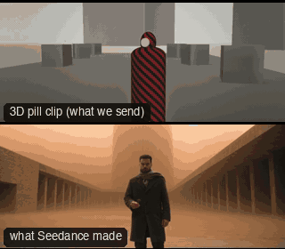

# CAM25-ArcAndRise: Arc and rise



**What it says.** We circle them and lift away at once: a moment growing into a landscape.

**Use it for.** The end of a big beat, a character left alone in the world, a hero reveal.

**Camera numbers.** 28 mm, MWS, a 120 degree arc while the arm rises 3 m over 7 s, aim held on the eyes.

**Avoid.** Rising first and arcing second: both axes have to start and stop together.

## The three.js code

This is an excerpt of the template (3 lines, from `engine/cinematic/src/templates/cameras2.ts`). `template.ts` in this folder is the same code with its imports. The helpers it calls (`make`, the actors, the rigs, the set and the post chain) are in `engine/cinematic/src`, so it does not run on its own: render it with `tools/render-pill.sh`.

```ts
import * as THREE from "three";
import { smoother, ramp } from "../util";
import { aimFor } from "../framer";
import { framed, rig } from "../kit/rigs";
import type { Cam } from "../shots";
import { ALEX, SAM, V, make as baseMake } from "./cameras";
import { stageFor } from "./studios";
import type { Piece } from "../piece";

make({ id: "CAM25-ArcAndRise", name: "Arc and rise", says: "We circle them and lift away at once: a moment growing into a landscape.", use: "The end of a big beat, a character left alone in the world, a hero reveal.", numbers: "28 mm, MWS, a 120 degree arc while the arm rises 3 m over 7 s, aim held on the eyes.", avoid: "Rising first and arcing second: both axes have to start and stop together." },
    [stand(0, 0, 0.2)],
    (P) => [{ start: 0, end: 8, label: "28mm  ARC AND RISE", rig: "TECHNOCRANE", subject: "ALEX", size: "MWS", sizeEnd: "WS", stop: 3, cam: rig.orbit(P("ALEX"), { size: "MWS", mm: 28 }, 20, 140, 0.3, 7.7, 3, 0.6), cut: "Opens the template", flags: ["compound"] }]),
```

**Make it yours.** Change rig: `rig.orbit`; lens: 28 mm; shot size: MWS. The actor `path` entries say where the pill stands and walks, and the numbers after `rig.` set the move (distance, angle, rise, start and end time).

## The videos

The stand-in in `pill.mp4` is the **pin** (a head on a slim body). Render the other with `--standin capsule`.

| What | File |
|---|---|
| The 3D pill clip, the reference video | `pill.mp4` |
| Another take from the same template | `release-media/CAM25-ArcAndRise/arc-rise-p2.mp4` |
| Another take from the same template | `release-media/CAM25-ArcAndRise/arc-rise-p3.mp4` |
| Another take from the same template | `release-media/CAM25-ArcAndRise/arc-rise-t.mp4` |
| Another take from the same template | `release-media/CAM25-ArcAndRise/arc-rise-v2.mp4` |
| Another take from the same template | `release-media/CAM25-ArcAndRise/arc-rise.mp4` |
| Another take from the same template | `release-media/CAM25-ArcAndRise/v10-cam25-m.mp4` |
| Another take from the same template | `release-media/CAM25-ArcAndRise/v10-cam25-t.mp4` |

## The prompt

One file per send. `sent.json` says, for each, whether it is the text that was sent, a recovered copy, or a rebuilt copy (`prompt.provenance`):

- `prompts/arc-rise-p2.txt`
- `prompts/arc-rise-p3.txt`
- `prompts/arc-rise-t.txt`
- `prompts/arc-rise-t2.txt`
- `prompts/arc-rise-v2.txt`
- `prompts/arc-rise.txt`
- `prompts/v10-cam25-m.txt`
- `prompts/v10-cam25-t.txt`

Keep the lines that say what the pills are and that the set is to be rebuilt as real. Change the person, the place and the light. These prompts come from the gallery runs and many predate the checks in `tools/seedance/`, so rebuild one with the gates before you reuse it.

## How it was sent

`sent.json` holds, for each send: the references in order with their roles, the settings, the credits and the outcome. Request ids are not kept; where one was known, a short hash is stored.

- **video #1**: 8 s, draft (480p preview), 21:9; references: @video1 = coarse blockout clip (grey clay set, striped capsule/pin stand-in); carries camera, framing, size and timing; no sound, @image1 = Alex's face photo: identity only (features, hair, beard), @image2 = whole environment contact sheet (4 panels, 2x2) as place/mood reference; prompt says: "@image2 is the reference for the real place and its mood: four photographs of the same location from different angles, laid out as a two by two contac"; confirmed: yes; 1166.4 credits.
- **video #2**: 8 s, draft (480p preview), 21:9; references: @video1 = coarse blockout clip (grey clay set, striped capsule/pin stand-in); carries camera, framing, size and timing; no sound, @image1 = Alex's face photo: identity only (features, hair, beard), @image2 = ONE panel of the environment contact sheet (panel 1); prompt says: "@image2 is the reference for the real place and its mood: one photograph of the location the shot takes place in."; confirmed: yes; 1166.4 credits.
- **video #3**: 8 s, draft (480p preview), 21:9; references: @video1 = coarse blockout clip (grey clay set, striped capsule/pin stand-in); carries camera, framing, size and timing; no sound, @image1 = Alex's face photo: identity only (features, hair, beard), @image2 = ONE panel of the environment contact sheet (panel 1); prompt says: "@image2 is a mood reference only: it shows the colour palette, the quality and temperature of the light, the haze, glow, softness and contrast, the te"; confirmed: yes; 1166.4 credits.
- **video #4**: 8 s, draft (480p preview), 21:9; references: @video1 = coarse blockout clip (grey clay set, striped capsule/pin stand-in); carries camera, framing, size and timing; no sound, @image1 = Alex's face photo: identity only (features, hair, beard); confirmed: yes; 1166.4 credits.
- **video #5**: 8 s, draft (480p preview), 21:9; references: @video1 = coarse blockout clip (grey clay set, striped capsule/pin stand-in); carries camera, framing, size and timing; no sound, @image1 = Alex's face photo: identity only (features, hair, beard); confirmed: yes.
- **video #6**: 8 s, draft (480p preview), 21:9; references: @video1 = coarse blockout clip (grey clay set, striped capsule/pin stand-in); carries camera, framing, size and timing; no sound, @image1 = Alex's face photo: identity only (features, hair, beard), @image2 = ONE panel of the environment contact sheet (panel 1); prompt says: "@image2 is the reference for the real place and its mood: one photograph of the location the shot takes place in."; confirmed: yes; 1166.4 credits.
- **video #7**: 8 s, draft (480p preview), 21:9; references: @video1 = coarse blockout clip (grey clay set, striped capsule/pin stand-in); carries camera, framing, size and timing; no sound, @image1 = Alex's face photo: identity only (features, hair, beard), @image2 = ONE panel of the environment contact sheet (panel 1); prompt says: "@image2 is used only for the mood of the place: its colour palette, the quality of its light, haze and glow, and its film feel."; confirmed: yes; 1166.4 credits.
- **video #8**: 8 s, draft (480p preview), 21:9; references: @video1 = coarse blockout clip (grey clay set, striped capsule/pin stand-in); carries camera, framing, size and timing; no sound, @image1 = Alex's face photo: identity only (features, hair, beard); confirmed: yes; 1166.4 credits.

See `reproduce.md` to render it and send it yourself.
