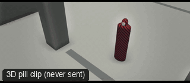

# CAM30-HighAngle: High angle



**What it says.** They are small, watched, or about to be caught.

**Use it for.** Vulnerability, surveillance, a character who has lost.

**Camera numbers.** Locked camera 3 m above eye level, 28 mm, FS looking down about 40 degrees, the ground filling the frame.

**Avoid.** Going to a full top-down: that is a map, not a power shot.

## The three.js code

This is an excerpt of the template (3 lines, from `engine/cinematic/src/templates/cameras2.ts`). `template.ts` in this folder is the same code with its imports. The helpers it calls (`make`, the actors, the rigs, the set and the post chain) are in `engine/cinematic/src`, so it does not run on its own: render it with `tools/render-pill.sh`.

```ts
import * as THREE from "three";
import { smoother, ramp } from "../util";
import { aimFor } from "../framer";
import { framed, rig } from "../kit/rigs";
import type { Cam } from "../shots";
import { ALEX, SAM, V, make as baseMake } from "./cameras";
import { stageFor } from "./studios";
import type { Piece } from "../piece";

make({ id: "CAM30-HighAngle", name: "High angle", says: "They are small, watched, or about to be caught.", use: "Vulnerability, surveillance, a character who has lost.", numbers: "Locked camera 3 m above eye level, 28 mm, FS looking down about 40 degrees, the ground filling the frame.", avoid: "Going to a full top-down: that is a map, not a power shot." },
    [stand(0, 0, 0.2)],
    (P) => [{ start: 0, end: 6, label: "28mm  HIGH ANGLE", rig: "TRIPOD · HIGH MOUNT", subject: "ALEX", size: "FS", stop: 4, cam: rig.locked(P("ALEX"), { size: "FS", mm: 28, deg: 20, rise: 3.2 }, 3), cut: "Opens the template" }]),
```

> **Locked camera.** This template does not move the camera. It is kept as a study of the shot, not as a template to send: the drafts made from four locked ANG clips were stiff (see `docs/why/why-no-static-shots.md`).

## The videos

The stand-in in `pill.mp4` is the **pin** (a head on a slim body). Render the other with `--standin capsule`.

| What | File |
|---|---|
| The 3D pill clip, the reference video | `pill.mp4` |

No Seedance result is included: locked camera: parked until given real motion.

The pill clip was rendered for this repo with the current engine. It has not been sent to Seedance, so there is no prompt yet: write one from `docs/prompt-anatomy.md` and the neighbouring templates' prompts.

## The prompt

No prompt was recorded for this template.

## How it was sent

`sent.json` holds, for each send: the references in order with their roles, the settings, the credits and the outcome. Request ids are not kept; where one was known, a short hash is stored.


See `reproduce.md` to render it and send it yourself.
