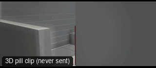

# CAM31-OverheadRise: Overhead rise



**What it says.** We lift off them and look straight down at where they stand.

**Use it for.** A character left alone, a map of a place, an ending that goes cold.

**Camera numbers.** 28 mm, the camera rises from 0.5 to 14 m over 7 s and swings in until it looks straight down, the figure kept central.

**Avoid.** Losing the subject at the top: keep them in the middle of the frame as it climbs.

## The three.js code

This is an excerpt of the template (3 lines, from `engine/cinematic/src/templates/cameras2.ts`). `template.ts` in this folder is the same code with its imports. The helpers it calls (`make`, the actors, the rigs, the set and the post chain) are in `engine/cinematic/src`, so it does not run on its own: render it with `tools/render-pill.sh`.

```ts
import * as THREE from "three";
import { smoother, ramp } from "../util";
import { aimFor } from "../framer";
import { framed, rig } from "../kit/rigs";
import type { Cam } from "../shots";
import { ALEX, SAM, V, make as baseMake } from "./cameras";
import { stageFor } from "./studios";
import type { Piece } from "../piece";

make({ id: "CAM31-OverheadRise", name: "Overhead rise", says: "We lift off them and look straight down at where they stand.", use: "A character left alone, a map of a place, an ending that goes cold.", numbers: "28 mm, the camera rises from 0.5 to 14 m over 7 s and swings in until it looks straight down, the figure kept central.", avoid: "Losing the subject at the top: keep them in the middle of the frame as it climbs." },
    [stand(0, 0, 0.2)],
    (P) => [{ start: 0, end: 8, label: "28mm  OVERHEAD RISE", rig: "TECHNOCRANE · DRONE", subject: "ALEX", size: "FS", sizeEnd: "WS", stop: 4, cam: rig.crane(P("ALEX"), { size: "FS", mm: 28, deg: 30 }, 0.5, 14, 0.3, 7.7, 0.15, 0.5), cut: "Opens the template", flags: ["compound"] }]),
```

**Make it yours.** Change rig: `rig.crane`; lens: 28 mm; shot size: FS. The actor `path` entries say where the pill stands and walks, and the numbers after `rig.` set the move (distance, angle, rise, start and end time).

## The videos

The stand-in in `pill.mp4` is the **pin** (a head on a slim body). Render the other with `--standin capsule`.

| What | File |
|---|---|
| The 3D pill clip, the reference video | `pill.mp4` |

No Seedance result is included: blockout bug: the pin is hidden behind a wall for the first second.

The pill clip was rendered for this repo with the current engine. It has not been sent to Seedance, so there is no prompt yet: write one from `docs/prompt-anatomy.md` and the neighbouring templates' prompts.

## The prompt

No prompt was recorded for this template.

## How it was sent

`sent.json` holds, for each send: the references in order with their roles, the settings, the credits and the outcome. Request ids are not kept; where one was known, a short hash is stored.


See `reproduce.md` to render it and send it yourself.
