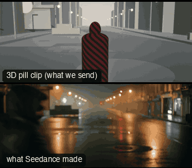

# CAM32-RunAndGun: Run and gun



**What it says.** We are running with them, and the camera is not steady either.

**Use it for.** Chases, escapes, war films, anything where the operator should be in danger.

**Camera numbers.** 28 mm, MWS from behind at 3 m, hand-held with a strong shake (amount 3), following a jog at about 2.4 m/s.

**Avoid.** Shaking the frame so hard the subject leaves it: the shake is on the camera, the subject stays framed.

## The three.js code

This is an excerpt of the template (3 lines, from `engine/cinematic/src/templates/cameras2.ts`). `template.ts` in this folder is the same code with its imports. The helpers it calls (`make`, the actors, the rigs, the set and the post chain) are in `engine/cinematic/src`, so it does not run on its own: render it with `tools/render-pill.sh`.

```ts
import * as THREE from "three";
import { smoother, ramp } from "../util";
import { aimFor } from "../framer";
import { framed, rig } from "../kit/rigs";
import type { Cam } from "../shots";
import { ALEX, SAM, V, make as baseMake } from "./cameras";
import { stageFor } from "./studios";
import type { Piece } from "../piece";

make({ id: "CAM32-RunAndGun", name: "Run and gun", says: "We are running with them, and the camera is not steady either.", use: "Chases, escapes, war films, anything where the operator should be in danger.", numbers: "28 mm, MWS from behind at 3 m, hand-held with a strong shake (amount 3), following a jog at about 2.4 m/s.", avoid: "Shaking the frame so hard the subject leaves it: the shake is on the camera, the subject stays framed." },
    [ALEX([{ t: 0.3, at: [0, 9] }, { t: 6.8, at: [0, -6] }])],
    (P) => [{ start: 0, end: 7, label: "28mm  RUN AND GUN", rig: "HANDHELD", subject: "ALEX", size: "MWS", stop: 2.8, cam: rig.shake(rig.follow(P("ALEX"), { size: "MWS", mm: 28, deg: 180, rise: 0.1 }, 0.35), 3, 4), cut: "Opens the template", flags: ["enters-moving", "exits-moving"] }]),
```

**Make it yours.** Change rig: `rig.follow`, `rig.shake`; lens: 28 mm; shot size: MWS. The actor `path` entries say where the pill stands and walks, and the numbers after `rig.` set the move (distance, angle, rise, start and end time).

## The videos

The stand-in in `pill.mp4` is the **pin** (a head on a slim body). Render the other with `--standin capsule`.

| What | File |
|---|---|
| The 3D pill clip, the reference video | `pill.mp4` |
| Another take from the same template | `release-media/CAM32-RunAndGun/v3-cam32-m.mp4` |
| Another take from the same template | `release-media/CAM32-RunAndGun/v3-cam32-t.mp4` |
| Another take from the same template | `release-media/CAM32-RunAndGun/v4-cam32-t.mp4` |
| Another take from the same template | `release-media/CAM32-RunAndGun/v6-cam32-m.mp4` |
| Another take from the same template | `release-media/CAM32-RunAndGun/v6-cam32-t.mp4` |

## The prompt

One file per send. `sent.json` says, for each, whether it is the text that was sent, a recovered copy, or a rebuilt copy (`prompt.provenance`):

- `prompts/v3-cam32-m.txt`
- `prompts/v3-cam32-t.txt`
- `prompts/v4-cam32-m.txt`
- `prompts/v4-cam32-t.txt`
- `prompts/v6-cam32-m.txt`
- `prompts/v6-cam32-t.txt`

Keep the lines that say what the pills are and that the set is to be rebuilt as real. Change the person, the place and the light. These prompts come from the gallery runs and many predate the checks in `tools/seedance/`, so rebuild one with the gates before you reuse it.

## How it was sent

`sent.json` holds, for each send: the references in order with their roles, the settings, the credits and the outcome. Request ids are not kept; where one was known, a short hash is stored.

- **video #1**: 7 s, draft (480p preview), 21:9; references: @video1 = coarse blockout clip (grey clay set, striped capsule/pin stand-in); carries camera, framing, size and timing; no sound, @image1 = Alex's face photo: identity only (features, hair, beard), @image2 = ONE panel of the environment contact sheet (panel 3); prompt says: "@image2 is a mood reference only (palette, light, haze, film feel).", @audio1 = the author's voice recording (not included): timbre, pace and accent for Alex's spoken line; confirmed: yes; 1020.6 credits.
- **video #2**: 7 s, draft (480p preview), 21:9; references: @video1 = coarse blockout clip (grey clay set, striped capsule/pin stand-in); carries camera, framing, size and timing; no sound, @image1 = Alex's face photo: identity only (features, hair, beard), @audio1 = the author's voice recording (not included): timbre, pace and accent for Alex's spoken line; confirmed: yes; 1020.6 credits.
- **video #3**: 7 s, draft (480p preview), 21:9; references: @video1 = coarse blockout clip (grey clay set, striped capsule/pin stand-in); carries camera, framing, size and timing; no sound, @image1 = Alex's face photo: identity only (features, hair, beard), @image2 = ONE panel of the environment contact sheet (panel 3); prompt says: "@image2 is used only for the mood of the place: its colour palette, the quality of its light, haze and glow, and its film feel.", @audio1 = the author's voice recording (not included): timbre, pace and accent for Alex's spoken line; confirmed: yes.
- **video #4**: 7 s, draft (480p preview), 21:9; references: @video1 = coarse blockout clip (grey clay set, striped capsule/pin stand-in); carries camera, framing, size and timing; no sound, @image1 = Alex's face photo: identity only (features, hair, beard), @audio1 = the author's voice recording (not included): timbre, pace and accent for Alex's spoken line; confirmed: yes; 1020.6 credits.
- **video #5**: 7 s, draft (480p preview), 21:9; references: @video1 = coarse blockout clip (grey clay set, striped capsule/pin stand-in); carries camera, framing, size and timing; no sound, @image1 = Alex's face photo: identity only (features, hair, beard), @image2 = ONE panel of the environment contact sheet (panel 3); prompt says: "@image2 is used only for the mood of the place: its colour palette, the quality of its light, haze and glow, and its film feel.", @audio1 = the author's voice recording (not included): timbre, pace and accent for Alex's spoken line; confirmed: yes; 1020.6 credits.
- **video #6**: 7 s, draft (480p preview), 21:9; references: @video1 = coarse blockout clip (grey clay set, striped capsule/pin stand-in); carries camera, framing, size and timing; no sound, @image1 = Alex's face photo: identity only (features, hair, beard), @audio1 = the author's voice recording (not included): timbre, pace and accent for Alex's spoken line; confirmed: yes; 1020.6 credits.

See `reproduce.md` to render it and send it yourself.
