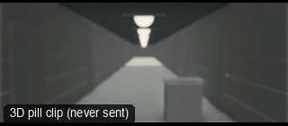

# CAM33-POVWalk: POV walk



**What it says.** We are them: we see only what they see.

**Use it for.** Horror, a search, a subjective beat, a game-like walk into danger.

**Camera numbers.** 24 mm at their eye height, a step bob of 2 cm, the aim a little below the horizon, walking about 1.7 m/s.

**Avoid.** Showing their hands or breath unless it is the point: a clean POV has no body in it.

## The three.js code

This is an excerpt of the template (3 lines, from `engine/cinematic/src/templates/cameras2.ts`). `template.ts` in this folder is the same code with its imports. The helpers it calls (`make`, the actors, the rigs, the set and the post chain) are in `engine/cinematic/src`, so it does not run on its own: render it with `tools/render-pill.sh`.

```ts
import * as THREE from "three";
import { smoother, ramp } from "../util";
import { aimFor } from "../framer";
import { framed, rig } from "../kit/rigs";
import type { Cam } from "../shots";
import { ALEX, SAM, V, make as baseMake } from "./cameras";
import { stageFor } from "./studios";
import type { Piece } from "../piece";

make({ id: "CAM33-POVWalk", name: "POV walk", says: "We are them: we see only what they see.", use: "Horror, a search, a subjective beat, a game-like walk into danger.", numbers: "24 mm at their eye height, a step bob of 2 cm, the aim a little below the horizon, walking about 1.7 m/s.", avoid: "Showing their hands or breath unless it is the point: a clean POV has no body in it." },
    [ALEX([{ t: 0.3, at: [0, 8] }, { t: 7, at: [0, -3.5] }])],
    (P) => [{ start: 0, end: 7, label: "24mm  POV WALK", rig: "BODY RIG · POV", subject: "ALEX", size: "WS", stop: 2.8, cam: (t: number): Cam => { const m = P("ALEX")(t), f = (m.heading ?? m.facing ?? V(0, 0, 1)).clone().setY(0).normalize(), bob = Math.abs(Math.sin(t * 3.4)) * 0.025; const pos = m.eye.clone().add(f.clone().multiplyScalar(0.4)).add(V(0, bob, 0)); return { pos, target: pos.clone().add(f.multiplyScalar(8)).add(V(0, -0.5, 0)), mm: 24 }; }, cut: "Opens the template", flags: ["enters-moving", "exits-moving"] }]),
```

**Make it yours.** Change lens: 24 mm; shot size: WS. The actor `path` entries say where the pill stands and walks, and the numbers after `rig.` set the move (distance, angle, rise, start and end time).

## The videos

The stand-in in `pill.mp4` is the **pin** (a head on a slim body). Render the other with `--standin capsule`.

| What | File |
|---|---|
| The 3D pill clip, the reference video | `pill.mp4` |

No Seedance result is included: POV: no person in frame by design.

The pill clip was rendered for this repo with the current engine. It has not been sent to Seedance, so there is no prompt yet: write one from `docs/prompt-anatomy.md` and the neighbouring templates' prompts.

## The prompt

No prompt was recorded for this template.

## How it was sent

`sent.json` holds, for each send: the references in order with their roles, the settings, the credits and the outcome. Request ids are not kept; where one was known, a short hash is stored.


See `reproduce.md` to render it and send it yourself.
