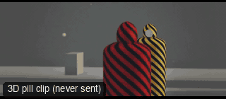

# CAM35-OTSPushIn: Over the shoulder push-in



**What it says.** The listener is shut out, and we move in on the one who speaks.

**Use it for.** A confession, an ultimatum, the line everything turns on.

**Camera numbers.** 75 mm over the shoulder from 4.6 m back, closing by 1.8 m over 6.5 s; the shoulder grows from about a third to 40% of the frame.

**Avoid.** Pushing so far the shoulder leaves the frame: it should still be there at the end.

## The three.js code

This is an excerpt of the template (3 lines, from `engine/cinematic/src/templates/cameras2.ts`). `template.ts` in this folder is the same code with its imports. The helpers it calls (`make`, the actors, the rigs, the set and the post chain) are in `engine/cinematic/src`, so it does not run on its own: render it with `tools/render-pill.sh`.

```ts
import * as THREE from "three";
import { smoother, ramp } from "../util";
import { aimFor } from "../framer";
import { framed, rig } from "../kit/rigs";
import type { Cam } from "../shots";
import { ALEX, SAM, V, make as baseMake } from "./cameras";
import { stageFor } from "./studios";
import type { Piece } from "../piece";

make({ id: "CAM35-OTSPushIn", name: "Over the shoulder push-in", says: "The listener is shut out, and we move in on the one who speaks.", use: "A confession, an ultimatum, the line everything turns on.", numbers: "75 mm over the shoulder from 4.6 m back, closing by 1.8 m over 6.5 s; the shoulder grows from about a third to 40% of the frame.", avoid: "Pushing so far the shoulder leaves the frame: it should still be there at the end." },
    [ALEX([{ t: 0, at: [-1.1, 0], yaw: Math.PI / 2 }], undefined, "SAM"), SAM([{ t: 0, at: [1.1, 0], yaw: -Math.PI / 2 }], undefined, "ALEX")],
    (P) => [{ start: 0, end: 7, label: "75mm  OTS PUSH-IN", rig: "DOLLY", subject: "SAM", size: "MCU", stop: 2, ots: "ALEX", pair: ["ALEX", "SAM"], cam: rig.ots(P("ALEX"), P("SAM"), 75, 1, 4.6, 0.5, 1.8, 0.5, 6.5), cut: "Opens the template" }]),
```

**Make it yours.** Change rig: `rig.ots`; shot size: MCU. The actor `path` entries say where the pill stands and walks, and the numbers after `rig.` set the move (distance, angle, rise, start and end time).

## The videos

The stand-in in `pill.mp4` is the **pin** (a head on a slim body). Render the other with `--standin capsule`.

| What | File |
|---|---|
| The 3D pill clip, the reference video | `pill.mp4` |

No Seedance result is included: never sent; the pill clip was re-rendered after the camera was moved to a clear place (environment 02) and pulled back to 4.6 m.

The pill clip was rendered for this repo with the current engine. It has not been sent to Seedance, so there is no prompt yet: write one from `docs/prompt-anatomy.md` and the neighbouring templates' prompts.

## The prompt

No prompt was recorded for this template.

## How it was sent

`sent.json` holds, for each send: the references in order with their roles, the settings, the credits and the outcome. Request ids are not kept; where one was known, a short hash is stored.


See `reproduce.md` to render it and send it yourself.
