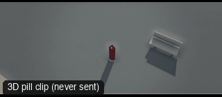

# CAM41-DroneOrbitHigh: Drone orbit (high)



**What it says.** We circle above the place and the person is where everything meets.

**Use it for.** Establishing a location, a gathering, an arrival from above.

**Camera numbers.** 24 mm, WS from 9 m up, a 180 degree orbit over 8 s at a steady radius, the subject kept central.

**Avoid.** Orbiting too fast: a drone orbit should feel like weather.

## The three.js code

This is an excerpt of the template (3 lines, from `engine/cinematic/src/templates/cameras2.ts`). `template.ts` in this folder is the same code with its imports. The helpers it calls (`make`, the actors, the rigs, the set and the post chain) are in `engine/cinematic/src`, so it does not run on its own: render it with `tools/render-pill.sh`.

```ts
import * as THREE from "three";
import { smoother, ramp } from "../util";
import { aimFor } from "../framer";
import { framed, rig } from "../kit/rigs";
import type { Cam } from "../shots";
import { ALEX, SAM, V, make as baseMake } from "./cameras";
import { stageFor } from "./studios";
import type { Piece } from "../piece";

make({ id: "CAM41-DroneOrbitHigh", name: "Drone orbit (high)", says: "We circle above the place and the person is where everything meets.", use: "Establishing a location, a gathering, an arrival from above.", numbers: "24 mm, WS from 9 m up, a 180 degree orbit over 8 s at a steady radius, the subject kept central.", avoid: "Orbiting too fast: a drone orbit should feel like weather." },
    [stand(0, 0, 0.2)],
    (P) => [{ start: 0, end: 9, label: "24mm  DRONE ORBIT HIGH", rig: "DRONE · GIMBAL", subject: "ALEX", size: "WS", stop: 4, cam: rig.orbit(P("ALEX"), { size: "WS", mm: 24, rise: 9 }, 20, 200, 0.4, 8.6, 9, 0.5), cut: "Opens the template", flags: ["compound"] }]),
```

**Make it yours.** Change rig: `rig.orbit`; lens: 24 mm; shot size: WS. The actor `path` entries say where the pill stands and walks, and the numbers after `rig.` set the move (distance, angle, rise, start and end time).

## The videos

The stand-in in `pill.mp4` is the **pin** (a head on a slim body). Render the other with `--standin capsule`.

| What | File |
|---|---|
| The 3D pill clip, the reference video | `pill.mp4` |

No Seedance result is included: pin too small for acting.

The pill clip was rendered for this repo with the current engine. It has not been sent to Seedance, so there is no prompt yet: write one from `docs/prompt-anatomy.md` and the neighbouring templates' prompts.

## The prompt

No prompt was recorded for this template.

## How it was sent

`sent.json` holds, for each send: the references in order with their roles, the settings, the credits and the outcome. Request ids are not kept; where one was known, a short hash is stored.


See `reproduce.md` to render it and send it yourself.
