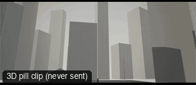

# CAM43-DroneRevealOverTerrace: Drone reveal



**What it says.** We rise over the edge of something and the place is revealed.

**Use it for.** The first view of a location, a reveal of scale, a journey's end.

**Camera numbers.** 24 mm, a programmed path from low behind a tall stack at the west side up to 14 m over the floor over 8 s, eyes kept on the person.

**Avoid.** Revealing the subject first: the place comes before the person.

## The three.js code

This is an excerpt of the template (3 lines, from `engine/cinematic/src/templates/cameras2.ts`). `template.ts` in this folder is the same code with its imports. The helpers it calls (`make`, the actors, the rigs, the set and the post chain) are in `engine/cinematic/src`, so it does not run on its own: render it with `tools/render-pill.sh`.

```ts
import * as THREE from "three";
import { smoother, ramp } from "../util";
import { aimFor } from "../framer";
import { framed, rig } from "../kit/rigs";
import type { Cam } from "../shots";
import { ALEX, SAM, V, make as baseMake } from "./cameras";
import { stageFor } from "./studios";
import type { Piece } from "../piece";

make({ id: "CAM43-DroneRevealOverTerrace", name: "Drone reveal", says: "We rise over the edge of something and the place is revealed.", use: "The first view of a location, a reveal of scale, a journey's end.", numbers: "24 mm, a programmed path from low behind a tall stack at the west side up to 14 m over the floor over 8 s, eyes kept on the person.", avoid: "Revealing the subject first: the place comes before the person." },
    [stand(0, 0, 0.2)],
    (P) => { void P; const look = V(0, 1.2, 0); return [{ start: 0, end: 9, label: "24mm  DRONE REVEAL", rig: "DRONE · PROGRAMMED", subject: "ALEX", size: "WS", stop: 4, cam: rig.spline([{ t: 0.3, pos: V(-30, 2.2, 0), look: V(-8, 8, 0), mm: 24 }, { t: 4, pos: V(-18, 10, 2), look, mm: 24 }, { t: 8.7, pos: V(2, 14, 9), look, mm: 24 }]), cut: "Opens the template", flags: ["compound"] }]; }),
```

**Make it yours.** Change rig: `rig.spline`; lens: 24 mm; shot size: WS. The actor `path` entries say where the pill stands and walks, and the numbers after `rig.` set the move (distance, angle, rise, start and end time).

## The videos

The stand-in in `pill.mp4` is the **pin** (a head on a slim body). Render the other with `--standin capsule`.

| What | File |
|---|---|
| The 3D pill clip, the reference video | `pill.mp4` |

No Seedance result is included: drone: pin stays tiny.

The pill clip was rendered for this repo with the current engine. It has not been sent to Seedance, so there is no prompt yet: write one from `docs/prompt-anatomy.md` and the neighbouring templates' prompts.

## The prompt

No prompt was recorded for this template.

## How it was sent

`sent.json` holds, for each send: the references in order with their roles, the settings, the credits and the outcome. Request ids are not kept; where one was known, a short hash is stored.


See `reproduce.md` to render it and send it yourself.
