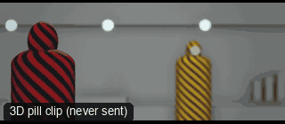

# CAM46-RackBetweenPeople: Rack focus (people)



**What it says.** Who is listening, and who is the one who matters now.

**Use it for.** A reaction behind the speaker, a power shift in a two-shot.

**Camera numbers.** 85 mm at T1.4, a locked two-shot, Alex near and sharp, Sam far and soft; focus pulls to Sam over 0.8 s at 3.2 s.

**Avoid.** Moving the camera too: the focus is the move.

## The three.js code

This is an excerpt of the template (3 lines, from `engine/cinematic/src/templates/cameras2.ts`). `template.ts` in this folder is the same code with its imports. The helpers it calls (`make`, the actors, the rigs, the set and the post chain) are in `engine/cinematic/src`, so it does not run on its own: render it with `tools/render-pill.sh`.

```ts
import * as THREE from "three";
import { smoother, ramp } from "../util";
import { aimFor } from "../framer";
import { framed, rig } from "../kit/rigs";
import type { Cam } from "../shots";
import { ALEX, SAM, V, make as baseMake } from "./cameras";
import { stageFor } from "./studios";
import type { Piece } from "../piece";

make({ id: "CAM46-RackBetweenPeople", name: "Rack focus (people)", says: "Who is listening, and who is the one who matters now.", use: "A reaction behind the speaker, a power shift in a two-shot.", numbers: "85 mm at T1.4, a locked two-shot, Alex near and sharp, Sam far and soft; focus pulls to Sam over 0.8 s at 3.2 s.", avoid: "Moving the camera too: the focus is the move." },
    [ALEX([{ t: 0, at: [-0.5, 1.6], yaw: Math.PI * 0.9 }]), SAM([{ t: 0, at: [0.7, -2.4], yaw: 0.1 }])],
    () => { const pos = V(0.2, 1.5, 6.2); return [{ start: 0, end: 7, label: "85mm  RACK FOCUS · ALEX TO SAM", rig: "TRIPOD", subject: (t) => (t < 3.2 ? "ALEX" : "SAM"), size: "MS", stop: 1.4, cam: () => ({ pos: pos.clone(), target: aimFor(pos, V(0.1, 1.5, -0.4), 85, [0, 0]), mm: 85 }), focus: (t) => ["ALEX", "SAM", smoother(ramp(t, 2.8, 3.6))], cut: "Opens the template" }]; }),
```

**Make it yours.** Change lens: 85 mm; shot size: MS. The actor `path` entries say where the pill stands and walks, and the numbers after `rig.` set the move (distance, angle, rise, start and end time).

## The videos

The stand-in in `pill.mp4` is the **pin** (a head on a slim body). Render the other with `--standin capsule`.

| What | File |
|---|---|
| The 3D pill clip, the reference video | `pill.mp4` |

No Seedance result is included: locked camera: parked until given real motion.

The pill clip was rendered for this repo with the current engine. It has not been sent to Seedance, so there is no prompt yet: write one from `docs/prompt-anatomy.md` and the neighbouring templates' prompts.

## The prompt

No prompt was recorded for this template.

## How it was sent

`sent.json` holds, for each send: the references in order with their roles, the settings, the credits and the outcome. Request ids are not kept; where one was known, a short hash is stored.


See `reproduce.md` to render it and send it yourself.
