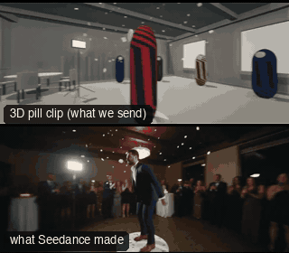

# FAM01-Booth360: 360 booth spin



Family: Famous shots.

**What it says.** The 360 party booth: the camera swings round them at arm's length, time drops to slow motion while they hang in a jump, then it comes round again and slows on the face.

**Use it for.** Someone showing off for the lens at a party, a wedding or a launch. Put one clear action (a jump, a throw) in the first slow stretch.

**Camera numbers.** 10.5 mm, level, lens 1.6 m from the platform's axis and 1.28 m off the floor. The arm turns 70°/s clockwise seen from above, 426° in 10.7 s. Clock 1 until 0.6 s, 0.16 from 1.1 to 3.5 s (11°/s, a 0.32 m jump hangs), 1 from 4.0 to 7.8 s, 0.18 from 8.3 s (13°/s), ending square on the face.

**Avoid.** Slowing the person but not the arm: in a real booth the room slows with them. No tilt, no change of radius; the rig cannot do either.

## The three.js code

This is an excerpt of the template (226 lines, from `engine/cinematic/src/templates/famous/f01-booth-360.ts`). `template.ts` in this folder is the same code with its imports. The helpers it calls (`make`, the actors, the rigs, the set and the post chain) are in `engine/cinematic/src`, so it does not run on its own: render it with `tools/render-pill.sh`.

```ts
// FAM01-Booth360
// Copied from engine/cinematic/src/templates/famous/f01-booth-360.ts (all of that file).
// The set builders, rigs and stand-ins it calls live in engine/cinematic/src and kit/.
// Render it: cd engine/cinematic && tools/render-pill.sh FAM01-Booth360
// FAM01-Booth360: the 360 photo booth. One person on a small round platform, a camera on a rotating arm circling them
// at arm's length with a very wide lens, played back with speed ramps. Measured from a booth company's showreel:
// the arm turns clockwise seen from above (the room slides right to left), 50 to 90°/s where the playback is at
// normal speed and 10 to 15°/s in the slow-motion stretches, about 360° in 9 s, lens at chest height, level.
// Camera and world share one clock: the arm turns at a constant 70°/s of world time and the ramp slows both together.
// Azimuths are degrees round the platform, 0 = +z (the way the hero faces), 90 = +x.
import * as THREE from "three";
import { speedRamp } from "../../kit/stage";
import { GREY, clay, shadeAll } from "../../kit/clay";
import { chair, room, table } from "../../kit/props";
import { Actor } from "../../kit/actors";
import { rigReady } from "../../kit/rig";
import { ramp, rng } from "../../util";
import type { Cam } from "../../shots";
import type { Piece } from "../../piece";
import { makeProduct, V, type ActorSpec, type KitWorld, type PathKey } from "../products/shared";

const RAD = Math.PI / 180;
const PLAT_R = 0.5, PLAT_H = 0.17;             // the platform: 1 m across, 17 cm high
const MM = 10.5, ARM_R = 1.6, LENS_Y = 1.28;   // the lens: 1.6 m from the platform's axis, 1.11 m above its top, level

// ---------------- time: normal speed, slow motion for the jump, normal speed round the back, slow motion to the end ----------------
const SLOW1 = 0.16, SLOW2 = 0.18, END = 10.7;
const HANG: [number, number] = [1.1, 3.5];     // the first slow stretch, film seconds
const CLOCK = speedRamp([[0, 1], [0.6, 1], [HANG[0], SLOW1], [HANG[1], SLOW1], [4.0, 1], [7.8, 1], [8.3, SLOW2], [END, SLOW2]]);

// ---------------- the arm: 70° per world second, clockwise from above ----------------
const OMEGA = 70;
const LEAD = (OMEGA * (CLOCK(HANG[0]) + CLOCK(HANG[1]))) / 2 - 9.5;      // degrees left of face-on at the start: the hang straddles the face
const azimuth = (t: number) => (LEAD - OMEGA * CLOCK(t)) * RAD;
const booth = (t: number): Cam => {
  const a = azimuth(t);
  return { pos: V(Math.sin(a) * ARM_R, LENS_Y, Math.cos(a) * ARM_R), target: V(0, LENS_Y, 0), mm: MM };
};

// ---------------- the hero: a standing jump whose flight sits across the first slow stretch (world seconds) ----------------
const VY = 2.5, FLIGHT = (2 * VY) / 9.81;                          // 0.32 m of rise, 0.51 s in the air
const APEX = (CLOCK(HANG[0]) + CLOCK(HANG[1])) / 2, T_TAKE = APEX - FLIGHT / 2, T_LAND = APEX + FLIGHT / 2;
const HERO_PATH: PathKey[] = (() => {
  // held still on the platform until the toes leave (the path is measured from the platform's top)
  const keys: PathKey[] = [{ t: -0.5, at: [0, 0, 0], yaw: 0 }, { t: 0.3, at: [0, 0, 0] }, { t: T_TAKE - 0.03, at: [0, 0, 0] }];
  for (let k = 0; k <= 24; k++) { const s = (FLIGHT * k) / 24; keys.push({ t: T_TAKE + s, at: [0, Math.max(0, VY * s - 4.905 * s * s), 0] }); }
  keys.push({ t: T_LAND + 1 / 24, at: [0, 0, 0] }, { t: T_LAND + 1.5, at: [0, 0, 0], yaw: 0 }, { t: 6, at: [0, 0, 0], yaw: 0 });
  return keys;
})();
const clip = (c: string, t0: number, t1?: number, ease = 0.15) => ({ kind: "clip" as const, clip: c, t0, t1, ease });
const HERO: ActorSpec = {
  id: "HERO", name: "Hero", kind: "human", tint: "ochre", capsule: "trunk", path: HERO_PATH,
  // Jump_Start's toes leave 0.22 s into the clip; the open-armed air pose takes over for the flight; then the landing.
  // Afterwards only clips that keep the standing feet where they are: a thumbs-up, then a raised palm for the lens
  acts: [clip("Jump_Start", T_TAKE - 0.22, T_TAKE + 0.02, 0.3), clip("Jump_Loop", T_TAKE + 0.17, T_LAND - 0.22, 0.15), clip("Jump_Land", T_LAND - 0.12, T_LAND + 1.1, 0.2),
    clip("Yes", T_LAND + 1.3, T_LAND + 3.1, 0.25), clip("Spell_Simple_Idle_Loop", CLOCK(7.6), undefined, 0.45)],
};

// The standing feet stay where they stand: the crouch into the jump and the later gestures would drag them a few
// centimetres. The ankles are held over the idle stance (measured, metres from the platform's axis) until the push-off
// ... (see template.ts for the rest)
```

## The videos

The stand-in in `pill.mp4` is the **capsule** (the single striped capsule of the first gallery clips). Render the other with `--standin pin`.

| What | File |
|---|---|
| The 3D pill clip, the reference video | `pill.mp4` |
| The contact sheet (sketch route) | `sketch-sheet.jpg` |
| What Seedance made from the pill clip (480p draft) | `release-media/FAM01-Booth360/result.mp4` (release asset) |
| What Seedance made from the contact sheet | `release-media/FAM01-Booth360/sketch-output.mp4` (release asset) |

## The prompt

One file per send. `sent.json` says, for each, whether it is the text that was sent, a recovered copy, or a rebuilt copy (`prompt.provenance`):

- `prompts/sketch.txt`
- `prompts/video-1.txt`
- `prompts/video-2.txt`
- `prompts/video-3.txt`

Keep the lines that say what the pills are and that the set is to be rebuilt as real. Change the person, the place and the light. These prompts come from the gallery runs and many predate the checks in `tools/seedance/`, so rebuild one with the gates before you reuse it.

## How it was sent

`sent.json` holds, for each send: the references in order with their roles, the settings, the credits and the outcome. Request ids are not kept; where one was known, a short hash is stored.

- **video #1**: 11 s, draft (480p preview), 21:9; references: @video1 = pill clip (the 3D blockout), @image1 = person photo (face reference); confirmed: yes; 1603.8 credits.
- **video #2**: 11 s, draft (480p preview), 21:9; references: @video1 = pill clip (the 3D blockout), @image1 = person photo (face reference); confirmed: yes; 1603.8 credits.
- **video #3**: 11 s, draft (480p preview), 21:9; references: @video1 = pill clip (the 3D blockout), @image1 = person photo (face reference); confirmed: yes.
- **sketch #1**: 11 s, draft (480p preview), 21:9; references: @image1 = person photo (face reference), @image2 = contact sheet of the pill (a few frames on one image); confirmed: yes; 1344.2 credits.

See `reproduce.md` to render it and send it yourself.
