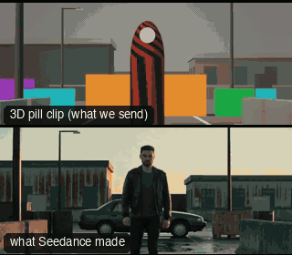

# FAM02-ExplosionWalk: Walk away from the explosion



Family: Famous shots.

**What it says.** Nothing behind them is worth a look: the hero walks at us, the world goes up, and they do not turn.

**Use it for.** The exit after the job is done: someone leaving a thing burning behind them. Once per film, as the last beat of a sequence.

**Camera numbers.** 85 mm straight in front, lens 1.0 m rising to 1.3 m, 8.6 m from the walker closing to 4.85 m (the dolly backs away at 15% of the 0.97 m/s walk): knees-up to waist-up. The car goes up 22 m behind the end mark at 2.0 s; clock 1 to 2.4 s, eased to 0.25 by 3.0 s and held to 10 s. No shake.

**Avoid.** A look back, a flinch or a quicker step: the calm is the shot. No camera shake, and no debris near the walker.

## The three.js code

This is an excerpt of the template (278 lines, from `engine/cinematic/src/templates/famous/f02-explosion-walk.ts`). `template.ts` in this folder is the same code with its imports. The helpers it calls (`make`, the actors, the rigs, the set and the post chain) are in `engine/cinematic/src`, so it does not run on its own: render it with `tools/render-pill.sh`.

```ts
// FAM02-ExplosionWalk
// Copied from engine/cinematic/src/templates/famous/f02-explosion-walk.ts (all of that file).
// The set builders, rigs and stand-ins it calls live in engine/cinematic/src and kit/.
// Render it: cd engine/cinematic && tools/render-pill.sh FAM02-ExplosionWalk
// FAM02-ExplosionWalk: the hero walks calmly at the lens while a car goes up behind them, and never looks back.
// Measured from two clips (a film scene and a home parody): a long lens straight in front at hip height, rock steady,
// the walker centred, the blast straight behind the head, playback at about a quarter speed. The film cuts from a
// normal-speed wide to the slow-motion shots; this is one take, so one speed ramp does that cut's job: 2 s of calm walk
// at normal speed, the blast, then slow motion to the end. Camera and world share the clock (an overcranked camera
// slows its own dolly too): it backs away at 15% of the walker's pace, so the walker gains on it, knees-up to waist-up.
// +z is toward the lens; the hero ends at z 0 and the car stands 22 m behind that. Render the pill version with
// --subframes 1 (with more, the sub-frame passes draw the person, not the capsule).
import * as THREE from "three";
import { getInputProps } from "remotion";
import { speedRamp } from "../../kit/stage";
import { GREY, clay, shadeAll } from "../../kit/clay";
import { barrel, building, car, crate, dress, ground } from "../../kit/props";
import { aimFor } from "../../framer";
import { lerp, noise2, rng, smooth } from "../../util";
import type { Cam } from "../../shots";
import type { Piece } from "../../piece";
import { makeProduct, V, type ActorSpec, type KitWorld, type PathKey } from "../products/shared";

// ---------------- time: normal speed through the blast, then a quarter speed to the end ----------------
const END = 10, SLOW = 0.25;
const T_BLAST = 2.0;                             // world seconds (the clock is still 1:1 here, so film seconds too)
const CLOCK = speedRamp([[0, 1], [2.4, 1], [3.0, SLOW], [END, SLOW]]);
const W_END = CLOCK(END);                        // 4.53 s of world time in 10 s of film

// ---------------- the hero: a straight walk at the clip's own pace, so the feet hold ----------------
const PACE = 0.97;                               // m/s: 4.39 m walked in the shot
const heroZ = (w: number) => PACE * (w - W_END);
const HERO_PATH: PathKey[] = Array.from({ length: 14 }, (_, i) => ({ t: i - 3, at: [0, heroZ(i - 3)] as [number, number], ...(i ? {} : { yaw: 0 }) }));
// the stand-in capsule is fitted to the trunk, not the swinging arms: a narrower pill hides less of the blast
const HERO: ActorSpec = { id: "HERO", name: "Hero", kind: "human", tint: "ochre", path: HERO_PATH, capsule: "trunk" };
const HEAD_TOP = 1.78;

// ---------------- the camera: 85 mm on a dolly, straight in front, backing away slower than the walk ----------------
const MM = 85;
const D0 = 8.58, D1 = 4.85;                      // lens to hero: a 1.52 m tall frame at the start, 0.86 m at the end
const H0 = 1.0, H1 = 1.3;                        // lens height: hip to chest, so the ground under the blast stays in frame
const dolly = (w: number): Cam => {
  const p = w / W_END, k = smooth(p);
  const pos = V(0, lerp(H0, H1, k), heroZ(w) + lerp(D0, D1, p));
  // the head top rides 19% down the frame at the start (as in the reference) and 14% at the end
  return { pos, target: aimFor(pos, V(0, HEAD_TOP, heroZ(w)), MM, [0, lerp(0.62, 0.72, k)]), mm: MM };
};
const camera = (t: number): Cam => dolly(CLOCK(t));

// ---------------- the blast, in seconds after it goes off (world clock) ----------------
const SITE = V(0, 0, -22), G = 9.81;
const grow = (tau: number, k: number) => (tau <= 0 ? 0 : 1 - Math.exp(-tau / k));
/** metres risen per m/s of final speed: starts from rest, reaches speed in about half a second */
const lift = (tau: number) => (tau <= 0 ? 0 : tau - 0.45 * (1 - Math.exp(-tau / 0.45)));
const HOT = new THREE.Color("#f1efe9"), SMOKE = new THREE.Color("#73726e"), DUST = new THREE.Color("#c6c4be");

type Lobe = { dir: THREE.Vector3; reach: number; r: number; up: number; cool: number; axis: THREE.Vector3; roll: number; swell: number };
/** the fireball: overlapping lumps thrown out of the core. The low heart stays white hot; the body cools to smoke lump
 *  by lump; the cap rises fastest and turns to smoke first */
const LOBES: Lobe[] = (() => {
// ... (see template.ts for the rest)
```

## The videos

The stand-in in `pill.mp4` is the **capsule** (the single striped capsule of the first gallery clips). Render the other with `--standin pin`.

| What | File |
|---|---|
| The 3D pill clip, the reference video | `pill.mp4` |
| The contact sheet (sketch route) | `sketch-sheet.jpg` |
| What Seedance made from the pill clip (480p draft) | `release-media/FAM02-ExplosionWalk/result.mp4` (release asset) |
| What Seedance made from the contact sheet | `release-media/FAM02-ExplosionWalk/sketch-output.mp4` (release asset) |
| Another take from the same template | `release-media/FAM02-ExplosionWalk/video-t-explosion-blocks.mp4` |
| Another take from the same template | `release-media/FAM02-ExplosionWalk/video-t-explosion-nodebris.mp4` |
| Another take from the same template | `release-media/FAM02-ExplosionWalk/video-t-explosion-nofire.mp4` |

## The prompt

One file per send. `sent.json` says, for each, whether it is the text that was sent, a recovered copy, or a rebuilt copy (`prompt.provenance`):

- `prompts/sketch.txt`
- `prompts/video-1.txt`
- `prompts/video-2.txt`
- `prompts/video-3.txt`
- `prompts/video-recovered-blocks.txt`
- `prompts/video-recovered-nodebris.txt`
- `prompts/video-recovered-nofire.txt`

Keep the lines that say what the pills are and that the set is to be rebuilt as real. Change the person, the place and the light. These prompts come from the gallery runs and many predate the checks in `tools/seedance/`, so rebuild one with the gates before you reuse it.

## How it was sent

`sent.json` holds, for each send: the references in order with their roles, the settings, the credits and the outcome. Request ids are not kept; where one was known, a short hash is stored.

- **video #1**: 10 s, draft (480p preview), 21:9; references: @video1 = pill clip (the 3D blockout), @image1 = person photo (face reference); confirmed: yes; 1458 credits.
- **video #2**: 10 s, draft (480p preview), 21:9; references: @video1 = pill clip (the 3D blockout), @image1 = person photo (face reference); confirmed: yes; 1458 credits.
- **video #3**: 10 s, draft (480p preview), 21:9; references: @video1 = pill clip (the 3D blockout), @image1 = person photo (face reference); confirmed: yes; 1458 credits.
- **video #4**: 10 s, draft (480p preview), 21:9; references: @video1 = pill clip (the 3D blockout), @image1 = person photo (face reference); confirmed: yes; 1458 credits.
- **video #5**: 10 s, draft (480p preview), 21:9; references: @video1 = pill clip (the 3D blockout), @image1 = person photo (face reference); confirmed: yes; 1458 credits.
- **video #6**: 10 s, draft (480p preview), 21:9; references: @video1 = pill clip (the 3D blockout), @image1 = person photo (face reference); confirmed: yes; 1458 credits.
- **sketch #1**: 10 s, draft (480p preview), 21:9; references: @image1 = person photo (face reference), @image2 = contact sheet of the pill (a few frames on one image); confirmed: yes; 1222 credits.

See `reproduce.md` to render it and send it yourself.
