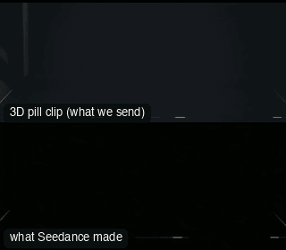

# FAM03-TrunkShot: Trunk shot



Family: Famous shots.

**What it says.** We are the thing in the boot. The lid lifts, daylight comes in, and three people stand over us looking down into the lens.

**Use it for.** A reveal from the point of view of whatever is in the boot: gangsters, a road trip, a find. The lid shutting to black is the cut out, and the clip loops.

**Camera numbers.** 16 mm locked off on the boot floor, lens 10 cm above it, tilted 49° up toward the tail, f/11. Black 0.6 s, the lid swings 36° in 0.75 s, then three people from the chest up with the tops of their heads a third down the frame, the lid across the top 15% and the sill along the bottom 4%. They lean in by 2 s, one reaches toward the lens from 4.3 to 6.7 s, they straighten at 8 s, the lid is pushed shut in 0.45 s from 8.9 s, black from 9.35 to 10 s.

**Avoid.** Moving the camera (the real one never does), or standing the people upright behind the bumper: they must lean over the sill or they sink to the bottom of the frame.

## The three.js code

This is an excerpt of the template (198 lines, from `engine/cinematic/src/templates/famous/f03-trunk-shot.ts`). `template.ts` in this folder is the same code with its imports. The helpers it calls (`make`, the actors, the rigs, the set and the post chain) are in `engine/cinematic/src`, so it does not run on its own: render it with `tools/render-pill.sh`.

```ts
// FAM03-TrunkShot
// Copied from engine/cinematic/src/templates/famous/f03-trunk-shot.ts (all of that file).
// The set builders, rigs and stand-ins it calls live in engine/cinematic/src and kit/.
// Render it: cd engine/cinematic && tools/render-pill.sh FAM03-TrunkShot
// FAM03-TrunkShot: the Tarantino trunk shot. The camera lies on the floor of a car boot looking up and back; the lid
// lifts, daylight comes in, and three people lean over the sill and look down into the lens. One reaches in, they
// straighten, the lid is pushed shut to black. Measured from a supercut of the real shots (see `numbers`).
import * as THREE from "three";
import type { Piece } from "../../piece";
import type { Actor } from "../../kit/actors";
import { GREY, clay, shadeAll } from "../../kit/clay";
import { building, dress, ground, lampPost } from "../../kit/props";
import { clamp, lerp, smooth, smoother } from "../../util";
import { V, makeProduct, type ActorSpec, type KitWorld } from "../products/shared";

// ---- the boot, in metres (the car's tail faces +z; the people stand at +z and face -z) ----
const FLOOR = 0.45, SILL = 0.84, DECK = 1.04;          // boot floor, top of the rear sill, top of the wings and the shut lid
const HALF = 0.75, FRONT = -0.85, REAR = 0.45;         // inside half width, the wall behind the seats (the hinge line), the sill's inside face
const LID_LEN = 1.32, LIP = 0.188, LID_OPEN = (36 * Math.PI) / 180;
// ---- the lens: 10 cm above the floor, tilted 49 degrees up toward the tail ----
const LENS = V(0, 0.55, -0.15), TILT = (49 * Math.PI) / 180, MM = 16;

// ---- timing (s) ----
const END = 10, T = { open: 0.6, openFor: 0.75, lean: 1.05, reach: [4.3, 5.2, 5.8, 6.7], back: 8.05, shut: 8.9, shutFor: 0.45 };
/** the lid's angle: an eased swing up, then pushed down accelerating into the latch (a slam) */
const lidAngle = (t: number) => (t < T.shut ? LID_OPEN * smooth((t - T.open) / T.openFor) : LID_OPEN * (1 - clamp((t - T.shut) / T.shutFor) ** 2));
/** how far the people are leaned in over the boot (0 standing, 1 in) and how far the reach has gone */
const leanIn = (t: number) => smoother((t - T.lean) / 0.9) * (1 - smoother((t - T.back) / 0.75));
const reachIn = (t: number) => smoother((t - T.reach[0]) / (T.reach[1] - T.reach[0])) * (1 - smoother((t - T.reach[2]) / (T.reach[3] - T.reach[2])));

// ---- the set ----
const mat = (hex: string, rough = 0.92) => new THREE.MeshStandardMaterial({ color: hex, roughness: rough, metalness: 0 });
const box = (m: THREE.Material, w: number, h: number, d: number, x: number, y: number, z: number, ry = 0) => {
  const o = new THREE.Mesh(new THREE.BoxGeometry(w, h, d), m); o.position.set(x, y, z); o.rotation.y = ry; o.castShadow = o.receiveShadow = true; return o;
};
function buildBoot(w: KitWorld) {
  w.add(ground(300, 0, 300, GREY.ground));
  // everything the lens can see of the car is lined in these: `tick` takes them from black to grey as the lid lifts
  const lining = mat(GREY.mid), panel = mat(GREY.set), rib = mat(GREY.dark), lamp = mat(GREY.paper, 0.6);
  const shell = clay(GREY.set, 0.85);
  const car = new THREE.Group();
  const len = REAR - FRONT, mid = (REAR + FRONT) / 2;
  car.add(box(lining, HALF * 2, 0.05, len, 0, FLOOR - 0.025, mid));                                         // floor
  for (const s of [-1, 1]) {
    car.add(box(lining, 0.03, DECK - FLOOR, len, s * (HALF + 0.015), (DECK + FLOOR) / 2, mid));             // side walls
    car.add(box(shell, 0.17, DECK - 0.2, len + 0.19, s * (HALF + 0.115), (DECK + 0.2) / 2, mid + 0.015));   // the wings outside them
  }
  car.add(box(lining, HALF * 2, 0.53, 0.03, 0, FLOOR + 0.265, FRONT - 0.015));                              // the wall behind the seats
  car.add(box(lining, HALF * 2, SILL - FLOOR, 0.02, 0, (SILL + FLOOR) / 2, REAR + 0.01));                   // the sill's inside face
  car.add(box(shell, 1.9, SILL - 0.2, 0.09, 0, (SILL + 0.2) / 2, REAR + 0.065));                            // the tail panel
  car.add(box(shell, 1.9, 0.1, 0.05, 0, 0.42, REAR + 0.135));                                               // bumper
  car.add(box(rib, 0.06, 0.03, 0.03, 0, SILL - 0.03, REAR - 0.015));                                        // the latch striker
  car.add(box(shell, 1.9, DECK - 0.2, 3.4, 0, (DECK + 0.2) / 2, FRONT - 0.08 - 1.7));                       // the rest of the car, never seen
  car.add(box(shell, 1.6, 0.45, 1.7, 0, DECK + 0.225, FRONT - 1.6));
  w.add(car, "boot");
  // the lid: hinged on the wall behind the seats, a slab with a down-turned lip that shuts 12 mm above the sill
  const lid = new THREE.Group(); lid.position.set(0, DECK, FRONT);
  const lw = HALF * 2 - 0.01;
  lid.add(box(panel, lw, 0.04, LID_LEN, 0, -0.02, LID_LEN / 2));
  lid.add(box(panel, lw, LIP - 0.04, 0.02, 0, -(LIP + 0.04) / 2, LID_LEN - 0.01));
// ... (see template.ts for the rest)
```

## The videos

The stand-in in `pill.mp4` is the **capsule** (the single striped capsule of the first gallery clips). Render the other with `--standin pin`.

| What | File |
|---|---|
| The 3D pill clip, the reference video | `pill.mp4` |
| What Seedance made from the pill clip (480p draft) | `release-media/FAM03-TrunkShot/result.mp4` (release asset) |
| Another take from the same template | `release-media/FAM03-TrunkShot/video-capsule.mp4` |

## The prompt

One file per send. `sent.json` says, for each, whether it is the text that was sent, a recovered copy, or a rebuilt copy (`prompt.provenance`):

- `prompts/video-recovered-capsule.txt`

Keep the lines that say what the pills are and that the set is to be rebuilt as real. Change the person, the place and the light. These prompts come from the gallery runs and many predate the checks in `tools/seedance/`, so rebuild one with the gates before you reuse it.

## How it was sent

`sent.json` holds, for each send: the references in order with their roles, the settings, the credits and the outcome. Request ids are not kept; where one was known, a short hash is stored.

- **video #1**: 10 s, draft (480p preview), 21:9; references: @video1 = pill clip (the 3D blockout), @image1 = person photo (face reference); confirmed: yes; 1458 credits.

See `reproduce.md` to render it and send it yourself.
