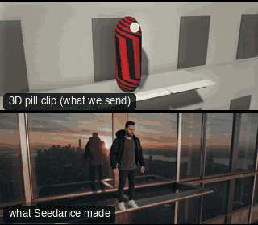

# FAM04-LeapOfFaith: Leap of faith



Family: Famous shots.

**What it says.** A jump there is no taking back. They dive off a tower and drop at full speed; the camera dives after them and the world turns over. Time stretches only on the frame where the fall becomes a rise: the city hangs from the top of the picture and they float up through it. Then we close on their face, still falling.

**Use it for.** A first leap, a point of no return, any fall the story turns on. Once per film. Let the inverted frame have its moment before the push-in.

**Camera numbers.** 28 to 35 mm, one 13.1 s take. Full shot on a window ledge 205 m up, held 1 s. Toe-off at 1.6 s (2.0 m/s up, 3.6 m/s out), then 3.3 s of real-speed fall: the camera climbs to look 70° down as they drop away to 16.6 m, then dives after them (peak 44 m/s), swinging 75° to their side and rolling 180° (peak 87°/s). At 4.9 s they are doing 30.6 m/s, 47 m down; the clock eases to 0.035 by 5.6 s as the camera lands level on the inverted wide: the figure 19.6% of frame height in the middle, falling 1.2 m/s in playback. The wide sits 1.5 s. From 7.1 to 11.6 s the camera pushes in to 1.5 m from the face (peak 6.8 m/s), arcing 30° to square on; the last 1.5 s hold the close-up.

**Avoid.** Slow motion before the inverted frame: the fall has to be a real fall. A roll in steps, or a cut into the inverted frame: it is one turn about the figure. Towers behind the figure in the wide: keep open sky under them. Any tumble once the push-in starts: the face must hold still in frame.

## The three.js code

This is an excerpt of the template (283 lines, from `engine/cinematic/src/templates/famous/f04-leap-of-faith.ts`). `template.ts` in this folder is the same code with its imports. The helpers it calls (`make`, the actors, the rigs, the set and the post chain) are in `engine/cinematic/src`, so it does not run on its own: render it with `tools/render-pill.sh`.

```ts
// FAM04-LeapOfFaith
// Copied from engine/cinematic/src/templates/famous/f04-leap-of-faith.ts (all of that file).
// The set builders, rigs and stand-ins it calls live in engine/cinematic/src and kit/.
// Render it: cd engine/cinematic && tools/render-pill.sh FAM04-LeapOfFaith
// FAM04-LeapOfFaith: the leap of faith (Spider-Man: Into the Spider-Verse, 2018), measured from a reference clip.
// One take. A person stands on a window ledge high on a tower and dives off. The fall is real speed: they drop away
// down the tower's face while the camera climbs over them, then it dives after them, swinging to their side and rolling
// 180 degrees. Time slows only as it arrives beside them, on the famous frame: the city hanging from the top of the
// picture, sky at the bottom, the falling figure small in the middle, upright in frame and seeming to rise.
// That frame sits, then the camera pushes in to a close-up of the face, still inverted, and ends there riding the fall.
import * as THREE from "three";
import { mergeGeometries } from "three/examples/jsm/utils/BufferGeometryUtils.js";
import { aimFor } from "../../framer";
import { GREY, clay } from "../../kit/clay";
import { building, ground } from "../../kit/props";
import { speedRamp } from "../../kit/stage";
import type { Piece } from "../../piece";
import type { Cam } from "../../shots";
import { clamp, lerp, rng, smoother } from "../../util";
import { V, makeProduct, type ActorSpec, type KitWorld, type PathKey } from "../products/shared";

const rad = THREE.MathUtils.degToRad;
const G = 9.81, MM = 28;
// film seconds: real time to SLOW[0], the clock eased to RATE by SLOW[1] (the inverted wide), the push-in, the close-up held
const SLOW = [4.9, 5.6], RATE = 0.035, PUSH = [7.1, 11.6], T_END = 13.1;

// ---------------- the hero (world-clock seconds) ----------------
// The tower's face is the plane z = 0 and the hero leaves it toward +z. The ledge top is the tower's 60th floor line.
const Y0 = 205.31;
const P0 = V(0, Y0, 0.96);                 // where the soles stand: toes at the ledge's edge, over the glass lip
const STANCE: ["l" | "r", number, number][] = [["l", 0.2, 0.13], ["r", -0.16, -0.27]];   // the ankles (x, z from P0): the jump clip's own stance
const TO = 1.6;                            // toe-off
const H0 = 1.0;                            // the body turns about this point, metres above the soles
const LEAN = 0.18;                         // tipping forward on the toes before they leave
const SPIN = rad(184);                     // the dive's turn rate: half a turn in about a second
const TH0 = (SPIN * LEAN) / 2;             // the lean at toe-off
const V0 = V(0, 2.0, 3.6);                 // the body's velocity at toe-off
const T1 = 0.3035, T2 = 0.6035;            // the first tip stops with the body face down to the street, spread out
const FLAT = TH0 + SPIN * T1 + ((T2 - T1) * SPIN) / 2;   // about 100 degrees over
const T3 = 3.5;                            // from there it tips on, slowly then faster, and is head down here, before time slows
const TWIST = rad(50), TW = [2.2, 3.5];    // a part twist as it goes head down, so the face ends turned along the avenue, not at the wall across

/** how far the body has tipped forward (0 = standing, pi = head down) */
function pitch(w: number) {
  const s = w - TO;
  if (s <= -LEAN) return 0;
  if (s <= 0) return (0.5 * SPIN * (s + LEAN) ** 2) / LEAN;
  if (s <= T1) return TH0 + SPIN * s;
  const k = (s - T1) / (T2 - T1);
  if (k <= 1) return TH0 + SPIN * T1 + (T2 - T1) * SPIN * (k - k * k * k + (k * k * k * k) / 2);
  return FLAT + (Math.PI - FLAT) * smoother(Math.pow(clamp((s - T2) / (T3 - T2)), 1.4));
}
/** the turn about the body's own long axis */
const twist = (w: number) => -TWIST * smoother((w - TO - TW[0]) / (TW[1] - TW[0]));
const C0 = P0.clone().add(V(0, H0 * Math.cos(TH0), H0 * Math.sin(TH0)));
/** the body's centre: over the soles while they are planted, then a free fall under gravity */
function centre(w: number) {
  const s = w - TO;
  if (s <= 0) { const a = pitch(w); return P0.clone().add(V(0, H0 * Math.cos(a), H0 * Math.sin(a))); }
  return V(C0.x + V0.x * s, C0.y + V0.y * s - (G / 2) * s * s, C0.z + V0.z * s);
// ... (see template.ts for the rest)
```

## The videos

The stand-in in `pill.mp4` is the **capsule** (the single striped capsule of the first gallery clips). Render the other with `--standin pin`.

| What | File |
|---|---|
| The 3D pill clip, the reference video | `pill.mp4` |
| The contact sheet (sketch route) | `sketch-sheet.jpg` |
| What Seedance made from the pill clip (480p draft) | `release-media/FAM04-LeapOfFaith/result.mp4` (release asset) |
| What Seedance made from the contact sheet | `release-media/FAM04-LeapOfFaith/sketch-output.mp4` (release asset) |
| Another take from the same template | `release-media/FAM04-LeapOfFaith/video-t-leap-video2.mp4` |

## The prompt

One file per send. `sent.json` says, for each, whether it is the text that was sent, a recovered copy, or a rebuilt copy (`prompt.provenance`):

- `prompts/sketch-1.txt`
- `prompts/sketch-2.txt`
- `prompts/sketch-3.txt`
- `prompts/video-recovered-film.txt`
- `prompts/video-recovered-film2.txt`
- `prompts/video.txt`

Keep the lines that say what the pills are and that the set is to be rebuilt as real. Change the person, the place and the light. These prompts come from the gallery runs and many predate the checks in `tools/seedance/`, so rebuild one with the gates before you reuse it.

## How it was sent

`sent.json` holds, for each send: the references in order with their roles, the settings, the credits and the outcome. Request ids are not kept; where one was known, a short hash is stored.

- **video #1**: 14 s, draft (480p preview), 21:9; references: @video1 = pill clip (the 3D blockout), @image1 = person photo (face reference); confirmed: yes.
- **video #2**: 14 s, draft (480p preview), 21:9; references: @video1 = pill clip (the 3D blockout), @image1 = person photo (face reference); confirmed: yes; 1968.3 credits.
- **video #3**: 14 s, draft (480p preview), 21:9; references: @video1 = pill clip (the 3D blockout), @image1 = person photo (face reference); confirmed: yes; 1968.3 credits.
- **sketch #1**: 14 s, draft (480p preview), 21:9; references: @image1 = person photo (face reference), @image2 = contact sheet of the pill (a few frames on one image); confirmed: yes; 1710.8 credits.
- **sketch #2**: 14 s, draft (480p preview), 21:9; references: @image1 = person photo (face reference), @image2 = contact sheet of the pill (a few frames on one image); confirmed: yes; 1710.8 credits.
- **sketch #3**: 14 s, draft (480p preview), 21:9; references: @image1 = person photo (face reference), @image2 = contact sheet of the pill (a few frames on one image); confirmed: yes; 1710.8 credits.

See `reproduce.md` to render it and send it yourself.
