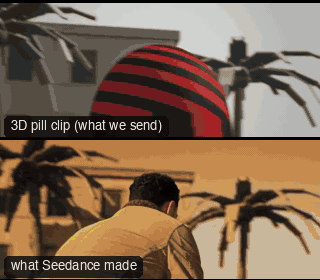

# FAM05-Bay360: Bay 360



Family: Famous shots.

**What it says.** They get up and the world turns round them: the heroes rise in slow motion against the sky while a low lens wheels from their backs to their faces.

**Use it for.** The beat after the blast or the chase, when the heroes stand to face what comes next; once per film.

**Camera numbers.** 85 mm, lens 0.3 m off the ground looking up 19 to 27°, on a 4.9 m circle of track passing 2.7 m from the heroes. 136° round them, from behind the right shoulder to front right, at a steady 17°/s for 8 s with no stop at either end. World clock 0.3 throughout: the near hero is up at 1.6 s, the far one at 3 s. The far hero stands 0.75 m ahead and left of the near one. The background crosses the frame at 0.6 widths a second.

**Avoid.** A wide lens or a lens at eye height: the heads must sit against sky with the background streaking behind them.

## The three.js code

This is an excerpt of the template (110 lines, from `engine/cinematic/src/templates/famous/f05-bay-360.ts`). `template.ts` in this folder is the same code with its imports. The helpers it calls (`make`, the actors, the rigs, the set and the post chain) are in `engine/cinematic/src`, so it does not run on its own: render it with `tools/render-pill.sh`.

```ts
// FAM05-Bay360
// Copied from engine/cinematic/src/templates/famous/f05-bay-360.ts (all of that file).
// The set builders, rigs and stand-ins it calls live in engine/cinematic/src and kit/.
// Render it: cd engine/cinematic && tools/render-pill.sh FAM05-Bay360
// FAM05-Bay360: the low circling hero shot. Two people come up from a crouch in slow motion while a long lens, a
// foot off the ground, wheels round them against the sky. Measured from a 6.75 s take of the shot in a supercut (and
// a 5.6 s single version beside it): the lens goes from behind the near hero's right shoulder to front right at about
// 17°/s without stopping, the second hero rises into frame from behind the first one's shoulder and ends nearer the
// lens and higher in frame, and the background crosses the frame at about 0.7 frame widths a second.
// Bearings are degrees round the heroes from straight in front of them (+z), toward their right (-x).
import * as THREE from "three";
import { speedRamp } from "../../kit/stage";
import type { Act } from "../../kit/actors";
import { GREY, clay, shadeAll } from "../../kit/clay";
import { building, dress, ground, lampPost } from "../../kit/props";
import { aimFor } from "../../framer";
import { clamp, ramp, rng } from "../../util";
import type { Cam } from "../../shots";
import type { Piece } from "../../piece";
import { makeProduct, V, type ActorSpec, type KitWorld } from "../products/shared";

const RAD = Math.PI / 180;
export const END = 8;

// ---------------- time: the whole take is slow motion ----------------
const SLOW = 0.3;                               // the stand-up clip takes 0.85 s; here it takes 2.8 s
const CLOCK = speedRamp([[0, SLOW], [END, SLOW]]);

// ---------------- the heroes ----------------
// Alex is nearer the lens at the start. Sam stands 0.75 m from him, ahead and to his left, on the line the lens looks
// along at bearing 150 (frame 0): he is behind Alex while he is still down and comes out to the right as he rises.
const SAM_AT: [number, number, number] = [0.375, 0, 0.65];
const C = V(SAM_AT[0] / 2, 0, SAM_AT[2] / 2);  // halfway between them: the point the lens wheels round
const GAZE: [number, number, number] = [-2.5, 14, 14];      // up and ahead, over the last camera position
/** Jump_Land's tail: the bottom of its crouch is 0.25 s in, standing 1.17 s in. `into` is how far in it is at frame 0;
 *  the clip is let go into the idle sway once the body is up. The clip hangs the head 50° down in the crouch, so the
 *  chin is held up until the body is nearly straight: the eyes stay on the gaze point all the way up */
const rise = (into: number): Act[] => [
  { kind: "clip", clip: "Jump_Land", t0: -into, t1: 1.35 - into, ease: 0.3 },
  { kind: "lookUp", t0: -5, t1: 1.2 - into, ease: 0.5 },
];
const hero = (id: string, name: string, tint: ActorSpec["tint"], at: [number, number, number], into: number): ActorSpec =>
  ({ id, name, kind: "human", tint, path: [{ t: 0, at, yaw: 0 }], acts: rise(into), look: GAZE, capsule: "trunk" });   // trunk: the two stand-ins must not merge
export const HEROES: ActorSpec[] = [hero("ALEX", "Alex", "ochre", [0, 0, 0], 0.6), hero("SAM", "Sam", "slate", SAM_AT, 0.25)];

// ---------------- the camera: a circle of track, the heroes standing off its centre ----------------
const MM = 85;
const LENS_Y = 0.3;                              // lens height off the ground
const BEARING0 = 150, DEG_PER_S = 17;            // 150 (behind Alex's right shoulder) to 14 (front right), never stopping
const TRACK = { radius: 4.9, off: 2.2, nearest: 80 };   // the rail passes 2.7 m from the heroes at bearing 80
const AIM = V(C.x, 1.62, C.z + 0.1);             // a fixed point between the two heads: the frame is set against it
// where AIM sits in frame (-1..1, + up and right). The tilt follows Alex up for 1.6 s, which leaves room under him for
// Sam to rise into, then eases back as the lens comes round to the front; Alex starts right of centre
const FRAME = { y0: 0.08, yLow: -0.35, y1: -0.06, x0: -0.1, x1: 0.12 };
export const bay360 = (t: number): Cam => {
  const b = (BEARING0 - DEG_PER_S * t) * RAD, d = b - TRACK.nearest * RAD;
  const r = -TRACK.off * Math.cos(d) + Math.sqrt(TRACK.radius ** 2 - (TRACK.off * Math.sin(d)) ** 2);
  const pos = V(C.x - Math.sin(b) * r, LENS_Y, C.z + Math.cos(b) * r);
  const ny = FRAME.yLow + (FRAME.y0 - FRAME.yLow) * (1 - clamp(t / 1.6)) ** 2 + (FRAME.y1 - FRAME.yLow) * ramp(t, 1.6, 5.4);
  const nx = FRAME.x0 + (FRAME.x1 - FRAME.x0) * ramp(t, 0.4, 4.2);
// ... (see template.ts for the rest)
```

## The videos

The stand-in in `pill.mp4` is the **capsule** (the single striped capsule of the first gallery clips). Render the other with `--standin pin`.

| What | File |
|---|---|
| The 3D pill clip, the reference video | `pill.mp4` |
| The contact sheet (sketch route) | `sketch-sheet.jpg` |
| What Seedance made from the pill clip (480p draft) | `release-media/FAM05-Bay360/result.mp4` (release asset) |
| What Seedance made from the contact sheet | `release-media/FAM05-Bay360/sketch-output.mp4` (release asset) |

## The prompt

One file per send. `sent.json` says, for each, whether it is the text that was sent, a recovered copy, or a rebuilt copy (`prompt.provenance`):

- `prompts/sketch.txt`
- `prompts/video-1.txt`
- `prompts/video-2.txt`

Keep the lines that say what the pills are and that the set is to be rebuilt as real. Change the person, the place and the light. These prompts come from the gallery runs and many predate the checks in `tools/seedance/`, so rebuild one with the gates before you reuse it.

## How it was sent

`sent.json` holds, for each send: the references in order with their roles, the settings, the credits and the outcome. Request ids are not kept; where one was known, a short hash is stored.

- **video #1**: 8 s, draft (480p preview), 21:9; references: @video1 = pill clip (the 3D blockout), @image1 = person photo (face reference); confirmed: yes; 1166.4 credits.
- **video #2**: 8 s, draft (480p preview), 21:9; references: @video1 = pill clip (the 3D blockout), @image1 = person photo (face reference); confirmed: yes.
- **sketch #1**: 8 s, draft (480p preview), 21:9; references: @image1 = person photo (face reference), @image2 = contact sheet of the pill (a few frames on one image); confirmed: yes; 977.6 credits.

See `reproduce.md` to render it and send it yourself.
