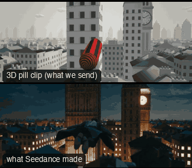

# FAM06-PeterPanFlight: Peter Pan flight



Family: Famous shots.

**What it says.** Flying, and the joy of it. They cross the city above the rooftops and the camera cannot keep still either: it circles them the whole way, behind, in front, over the top, while the roofs stream past.

**Use it for.** A character who can fly, a dream, an arrival over a city, the high point of a fantasy. One take: do not cut between the angles, and let the last two seconds on the face play out.

**Camera numbers.** 24 mm, one 16 s take at real speed. The flyer covers 243 m at 13.7 to 17.2 m/s: climbs from 26.5 to 38 m, weaves between two towers 5.5 and 6.8 m off, banks 45° round a clock tower on a 24 m radius, dips to 27.5 m (4.4 m over the roofs) and rises. The camera travels with them and goes round them one and a half times (531°), never faster than 51°/s: a chase from 4.3 m behind, side-on at 3 s, face to lens from 3.2 m at 5 s, 64° overhead from 6 m at 7.3 s, wide outside the bank from 8.5 to 9 m at 9 to 10 s with the clock face in frame, side-on again through the dip at 13 s, then ahead and low at 3.5 m for the last 1.5 s. The horizon tilts with the bank only, up to 11°.

**Avoid.** A flyer who hovers: the roofs must keep passing, or it reads as a wire rig. Stopping the orbit to hold an angle: the angles are passed through, not cut between.

## The three.js code

This is an excerpt of the template (362 lines, from `engine/cinematic/src/templates/famous/f06-peter-pan-flight.ts`). `template.ts` in this folder is the same code with its imports. The helpers it calls (`make`, the actors, the rigs, the set and the post chain) are in `engine/cinematic/src`, so it does not run on its own: render it with `tools/render-pill.sh`.

```ts
// FAM06-PeterPanFlight
// Copied from engine/cinematic/src/templates/famous/f06-peter-pan-flight.ts (all of that file).
// The set builders, rigs and stand-ins it calls live in engine/cinematic/src and kit/.
// Render it: cd engine/cinematic && tools/render-pill.sh FAM06-PeterPanFlight
// FAM06-PeterPanFlight: flying like Peter Pan over a city, measured from reference clips of the 2003 film's flight.
// One take, real speed. A person flies over the rooftops: a climb out, a weave between two towers, a banked turn
// round a clock tower by the river, a dip to the roofs and a rise. The camera never stops travelling with them and
// never stops going round them: a chase from behind, out to the side, round to the front, up over the top, down the
// other side to a wide chase through the bank, then round once more to end close on the face as they climb.
import * as THREE from "three";
import { getInputProps } from "remotion";
import { mergeGeometries } from "three/examples/jsm/utils/BufferGeometryUtils.js";
import { aimFor } from "../../framer";
import { GREY, clay } from "../../kit/clay";
import { building, ground } from "../../kit/props";
import type { Piece } from "../../piece";
import type { Cam } from "../../shots";
import { CAPSULE, stripes } from "../../standins";
import { rng } from "../../util";
import { V, makeProduct, type ActorSpec, type KitWorld, type PathKey } from "../products/shared";

const rad = THREE.MathUtils.degToRad;
const G = 9.81, MM = 24, T_END = 16;

// ---------------- curves: keys joined by straight lines, then smoothed, so nothing ever changes rate suddenly ----------------
const DT = 1 / 240, T0 = -3, T1 = T_END + 3, N = Math.round((T1 - T0) / DT) + 1;
/** a running mean over `w` seconds (the ends hold their value) */
function mean(a: Float64Array, w: number) {
  const k = Math.max(1, Math.round(w / DT / 2)), sum = new Float64Array(N + 1), out = new Float64Array(N);
  for (let i = 0; i < N; i++) sum[i + 1] = sum[i] + a[i];
  const S = (i: number) => (i <= 0 ? i * a[0] : i >= N ? sum[N] + (i - N) * a[N - 1] : sum[i]);
  for (let i = 0; i < N; i++) out[i] = (S(i + k + 1) - S(i - k)) / (2 * k + 1);
  return out;
}
const smoothed = (a: Float64Array, w: number) => mean(mean(mean(a, w / 3), w / 3), w / 3);
/** [time, value] keys as a table: straight lines between keys, smoothed over `w` seconds */
function soft(keys: [number, number][], w: number, scale = 1) {
  const a = new Float64Array(N);
  for (let i = 0, j = 0; i < N; i++) {
    const t = T0 + i * DT;
    while (j < keys.length - 2 && t > keys[j + 1][0]) j++;
    const [ta, va] = keys[j], [tb, vb] = keys[j + 1];
    a[i] = (va + (vb - va) * Math.min(1, Math.max(0, (t - ta) / (tb - ta)))) * scale;
  }
  return smoothed(a, w);
}
/** read a table at any time (a cubic through the four nearest samples) */
function at(a: Float64Array, t: number) {
  const u = Math.min(N - 2.001, Math.max(1, (t - T0) / DT)), i = Math.floor(u), f = u - i, p0 = a[i - 1], p1 = a[i], p2 = a[i + 1], p3 = a[i + 2];
  return 0.5 * (2 * p1 + (p2 - p0) * f + (2 * p0 - 5 * p1 + 4 * p2 - p3) * f * f + (3 * p1 - p0 - 3 * p2 + p3) * f * f * f);
}
type V3T = [Float64Array, Float64Array, Float64Array];
const at3 = (a: V3T, t: number) => V(at(a[0], t), at(a[1], t), at(a[2], t));

// ---------------- the flyer (seconds; a left turn is a rising heading) ----------------
// Heading: straight out, a weave right then left between the towers, then 156 degrees to the right round the clock tower.
const PSI = soft([[-3, 0], [1.2, 0], [2.0, -14], [2.5, -14], [3.4, 14], [4.8, 14], [6.2, 2], [10.5, -156], [19, -158]], 1.2, Math.PI / 180);
// Climb angle: up and out, level, a dip to the roofs, a rise.
const GAM = soft([[-3, 5], [0, 7], [0.8, 18], [2.2, 18], [3.4, 2], [5, 0], [7, 3], [9.5, -2], [10.8, -4], [11.4, -20], [12.6, -20], [13.5, 5], [14.3, 16], [19, 16]], 1.0, Math.PI / 180);
// Speed: a little slower climbing, a little faster in the dip.
// ... (see template.ts for the rest)
```

## The videos

The stand-in in `pill.mp4` is the **capsule** (the single striped capsule of the first gallery clips). Render the other with `--standin pin`.

| What | File |
|---|---|
| The 3D pill clip, the reference video | `pill.mp4` |
| The contact sheet (sketch route) | `sketch-sheet.jpg` |
| What Seedance made from the pill clip (480p draft) | `release-media/FAM06-PeterPanFlight/result.mp4` (release asset) |
| What Seedance made from the contact sheet | `release-media/FAM06-PeterPanFlight/sketch-output.mp4` (release asset) |

## The prompt

One file per send. `sent.json` says, for each, whether it is the text that was sent, a recovered copy, or a rebuilt copy (`prompt.provenance`):

- `prompts/sketch.txt`
- `prompts/video.txt`

Keep the lines that say what the pills are and that the set is to be rebuilt as real. Change the person, the place and the light. These prompts come from the gallery runs and many predate the checks in `tools/seedance/`, so rebuild one with the gates before you reuse it.

## How it was sent

`sent.json` holds, for each send: the references in order with their roles, the settings, the credits and the outcome. Request ids are not kept; where one was known, a short hash is stored.

- **video #1**: 16 s, draft (480p preview), 21:9; references: @video1 = pill clip (the 3D blockout), @image1 = person photo (face reference); confirmed: yes.
- **sketch #1**: 16 s, draft (480p preview), 21:9; references: @image1 = person photo (face reference), @image2 = contact sheet of the pill (a few frames on one image); confirmed: yes; 1955.2 credits.

See `reproduce.md` to render it and send it yourself.
