# All templates

Every template with its pill clip, what it says and a preview. Click an id for its folder: the three.js code, the prompts, the references and the result.

| | Template | What it says |
|---|---|---|
| 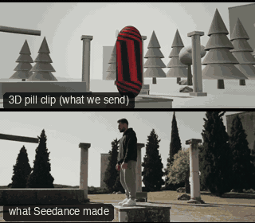 | [ACT01-BulletTimeOrbit: Bullet-time orbit](ACT01-BulletTimeOrbit/) | Time stops for this one moment: we walk round it while the world hangs. |
| 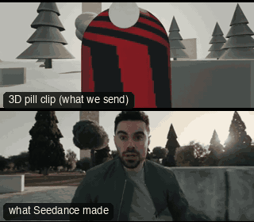 | [ACT02-Snorricam: Snorricam](ACT02-Snorricam/) | We are strapped to them: they hold still and the world lurches; panic, flight, a body out of control. |
| 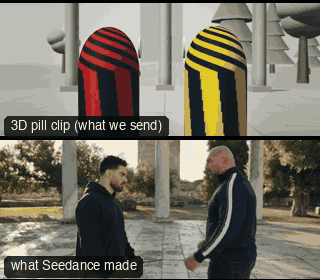 | [ACT03-CrashZoomFight: Crash zoom and whip (fight)](ACT03-CrashZoomFight/) | That one landed: the zoom slams in on the hit and the whip throws us after the body. |
| 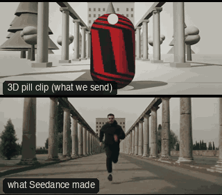 | [ACT04-SprintDollyZoom: Sprint dolly zoom](ACT04-SprintDollyZoom/) | They run and the world chases them: the far end looms closer the harder they run. |
| 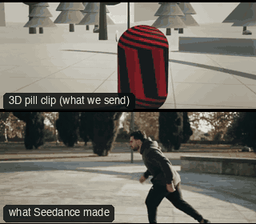 | [ACT05-ParkourTrack: Parkour track](ACT05-ParkourTrack/) | We run with them and see the whole body solve the obstacle: skill, speed, flow. |
| 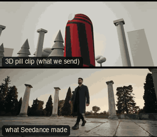 | [ACT06-HeroLowArc: Hero low arc](ACT06-HeroLowArc/) | Here they come: bigger than life, and time bends round them. |
| 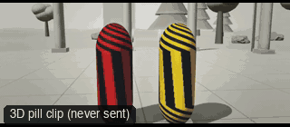 | [ACT07-FightCoverage: Fight coverage](ACT07-FightCoverage/) | Who hits whom, in order: a wide for the geography, then closer as the fight decides itself. |
| 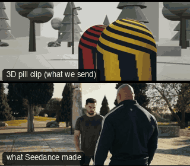 | [ACT08-FallDrop: Fall drop](ACT08-FallDrop/) | We go down with them: the floor comes up, and the one left standing towers. |
| 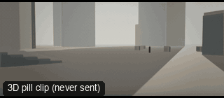 | [ANG01-ExtremeWide: Extreme wide shot](ANG01-ExtremeWide/) | The place is the subject, and the person is small inside it. |
| 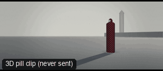 | [ANG02-Wide: Wide shot](ANG02-Wide/) | Who they are, and where they are. |
| 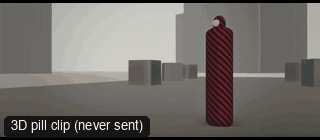 | [ANG03-Full: Full shot](ANG03-Full/) | The whole body, head to toe: how they stand, how they carry themselves. |
| 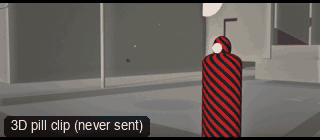 | [ANG04-Cowboy: Cowboy shot (medium wide)](ANG04-Cowboy/) | From the thigh up: the hands and the face are both in play. |
| 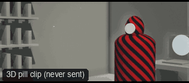 | [ANG05-Medium: Medium shot](ANG05-Medium/) | The default: person and surroundings in balance. |
| 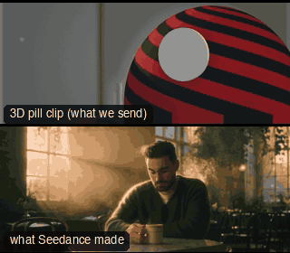 | [ANG06-MediumCloseUp: Medium close-up](ANG06-MediumCloseUp/) | Close enough to read the face, far enough to keep the body language. |
| 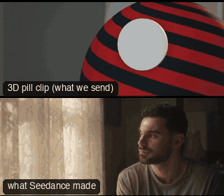 | [ANG07-CloseUp: Close-up](ANG07-CloseUp/) | Nothing but the face: this is what they feel. |
| 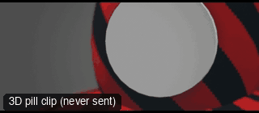 | [ANG08-ExtremeCloseUp: Extreme close-up](ANG08-ExtremeCloseUp/) | A detail so near it becomes the whole story: the eyes, a lip, a twitch. |
| 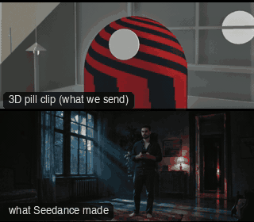 | [ANG10-EyeLevel: Eye level](ANG10-EyeLevel/) | Neutral: we stand where they stand and judge nothing. |
| 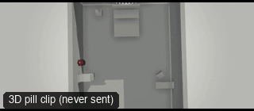 | [ANG11-BirdsEye: Bird's-eye (straight down)](ANG11-BirdsEye/) | We are above it all, looking straight down at someone crossing the ground. |
| 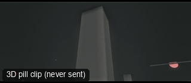 | [ANG12-WormsEye: Worm's-eye (ground level)](ANG12-WormsEye/) | The camera lies on the ground and the person towers over it. |
| 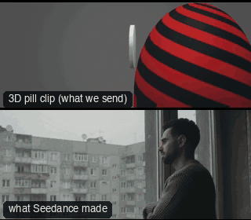 | [ANG13-Profile: Profile](ANG13-Profile/) | Seen from the side: a person in thought, in line with something else. |
| 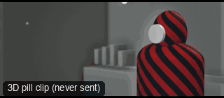 | [ANG14-ThreeQuarter: Three-quarter](ANG14-ThreeQuarter/) | The most flattering view of a face: it has depth and still looks at us. |
| 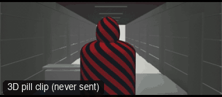 | [ANG15-FromBehind: From behind](ANG15-FromBehind/) | We stay behind them, facing what they face. |
| 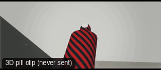 | [ANG16-DutchLow: Dutch and low](ANG16-DutchLow/) | The room is crooked and they loom: a threat who is off balance too. |
| 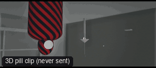 | [ANG17-UpsideDown: Upside-down](ANG17-UpsideDown/) | The world has flipped, and so has the person in it. |
| 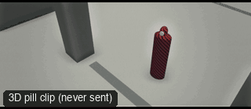 | [ANG18-TwoThirdsHigh: High angle (looking down)](ANG18-TwoThirdsHigh/) | We look down on them: small, watched, caught. |
| 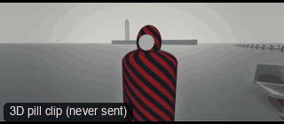 | [ANG20-SuperWide: Super wide (14 mm)](ANG20-SuperWide/) | The lens pushes the space away from the centre and makes near things huge. |
| 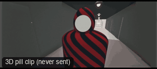 | [ANG21-UltraWideCloseUp: Ultra wide close-up (10 mm)](ANG21-UltraWideCloseUp/) | A face that is too close: grotesque, funny, frightening. |
| 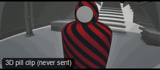 | [ANG22-Fisheye: Fisheye (8 mm)](ANG22-Fisheye/) | The whole world bends round the person at the centre. |
| 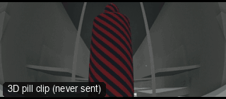 | [ANG23-FisheyeLow: Fisheye low (skate-cam)](ANG23-FisheyeLow/) | The ground rushes past and the person walks above it. |
| 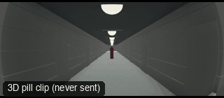 | [ANG24-Peephole: Peephole](ANG24-Peephole/) | We are on the other side of the door, watching someone arrive. |
| 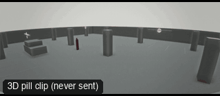 | [ANG25-SecurityCam: Security camera](ANG25-SecurityCam/) | Nobody is meant to see this: a camera in a corner, a person who thinks they are alone. |
| 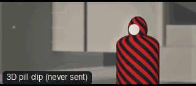 | [ANG26-LongLens: Long lens (135 mm)](ANG26-LongLens/) | Far away, and flattened: the person and the background are glued together. |
| 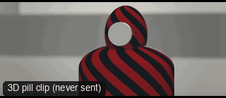 | [ANG27-TelephotoCloseUp: Telephoto close-up (200 mm)](ANG27-TelephotoCloseUp/) | Watched from a long way off: a stranger who does not know we are there. |
| 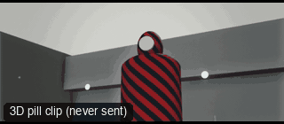 | [ANG30-HipLevel: Hip level](ANG30-HipLevel/) | The camera sits where the hands are: something is about to be drawn. |
| 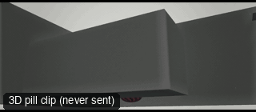 | [ANG31-KneeLevel: Knee level](ANG31-KneeLevel/) | Low and close to the floor: a creeping, watchful or comic point of view. |
| 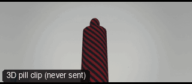 | [ANG32-GroundLevelWalk: Ground level walk](ANG32-GroundLevelWalk/) | We see where they are going by their feet, and nothing of their face. |
| 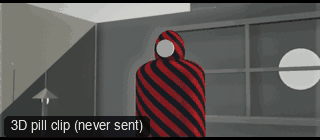 | [ANG33-ShoulderLevel: Shoulder level](ANG33-ShoulderLevel/) | A natural, reportage height: slightly below the eyes, so the person is a little taller than us. |
| 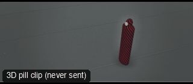 | [ANG34-HighThreeQuarter: High three-quarter](ANG34-HighThreeQuarter/) | We look down on them from above and to one side: small, but still a person, not a symbol. |
| 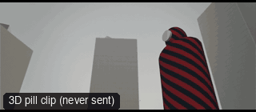 | [ANG35-LowThreeQuarter: Low three-quarter](ANG35-LowThreeQuarter/) | They rise above us at an angle, and the sky is behind them. |
| 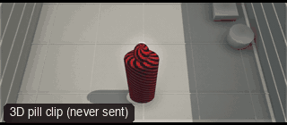 | [ANG36-OverTheHead: Over the head](ANG36-OverTheHead/) | We are behind and above them, looking down past their head at what they face. |
| 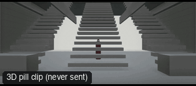 | [ANG37-Symmetrical: Symmetrical shot](ANG37-Symmetrical/) | Everything is balanced round the person in the middle: calm, ceremony, a trap. |
| 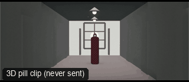 | [ANG38-FramedShot: Frame within a frame](ANG38-FramedShot/) | The person is held inside something else: a doorway, a gap, a pair of columns. |
| 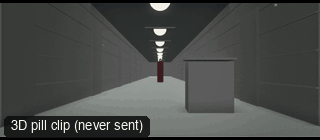 | [ANG39-LeadingLines: Leading lines](ANG39-LeadingLines/) | Every line in the ground runs to one person. |
| 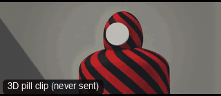 | [ANG40-SlightLowCloseUp: Slight low-angle close-up](ANG40-SlightLowCloseUp/) | We look up at a face a little: sure of itself, or looking at something above us. |
| 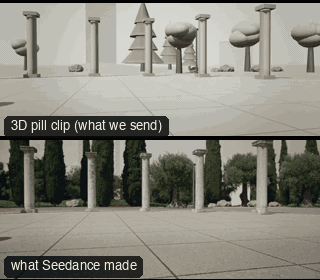 | [CAM01-LockedOff: Locked-off](CAM01-LockedOff/) | Observation. The world moves, the camera does not judge it. |
| 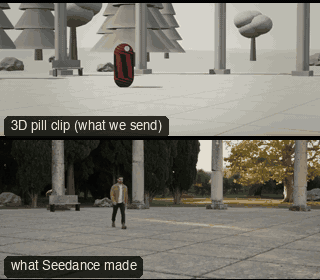 | [CAM02-PanWith: Pan with](CAM02-PanWith/) | We are standing in the world, turning our head to follow someone. |
| 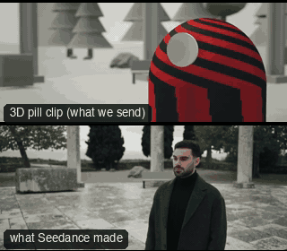 | [CAM03-PushIn: Push in](CAM03-PushIn/) | Something is dawning on them. We lean in with the thought. |
| 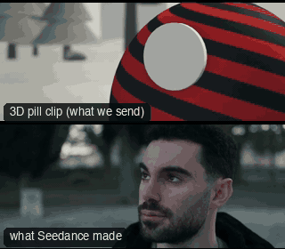 | [CAM04-PullOutReveal: Pull out (reveal)](CAM04-PullOutReveal/) | We discover where they are, and how small they are in it. |
| 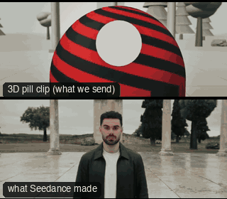 | [CAM05-DollyZoom: Dolly zoom](CAM05-DollyZoom/) | The ground shifts under them: dread, vertigo, a realisation that changes everything. |
| 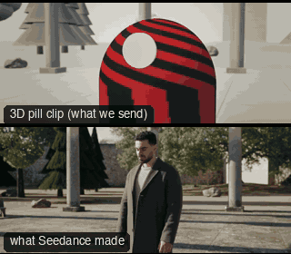 | [CAM06-Orbit: Orbit](CAM06-Orbit/) | Everything turns around this person: a standoff, a decision, a hero moment. |
|  | [CAM07-CraneUp: Crane up](CAM07-CraneUp/) | Release: we rise above them and see what they are heading into. |
|  | [CAM08-CraneDown: Crane down (arrival)](CAM08-CraneDown/) | We arrive in the world from above and come down to meet the person in it. |
|  | [CAM09-SteadicamFollow: Steadicam follow](CAM09-SteadicamFollow/) | We go with them, into their world, sharing their point of view. |
|  | [CAM10-SteadicamLead: Steadicam lead](CAM10-SteadicamLead/) | They are coming at us: purpose, confrontation, a walk-and-talk. |
|  | [CAM11-TrackingSide: Tracking alongside](CAM11-TrackingSide/) | We travel with them as an equal; the world streams past behind. |
|  | [CAM12-OTSPair: Over the shoulder (pair)](CAM12-OTSPair/) | A conversation: whose turn it is, who holds the power. |
|  | [CAM13-WhipPan: Whip pan](CAM13-WhipPan/) | Sudden attention: something pulls our eyes, or one thought snaps to another. |
|  | [CAM14-Handheld: Handheld](CAM14-Handheld/) | We are there, unsteady with them: urgency, nerves, documentary truth. |
|  | [CAM15-ChaseDrone: Chase drone](CAM15-ChaseDrone/) | Speed and freedom: we fly with them. |
|  | [CAM16-FPV: FPV drone](CAM16-FPV/) | Raw speed, danger, a body moving fast through space. |
|  | [CAM17-SlowZoomIn: Slow zoom in](CAM17-SlowZoomIn/) | Something is closing in on them, and they do not know it. |
|  | [CAM18-SlowZoomOut: Slow zoom out](CAM18-SlowZoomOut/) | We pull back from the thought and see the room it happens in. |
|  | [CAM19-TiltUp: Tilt up](CAM19-TiltUp/) | We meet them from the ground up: boots, body, then the face. |
|  | [CAM20-TiltDown: Tilt down](CAM20-TiltDown/) | We start on the face and are taken down to what they are standing on, or holding. |
|  | [CAM21-PanReveal: Pan reveal](CAM21-PanReveal/) | We look away from the person, and the turn of the camera brings them in. |
|  | [CAM22-PedestalUp: Pedestal up](CAM22-PedestalUp/) | We rise gently to meet their eyes, or to look down on what they have done. |
|  | [CAM23-PedestalDown: Pedestal down](CAM23-PedestalDown/) | We drop from above their eyes to meet them, or to sit beneath their weight. |
|  | [CAM24-ShortArc: Short arc](CAM24-ShortArc/) | We swing a little way round them to see who they really are facing. |
|  | [CAM25-ArcAndRise: Arc and rise](CAM25-ArcAndRise/) | We circle them and lift away at once: a moment growing into a landscape. |
|  | [CAM26-DutchAngle: Dutch angle](CAM26-DutchAngle/) | The world is tilted, and so is whoever is in it. |
|  | [CAM27-DutchPush: Dutch push-in](CAM27-DutchPush/) | The tilt grows as we close in: something is going wrong in their head. |
|  | [CAM28-BarrelRoll: Barrel roll](CAM28-BarrelRoll/) | The whole world turns over around them. |
|  | [CAM29-LowAngleHero: Low angle (power shot)](CAM29-LowAngleHero/) | They are bigger than the room: strength, threat, a hero. |
|  | [CAM30-HighAngle: High angle](CAM30-HighAngle/) | They are small, watched, or about to be caught. |
|  | [CAM31-OverheadRise: Overhead rise](CAM31-OverheadRise/) | We lift off them and look straight down at where they stand. |
|  | [CAM32-RunAndGun: Run and gun](CAM32-RunAndGun/) | We are running with them, and the camera is not steady either. |
|  | [CAM33-POVWalk: POV walk](CAM33-POVWalk/) | We are them: we see only what they see. |
|  | [CAM34-POVLookAround: POV look around](CAM34-POVLookAround/) | Someone standing still turns their head, and we turn with it. |
|  | [CAM35-OTSPushIn: Over the shoulder push-in](CAM35-OTSPushIn/) | The listener is shut out, and we move in on the one who speaks. |
|  | [CAM36-TwoShotTruck: Two-shot truck](CAM36-TwoShotTruck/) | We slide along the space between two people and see who is closer. |
|  | [CAM37-SliderPortrait: Slider on the face](CAM37-SliderPortrait/) | A small, slow slide across a face: the thought moving behind the eyes. |
|  | [CAM38-PushToCloseUp: Push to the close-up](CAM38-PushToCloseUp/) | We go in until nothing is left but the face. |
|  | [CAM39-WhipTilt: Whip tilt](CAM39-WhipTilt/) | The eye is dragged up and away: a thought snapping to somewhere else. |
|  | [CAM40-ReverseDollyZoom: Reverse dolly zoom](CAM40-ReverseDollyZoom/) | The room opens up behind them while they stay the same size: the world is leaving. |
|  | [CAM41-DroneOrbitHigh: Drone orbit (high)](CAM41-DroneOrbitHigh/) | We circle above the place and the person is where everything meets. |
|  | [CAM42-DroneDive: Drone dive](CAM42-DroneDive/) | We fall out of the sky onto them. |
|  | [CAM43-DroneRevealOverTerrace: Drone reveal](CAM43-DroneRevealOverTerrace/) | We rise over the edge of something and the place is revealed. |
|  | [CAM44-DroneRiseUp: Drone rise up](CAM44-DroneRiseUp/) | We lift straight up off the spot and see how small it all is. |
|  | [CAM45-LowFollow: Low follow](CAM45-LowFollow/) | We follow at the height of their feet: weight, pace, intent. |
|  | [CAM46-RackBetweenPeople: Rack focus (people)](CAM46-RackBetweenPeople/) | Who is listening, and who is the one who matters now. |
|  | [CAM47-HandheldPushIn: Handheld push-in](CAM47-HandheldPushIn/) | We lean in with a shaking body: fear, a secret, something we should not see. |
|  | [CAM48-OrbitWalk: Orbit a walker](CAM48-OrbitWalk/) | They walk, and the whole world swings round them as they go. |
|  | [FAM01-Booth360: 360 booth spin](FAM01-Booth360/) | The 360 party booth: the camera swings round them at arm's length, time drops to slow motion while they hang in a jump, then it comes round again and slows on the face. |
|  | [FAM02-ExplosionWalk: Walk away from the explosion](FAM02-ExplosionWalk/) | Nothing behind them is worth a look: the hero walks at us, the world goes up, and they do not turn. |
|  | [FAM03-TrunkShot: Trunk shot](FAM03-TrunkShot/) | We are the thing in the boot. The lid lifts, daylight comes in, and three people stand over us looking down into the lens. |
|  | [FAM04-LeapOfFaith: Leap of faith](FAM04-LeapOfFaith/) | A jump there is no taking back. They dive off a tower and drop at full speed; the camera dives after them and the world turns over. Time stretches only on the frame where the fall becomes a rise: the city hangs from the top of the picture and they float up through it. Then we close on their face, still falling. |
|  | [FAM05-Bay360: Bay 360](FAM05-Bay360/) | They get up and the world turns round them: the heroes rise in slow motion against the sky while a low lens wheels from their backs to their faces. |
|  | [FAM06-PeterPanFlight: Peter Pan flight](FAM06-PeterPanFlight/) | Flying, and the joy of it. They cross the city above the rooftops and the camera cannot keep still either: it circles them the whole way, behind, in front, over the top, while the roofs stream past. |
|  | [OBJ01-PushInObject: Push in on an object](OBJ01-PushInObject/) | This thing matters: the clue, the weapon, the letter. |
|  | [OBJ02-OrbitHero: Hero orbit (object)](OBJ02-OrbitHero/) | Admire it: the reveal of a hero vehicle, a product, a prize. |
|  | [OBJ03-CraneUpStatue: Crane up a monument](OBJ03-CraneUpStatue/) | Scale and awe: we rise with it to see how big it is, and what it watches over. |
|  | [OBJ04-TruckPastParallax: Truck past (parallax)](OBJ04-TruckPastParallax/) | Depth and travel: the world is layered, and we are moving through it. |
|  | [OBJ05-TrackingCarLow: Low tracking (vehicle)](OBJ05-TrackingCarLow/) | Speed and power: low to the ground, matched to it, the road streaming past. |
|  | [OBJ06-TopDown: Top-down (god's eye)](OBJ06-TopDown/) | Pattern and fate: we look down like a map; the people below are pieces. |
|  | [OBJ07-RackFocus: Rack focus](OBJ07-RackFocus/) | Look here, now there: the lens moves our attention without the camera moving. |
|  | [OBJ08-WipeReveal: Wipe reveal](OBJ08-WipeReveal/) | A curtain opens: something near the lens passes and the subject is there. |
|  | [OBJ09-ThroughDoorway: Through a doorway](OBJ09-ThroughDoorway/) | Crossing a threshold: we enter their world, their room, their story. |
|  | [OBJ10-CrashZoom: Crash zoom](OBJ10-CrashZoom/) | Shock or punchline: the lens slams in on the thing that matters. |
|  | [OBJ11-TiltUpTall: Tilt up (height reveal)](OBJ11-TiltUpTall/) | How tall it is: from the base, we look up and up. |
|  | [OBJ12-FlybyPan: Flyby pan](OBJ12-FlybyPan/) | It roars past us: speed, scale, a near miss. |
|  | [OBJ13-MacroSlider: Macro slider](OBJ13-MacroSlider/) | Look closely: a small thing, made precious by the time we take over it. |
|  | [OBJ14-FlyThroughWindow: Fly through a window](OBJ14-FlyThroughWindow/) | We cross from outside to in without a cut: the threshold is the moment. |
|  | [OBJ15-TopDownSpiral: Top-down spiral](OBJ15-TopDownSpiral/) | From a map to a monument: we come down out of the sky and around, and it rises to meet us. |
|  | [OBJ16-ProductSpin: Product spin](OBJ16-ProductSpin/) | Look at it from every side, fast, then let it settle: this is the one. |
|  | [ONE01-CraneToFollowWhip: Crane to follow, whip reveal](ONE01-CraneToFollowWhip/) | We arrive from above, fall in with them, and turn to see what they are walking toward. |
|  | [ONE02-DroneDiveChase: Drone dive into a chase](ONE02-DroneDiveChase/) | From far above, the world; then we drop out of the sky and ride with them; then we let them go. |
|  | [ONE03-InteriorOner: Interior oner](ONE03-InteriorOner/) | We walk the space with them, in real time: no cuts, so nothing is hidden and nobody can leave. |
|  | [ONE04-OrbitPushRack: Orbit, push, rack](ONE04-OrbitPushRack/) | We circle a conversation, then close in on her over his shoulder, and when he looks away the focus leaves her for him. |
|  | [PRD01-FrozenSplashOrbit: Frozen splash orbit](PRD01-FrozenSplashOrbit/) | A bottle or can drops onto a wet table, time stops on the splash, the camera circles it 270 degrees at its own height, then time resumes. |
|  | [PRD02-RobotArmSnap: Robot-arm snap](PRD02-RobotArmSnap/) | Three angles on three beats: the camera crosses the studio in under a second, stops dead on the product, then snaps twice more. |
|  | [PRD03-ExplodedBuild: Exploded build](PRD03-ExplodedBuild/) | It is made of parts and every part has its place: we go through the middle of it, and it closes into one thing behind us. |
|  | [PRD04-ProbeFlyThrough: Probe fly-through](PRD04-ProbeFlyThrough/) | We are small enough to fly through what it is made of: the ingredients are a landscape, and the product is where it leads. |
|  | [PRD05-SkylineDive: Skyline dive](PRD05-SkylineDive/) | The whole city narrows to one object: from the skyline to a table in one breath, and the product is where it lands. |
|  | [PRD06-Glambot: Glambot](PRD06-Glambot/) | The red-carpet robot shot: the lens drops in on a pose and time falls into slow motion as it arrives, so the move never stops. |
|  | [SC01-ForestClearing: Forest clearing](SC01-ForestClearing/) | A person arrives somewhere and finds something. |
|  | [SC02-InteriorDialogue: Interior dialogue](SC02-InteriorDialogue/) | Two people talk; the camera tells us whose moment it is. |
|  | [SC03-StreetWalkTalk: Street walk-and-talk](SC03-StreetWalkTalk/) | Two people on the move, talking; the city carries on around them. |
|  | [SC04-CarInterior: Car interior](SC04-CarInterior/) | Two people trapped together in motion: intimacy, tension, a confession. |
|  | [SC05-SpaceFlyby: Space flyby](SC05-SpaceFlyby/) | Scale and speed: a small ship against an enormous world. |
|  | [SC06-RooftopChase: Rooftop chase](SC06-RooftopChase/) | One gets away, one is left at the edge: the gap between two roofs is the story. |
|  | [SC07-AlleyFight: Alley fight](SC07-AlleyFight/) | Who hits whom, and what it costs: the crates behind him are shown before he goes into them. |
|  | [SC08-HeistApproach: Heist approach](SC08-HeistApproach/) | Getting in unseen: the wall, the walk, the door, and the one who keeps watch. |
|  | [SC09-StandoffDebris: Stand-off](SC09-StandoffDebris/) | Two people, one street, a wait; it ends in one shot that hits what we were shown at the start. |
|  | [SC10-CarCrashBarrier: Car through the barrier](SC10-CarCrashBarrier/) | Something unstoppable meets something in its way; someone watches it happen from just far enough away. |
|  | [SHOW01-TheHandoff: The Handoff](SHOW01-TheHandoff/) | A whole 30 second scene built from the template moves: ten shots, two people, a case, a drone and a chase, planned as pills and drawn as a storyboard before anything real was made. |
|  | [STORY02-DiveToShutter: Dive to the shutter](STORY02-DiveToShutter/) | From the sky onto a man who can barely walk, across a dead place, to one spot where he turns a key. |
|  | [STORY03-TheGap: Dive to the shutter](STORY03-TheGap/) | From the sky onto a man who can barely walk, across a dead place, to one spot where he turns a key. |
