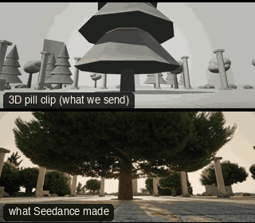

# OBJ11-TiltUpTall: Tilt up (height reveal)



Family: Camera moves on objects.

**What it says.** How tall it is: from the base, we look up and up.

**Use it for.** Trees, towers, giants, buildings; the first sight of something huge.

**Camera numbers.** 18 mm from low near the base, tilting up about 45° over 8–9 s, eased (slow enough not to judder at 24 fps).

**Avoid.** Tilting past the top into empty sky; land on the top.

## The three.js code

This is an excerpt of the template (3 lines, from `engine/cinematic/src/templates/objects.ts`). `template.ts` in this folder is the same code with its imports. The helpers it calls (`make`, the actors, the rigs, the set and the post chain) are in `engine/cinematic/src`, so it does not run on its own: render it with `tools/render-pill.sh`.

```ts
import * as THREE from "three";
import { planner, scenePiece, type SceneSpec, type ShotDef } from "../kit/stage";
import type { ActorSpec } from "../kit/actors";
import { lag, rig } from "../kit/rigs";
import { aimFor } from "../framer";
import { ramp, smoother } from "../util";
import { buildLab } from "./lab";
import type { Piece } from "../piece";
import { CAMERA_INFO, type TemplateInfo } from "./cameras";

make({ id: "OBJ11-TiltUpTall", name: "Tilt up (height reveal)", says: "How tall it is: from the base, we look up and up.", use: "Trees, towers, giants, buildings; the first sight of something huge.", numbers: "18 mm from low near the base, tilting up about 45° over 8–9 s, eased (slow enough not to judder at 24 fps).", avoid: "Tilting past the top into empty sky; land on the top." },
    [prop("TREE", "Pine", "pine", [0, 0], 0, "sage")],
    () => [{ start: 0, end: 9, label: "18mm  TILT UP · BASE TO TOP", rig: "TRIPOD · FLUID HEAD", subject: "TREE", size: "CU", stop: 5.6, cam: rig.tiltReveal(V(0.5, 0.5, 11), V(0, 3.2, 0), V(0, 11, 0), 18, 0, 9), cut: "Opens the template", flags: ["centre"] }]),
```

**Make it yours.** Change rig: `rig.tiltReveal`; shot size: CU. The actor `path` entries say where the pill stands and walks, and the numbers after `rig.` set the move (distance, angle, rise, start and end time).

## The videos

The stand-in in `pill.mp4` is the **capsule** (the single striped capsule of the first gallery clips). Render the other with `--standin pin`.

| What | File |
|---|---|
| The 3D pill clip, the reference video (a re-render: the clip that was uploaded was not kept) | `pill.mp4` |
| What Seedance made from the pill clip (480p draft) | `release-media/OBJ11-TiltUpTall/result.mp4` (release asset) |

## The prompt

One file per send. `sent.json` says, for each, whether it is the text that was sent, a recovered copy, or a rebuilt copy (`prompt.provenance`):

- `prompts/video.txt`

Keep the lines that say what the pills are and that the set is to be rebuilt as real. Change the person, the place and the light. These prompts come from the gallery runs and many predate the checks in `tools/seedance/`, so rebuild one with the gates before you reuse it.

## How it was sent

`sent.json` holds, for each send: the references in order with their roles, the settings, the credits and the outcome. Request ids are not kept; where one was known, a short hash is stored.

- **video #1**: 9 s, draft (480p preview), 21:9; references: @video1 = pill clip (the 3D blockout); confirmed: yes; 1312.2 credits.

See `reproduce.md` to render it and send it yourself.
