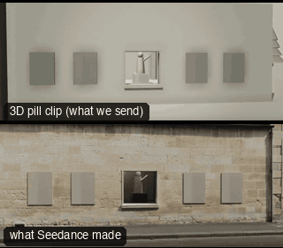

# OBJ14-FlyThroughWindow: Fly through a window



Family: Camera moves on objects.

**What it says.** We cross from outside to in without a cut: the threshold is the moment.

**Use it for.** Entering a building, a reveal of what is inside, a transition from a public space to a private one.

**Camera numbers.** 24 mm, one keyed drone path of 13.6 m over 6 s, descending 0.6 m; the window frame (2 × 2 m) passes within 0.9 m of the lens at the move's fastest point, then the move settles on the statue.

**Avoid.** Slowing in the opening: the frame edge sells the crossing only at speed.

## The three.js code

This is an excerpt of the template (13 lines, from `engine/cinematic/src/templates/oners.ts`). `template.ts` in this folder is the same code with its imports. The helpers it calls (`make`, the actors, the rigs, the set and the post chain) are in `engine/cinematic/src`, so it does not run on its own: render it with `tools/render-pill.sh`.

```ts
import * as THREE from "three";
import { planner, scenePiece, type KitWorld, type SceneSpec, type ShotDef } from "../kit/stage";
import type { ActorSpec, PathKey } from "../kit/actors";
import { GREY, clay, shadeAll } from "../kit/clay";
import { framed, lag, rig, type Subj } from "../kit/rigs";
import { aimFor } from "../framer";
import { barrel, bench, broadTree, building, crate, floorLamp, ground, lampPost, pine, rock, scatter, shelf, sofa, table } from "../kit/props";
import { buildLab } from "./lab";
import { lerp, ramp, rng, smooth, smoother } from "../util";
import type { Marks } from "../marks";
import type { Piece } from "../piece";
import type { Cam } from "../shots";
import { CAMERA_INFO, type TemplateInfo } from "./cameras";

make({ id: "OBJ14-FlyThroughWindow", name: "Fly through a window", says: "We cross from outside to in without a cut: the threshold is the moment.", use: "Entering a building, a reveal of what is inside, a transition from a public space to a private one.", numbers: "24 mm, one keyed drone path of 13.6 m over 6 s, descending 0.6 m; the window frame (2 × 2 m) passes within 0.9 m of the lens at the move's fastest point, then the move settles on the statue.", avoid: "Slowing in the opening: the frame edge sells the crossing only at speed." },
    { sky: "day", build: buildGallery, keyDir: [-0.35, 0.86, 0.38], motes: { center: [0, 2.5, -2], size: [18, 5, 26], count: 220 } },
    [prop("STATUE", "Statue", "statue", [0.6, -8], 0.15, "sand")],
    (P) => {
      const S = P("STATUE");
      const win = V(0, 2.1, 0);
      return [{ start: 0, end: 7, label: "24mm  FLY THROUGH WINDOW", rig: "FPV DRONE · CINEWHOOP", subject: "STATUE", size: "WS", sizeEnd: "FS", stop: 4,
        cam: evenSpline([
          { t: 0.3, pos: V(-1.05, 2.65, 11), look: (t) => win.clone().lerp(S(t).eye, 0.35), mm: 24 },
          { t: 6.3, pos: V(0.25, 2.0, -2.6), look: (t) => S(t).eye.clone().add(V(0, -0.7, 0)), mm: 24 },
        ]),
        cut: "Opens the template", flags: ["centre", "wipe"] }];
    }),
```

**Make it yours.** Change lens: 24 mm; shot size: WS. The actor `path` entries say where the pill stands and walks, and the numbers after `rig.` set the move (distance, angle, rise, start and end time).

## The videos

The stand-in in `pill.mp4` is the **capsule** (the single striped capsule of the first gallery clips). Render the other with `--standin pin`.

| What | File |
|---|---|
| The 3D pill clip, the reference video | `pill.mp4` |
| What Seedance made from the pill clip (480p draft) | `release-media/OBJ14-FlyThroughWindow/result.mp4` (release asset) |

## The prompt

One file per send. `sent.json` says, for each, whether it is the text that was sent, a recovered copy, or a rebuilt copy (`prompt.provenance`):

- `prompts/video.txt`

Keep the lines that say what the pills are and that the set is to be rebuilt as real. Change the person, the place and the light. These prompts come from the gallery runs and many predate the checks in `tools/seedance/`, so rebuild one with the gates before you reuse it.

## How it was sent

`sent.json` holds, for each send: the references in order with their roles, the settings, the credits and the outcome. Request ids are not kept; where one was known, a short hash is stored.

- **video #1**: 7 s, draft (480p preview), 21:9; references: @video1 = pill clip (the 3D blockout); confirmed: yes; 1020.6 credits.

See `reproduce.md` to render it and send it yourself.
