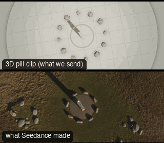

# OBJ15-TopDownSpiral: Top-down spiral



Family: Camera moves on objects.

**What it says.** From a map to a monument: we come down out of the sky and around, and it rises to meet us.

**Use it for.** Arrivals at a landmark, an object of worship or dread; the end of a search.

**Camera numbers.** 24 → 20 mm. From straight down at 16 m, a 270° spiral that descends to 0.3 m and widens to 4.6 m over 6.8 s on an S-curve; the tilt goes from 90° down to about 17° up, ending low under the stone, base to top, against open sky. Held 0.6 s at each end.

**Avoid.** Spinning so fast the ground smears: the rotation eases out with the descent.

## The three.js code

This is an excerpt of the template (15 lines, from `engine/cinematic/src/templates/oners.ts`). `template.ts` in this folder is the same code with its imports. The helpers it calls (`make`, the actors, the rigs, the set and the post chain) are in `engine/cinematic/src`, so it does not run on its own: render it with `tools/render-pill.sh`.

```ts
import * as THREE from "three";
import { planner, scenePiece, type KitWorld, type SceneSpec, type ShotDef } from "../kit/stage";
import type { ActorSpec, PathKey } from "../kit/actors";
import { GREY, clay, shadeAll } from "../kit/clay";
import { framed, lag, rig, type Subj } from "../kit/rigs";
import { aimFor } from "../framer";
import { barrel, bench, broadTree, building, crate, floorLamp, ground, lampPost, pine, rock, scatter, shelf, sofa, table } from "../kit/props";
import { buildLab } from "./lab";
import { lerp, ramp, rng, smooth, smoother } from "../util";
import type { Marks } from "../marks";
import type { Piece } from "../piece";
import type { Cam } from "../shots";
import { CAMERA_INFO, type TemplateInfo } from "./cameras";

make({ id: "OBJ15-TopDownSpiral", name: "Top-down spiral", says: "From a map to a monument: we come down out of the sky and around, and it rises to meet us.", use: "Arrivals at a landmark, an object of worship or dread; the end of a search.", numbers: "24 → 20 mm. From straight down at 16 m, a 270° spiral that descends to 0.3 m and widens to 4.6 m over 6.8 s on an S-curve; the tilt goes from 90° down to about 17° up, ending low under the stone, base to top, against open sky. Held 0.6 s at each end.", avoid: "Spinning so fast the ground smears: the rotation eases out with the descent." },
    { ...LAB, build: buildCircle, keyDir: [-0.5, 0.8, 0.35] },
    [prop("MONO", "Monolith", "monolith", [0, 0], 0.4, "plum")],
    (P) => {
      const M = P("MONO");
      const cam = (t: number) => {
        const k = smooth((t - 0.6) / 6.8), m = M(t);
        // the azimuth lands north of the stone, looking south through the gap in the colonnade
        const a = Math.PI * 0.95 - lerp(1.5 * Math.PI, 0, k), r = lerp(0.25, 4.6, Math.pow(k, 1.4)), h = lerp(16, 0.32, Math.pow(k, 0.75));
        const pos = V(Math.sin(a) * r, h, Math.cos(a) * r);
        const aim = m.top.clone().lerp(m.eye, k);
        return { pos, target: aimFor(pos, aim, lerp(24, 20, k), [0, 0]), mm: lerp(24, 20, k) };
      };
      return [{ start: 0, end: 8, label: "24>20mm  TOP-DOWN SPIRAL", rig: "TECHNOCRANE · REMOTE HEAD", subject: "MONO", size: "WS", sizeEnd: "FS", stop: 5.6, cam: rig.chain([{ from: 0, cam }]), cut: "Opens the template", flags: ["centre", "compound"] }];
    }),
```

**Make it yours.** Change rig: `rig.chain`; shot size: WS. The actor `path` entries say where the pill stands and walks, and the numbers after `rig.` set the move (distance, angle, rise, start and end time).

## The videos

The stand-in in `pill.mp4` is the **capsule** (the single striped capsule of the first gallery clips). Render the other with `--standin pin`.

| What | File |
|---|---|
| The 3D pill clip, the reference video | `pill.mp4` |
| What Seedance made from the pill clip (480p draft) | `release-media/OBJ15-TopDownSpiral/result.mp4` (release asset) |

## The prompt

One file per send. `sent.json` says, for each, whether it is the text that was sent, a recovered copy, or a rebuilt copy (`prompt.provenance`):

- `prompts/video.txt`

Keep the lines that say what the pills are and that the set is to be rebuilt as real. Change the person, the place and the light. These prompts come from the gallery runs and many predate the checks in `tools/seedance/`, so rebuild one with the gates before you reuse it.

## How it was sent

`sent.json` holds, for each send: the references in order with their roles, the settings, the credits and the outcome. Request ids are not kept; where one was known, a short hash is stored.

- **video #1**: 8 s, draft (480p preview), 21:9; references: @video1 = pill clip (the 3D blockout); confirmed: yes; 1166.4 credits.

See `reproduce.md` to render it and send it yourself.
