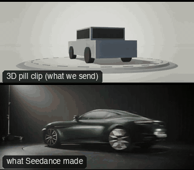

# OBJ16-ProductSpin: Product spin



Family: Camera moves on objects.

**What it says.** Look at it from every side, fast, then let it settle: this is the one.

**Use it for.** Product and vehicle reveals, the hero object of an ad, the end card before a logo.

**Camera numbers.** 40 mm low (0.9 m, just under the roofline), the turntable arriving at 0.9 rev/s and braking on a cubic to a dead stop at 4.7 s, while the camera creeps 1.2 m in; held 1.8 s on the three-quarter front.

**Avoid.** A spin that stops on a side-on or a rear angle: the brake lands on the beauty angle, decided first.

## The three.js code

This is an excerpt of the template (9 lines, from `engine/cinematic/src/templates/oners.ts`). `template.ts` in this folder is the same code with its imports. The helpers it calls (`make`, the actors, the rigs, the set and the post chain) are in `engine/cinematic/src`, so it does not run on its own: render it with `tools/render-pill.sh`.

```ts
import * as THREE from "three";
import { planner, scenePiece, type KitWorld, type SceneSpec, type ShotDef } from "../kit/stage";
import type { ActorSpec, PathKey } from "../kit/actors";
import { GREY, clay, shadeAll } from "../kit/clay";
import { framed, lag, rig, type Subj } from "../kit/rigs";
import { aimFor } from "../framer";
import { barrel, bench, broadTree, building, crate, floorLamp, ground, lampPost, pine, rock, scatter, shelf, sofa, table } from "../kit/props";
import { buildLab } from "./lab";
import { lerp, ramp, rng, smooth, smoother } from "../util";
import type { Marks } from "../marks";
import type { Piece } from "../piece";
import type { Cam } from "../shots";
import { CAMERA_INFO, type TemplateInfo } from "./cameras";

make({ id: "OBJ16-ProductSpin", name: "Product spin", says: "Look at it from every side, fast, then let it settle: this is the one.", use: "Product and vehicle reveals, the hero object of an ad, the end card before a logo.", numbers: "40 mm low (0.9 m, just under the roofline), the turntable arriving at 0.9 rev/s and braking on a cubic to a dead stop at 4.7 s, while the camera creeps 1.2 m in; held 1.8 s on the three-quarter front.", avoid: "A spin that stops on a side-on or a rear angle: the brake lands on the beauty angle, decided first." },
    { sky: "studio", build: buildStudio, tick: tickSpin, keyDir: [-0.6, 0.72, 0.35], motes: { center: [0, 2, 0], size: [14, 4, 14], count: 140 } },
    [{ id: "CAR", name: "Car", kind: "prop", model: "car", tint: "slate", path: [{ t: 0, at: [0, 0], yaw: SPIN_END }] }],
    () => {
      const a = V(5.5, 0.95, 9.0), b = V(4.85, 0.85, 7.95), aim = V(0, 0.78, 0);
      return [{ start: 0, end: 7, label: "40mm  TURNTABLE SPIN > BEAUTY", rig: "DOLLY · LOW HAT", subject: "CAR", size: "WS", sizeEnd: "WS", stop: 4,
        cam: (t) => { const k = smoother(ramp(t, 0, 5.2)), pos = a.clone().lerp(b, k); return { pos, target: aimFor(pos, aim, 40, [0, -0.12]), mm: 40 }; },
        cut: "Opens the template", flags: ["centre", "enters-moving"] }];
    }),
```

**Make it yours.** Change lens: 40 mm; shot size: WS. The actor `path` entries say where the pill stands and walks, and the numbers after `rig.` set the move (distance, angle, rise, start and end time).

## The videos

The stand-in in `pill.mp4` is the **capsule** (the single striped capsule of the first gallery clips). Render the other with `--standin pin`.

| What | File |
|---|---|
| The 3D pill clip, the reference video | `pill.mp4` |
| What Seedance made from the pill clip (480p draft) | `release-media/OBJ16-ProductSpin/result.mp4` (release asset) |

## The prompt

One file per send. `sent.json` says, for each, whether it is the text that was sent, a recovered copy, or a rebuilt copy (`prompt.provenance`):

- `prompts/video.txt`

Keep the lines that say what the pills are and that the set is to be rebuilt as real. Change the person, the place and the light. These prompts come from the gallery runs and many predate the checks in `tools/seedance/`, so rebuild one with the gates before you reuse it.

## How it was sent

`sent.json` holds, for each send: the references in order with their roles, the settings, the credits and the outcome. Request ids are not kept; where one was known, a short hash is stored.

- **video #1**: 7 s, draft (480p preview), 21:9; references: @video1 = pill clip (the 3D blockout); confirmed: yes; 1020.6 credits.

See `reproduce.md` to render it and send it yourself.
