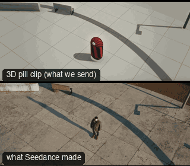

# ONE01-CraneToFollowWhip: Crane to follow, whip reveal



Family: One-take shots.

**What it says.** We arrive from above, fall in with them, and turn to see what they are walking toward.

**Use it for.** Openings that hand geography to a character, then the destination: arrivals, discoveries, the first sight of the goal.

**Camera numbers.** 32 mm throughout. Crane from 7 m above and 7.6 m out to eye level 3.1 m in front over 4.3 s, a Steadicam lead at her pace (she builds to 1.75 m/s, a purposeful stride) with a 0.6 s lag, then the operator plants and whips 0.45 s (about 140°) onto the destination, held 4 s while she walks on past the lens into the frame toward it.

**Avoid.** A whip onto a frame that is not composed, or a crane that lands on nothing: each stage of the take must end on a frame you could cut on.

## The three.js code

This is an excerpt of the template (16 lines, from `engine/cinematic/src/templates/oners.ts`). `template.ts` in this folder is the same code with its imports. The helpers it calls (`make`, the actors, the rigs, the set and the post chain) are in `engine/cinematic/src`, so it does not run on its own: render it with `tools/render-pill.sh`.

```ts
import * as THREE from "three";
import { planner, scenePiece, type KitWorld, type SceneSpec, type ShotDef } from "../kit/stage";
import type { ActorSpec, PathKey } from "../kit/actors";
import { GREY, clay, shadeAll } from "../kit/clay";
import { framed, lag, rig, type Subj } from "../kit/rigs";
import { aimFor } from "../framer";
import { barrel, bench, broadTree, building, crate, floorLamp, ground, lampPost, pine, rock, scatter, shelf, sofa, table } from "../kit/props";
import { buildLab } from "./lab";
import { lerp, ramp, rng, smooth, smoother } from "../util";
import type { Marks } from "../marks";
import type { Piece } from "../piece";
import type { Cam } from "../shots";
import { CAMERA_INFO, type TemplateInfo } from "./cameras";

make({ id: "ONE01-CraneToFollowWhip", name: "Crane to follow, whip reveal", says: "We arrive from above, fall in with them, and turn to see what they are walking toward.", use: "Openings that hand geography to a character, then the destination: arrivals, discoveries, the first sight of the goal.", numbers: "32 mm throughout. Crane from 7 m above and 7.6 m out to eye level 3.1 m in front over 4.3 s, a Steadicam lead at her pace (she builds to 1.75 m/s, a purposeful stride) with a 0.6 s lag, then the operator plants and whips 0.45 s (about 140°) onto the destination, held 4 s while she walks on past the lens into the frame toward it.", avoid: "A whip onto a frame that is not composed, or a crane that lands on nothing: each stage of the take must end on a frame you could cut on." },
    LAB,
    [human("ALEX", "Alex", "ochre", [{ t: 0.4, at: [0.8, 9.0] }, { t: 16, at: [0.2, -9.5] }], { look: [-1.2, 3.0, -11.5], lookFrom: 7.3 }),
      prop("STATUE", "Statue", "statue", [-1.2, -11.5], 0, "stone")],
    (P) => {
      const A = P("ALEX"), S = P("STATUE");
      const lead = rig.follow(A, { size: "MWS", mm: 32, deg: 35, rise: 0.05 });
      const tw = 8.95, pw = lead(tw).pos;
      const onStatue = () => ({ pos: pw.clone(), target: aimFor(pw, S(0).eye.clone().add(V(0, -1.0, 0)), 32, [-0.12, 0.0]), mm: 32 });
      return [{ start: 0, end: 13.5, label: "32mm  CRANE DOWN > LEAD > WHIP", rig: "TECHNOCRANE > STEADICAM", subject: (t) => (t < tw + 0.2 ? "ALEX" : "STATUE"), size: "WS", sizeEnd: "FS", stop: 4,
        cam: rig.chain([
          { from: 0, cam: reframe(rig.crane(A, { size: "WS", mm: 32, deg: 35 }, 7, 0.05, 0, 4.9, 0.41, 0.5), A, (t) => [0, (1 / 3) * smoother(ramp(t, 1.2, 4.6))]) },
          { from: 4.5, cam: rig.whip(lead, onStatue, tw, 0.45) },
        ], 1.0),
        cut: "Opens the template", flags: ["compound", "whip"], note: "Crane down onto Alex arriving, lands as a Steadicam lead, whip to the statue she has been looking at." }];
    }),
```

**Make it yours.** Change rig: `rig.chain`, `rig.crane`, `rig.follow`, `rig.whip`; lens: 32 mm; shot size: MWS, WS. The actor `path` entries say where the pill stands and walks, and the numbers after `rig.` set the move (distance, angle, rise, start and end time).

## The videos

The stand-in in `pill.mp4` is the **capsule** (the single striped capsule of the first gallery clips). Render the other with `--standin pin`.

| What | File |
|---|---|
| The 3D pill clip, the reference video (a re-render: the clip that was uploaded was not kept) | `pill.mp4` |
| What Seedance made from the pill clip (480p draft) | `release-media/ONE01-CraneToFollowWhip/result.mp4` (release asset) |
| The same move in other looks (ink, pencil, ghost, plate, boxes, clay, hand) | `release-media/ONE01-CraneToFollowWhip/looks/` |

## The prompt

One file per send. `sent.json` says, for each, whether it is the text that was sent, a recovered copy, or a rebuilt copy (`prompt.provenance`):

- `prompts/video.txt`

Keep the lines that say what the pills are and that the set is to be rebuilt as real. Change the person, the place and the light. These prompts come from the gallery runs and many predate the checks in `tools/seedance/`, so rebuild one with the gates before you reuse it.

## How it was sent

`sent.json` holds, for each send: the references in order with their roles, the settings, the credits and the outcome. Request ids are not kept; where one was known, a short hash is stored.

- **video #1**: 14 s, draft (480p preview), 21:9; references: @video1 = pill clip (the 3D blockout), @image1 = person photo (face reference); confirmed: yes; 2041.2 credits.

See `reproduce.md` to render it and send it yourself.
