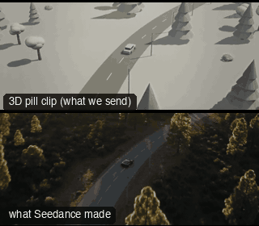

# ONE02-DroneDiveChase: Drone dive into a chase



Family: One-take shots.

**What it says.** From far above, the world; then we drop out of the sky and ride with them; then we let them go.

**Use it for.** Car and vehicle openings, the start or end of a chase, any journey that needs scale and speed in one move.

**Camera numbers.** 35 mm. The drone starts 56 m back and 30 m up (the car a tenth of the frame), dives over 5 s (peak 16 m/s closing speed) to 9 m behind and 2.2 m up at the car's 14 m/s, chases 3 s, then climbs and falls back (a real-film dolly-out-and-up path, played at 1.6×) to end high and wide.

**Avoid.** Diving with a jolt: the drone must already be matched to the car's speed before it drops, and land on the chase without a bump.

## The three.js code

This is an excerpt of the template (14 lines, from `engine/cinematic/src/templates/oners.ts`). `template.ts` in this folder is the same code with its imports. The helpers it calls (`make`, the actors, the rigs, the set and the post chain) are in `engine/cinematic/src`, so it does not run on its own: render it with `tools/render-pill.sh`.

```ts
import * as THREE from "three";
import { planner, scenePiece, type KitWorld, type SceneSpec, type ShotDef } from "../kit/stage";
import type { ActorSpec, PathKey } from "../kit/actors";
import { GREY, clay, shadeAll } from "../kit/clay";
import { framed, lag, rig, type Subj } from "../kit/rigs";
import { aimFor } from "../framer";
import { barrel, bench, broadTree, building, crate, floorLamp, ground, lampPost, pine, rock, scatter, shelf, sofa, table } from "../kit/props";
import { buildLab } from "./lab";
import { lerp, ramp, rng, smooth, smoother } from "../util";
import type { Marks } from "../marks";
import type { Piece } from "../piece";
import type { Cam } from "../shots";
import { CAMERA_INFO, type TemplateInfo } from "./cameras";

make({ id: "ONE02-DroneDiveChase", name: "Drone dive into a chase", says: "From far above, the world; then we drop out of the sky and ride with them; then we let them go.", use: "Car and vehicle openings, the start or end of a chase, any journey that needs scale and speed in one move.", numbers: "35 mm. The drone starts 56 m back and 30 m up (the car a tenth of the frame), dives over 5 s (peak 16 m/s closing speed) to 9 m behind and 2.2 m up at the car's 14 m/s, chases 3 s, then climbs and falls back (a real-film dolly-out-and-up path, played at 1.6×) to end high and wide.", avoid: "Diving with a jolt: the drone must already be matched to the car's speed before it drops, and land on the chase without a bump." },
    { sky: "day", build: buildRoad, keyDir: [0.45, 0.75, 0.5], motes: { center: [0, 2.5, 0], size: [60, 8, 60], count: 120 } },
    [{ id: "CAR", name: "Car", kind: "prop", model: "car", tint: "slate", path: roadKeys() }],
    (P) => {
      const C = P("CAR");
      const dive = (t: number) => { const k = Math.min(1, Math.max(0, (t - 0.4) / 5.0)), e = k * k * (3 - 2 * k); return rig.chase(C, lerp(56, 9, e), lerp(30, 2.2, e), 35, lerp(22, 1.4, e), 0.9)(t); };
      return [{ start: 0, end: 12, label: "35mm  DRONE DIVE > CHASE > RISE", rig: "DRONE · GIMBAL", subject: "CAR", size: "EWS", sizeEnd: "EWS", stop: 5.6, shadow: 45,
        cam: rig.chain([
          { from: 0, cam: dive },
          { from: 5.6, cam: rig.chase(C, 9, 2.2, 35, 1.4, 0.9) },
          { from: 8.6, cam: reframe(steady(rig.filmPath("dolly_out_and_up_2", C, { size: "WS", mm: 35, rise: 1.8 }, 8.2, 1.6, true)), C, () => [0, 0.15]) },
        ], 1.4),
        cut: "Opens the template", flags: ["compound", "centre", "enters-moving", "exits-moving"], note: "Real-film path: dolly_out_and_up_2 (mirrored to play from behind) for the rise." }];
    }),
```

**Make it yours.** Change rig: `rig.chain`, `rig.chase`, `rig.filmPath`; lens: 35 mm; shot size: EWS, WS. The actor `path` entries say where the pill stands and walks, and the numbers after `rig.` set the move (distance, angle, rise, start and end time).

## The videos

The stand-in in `pill.mp4` is the **capsule** (the single striped capsule of the first gallery clips). Render the other with `--standin pin`.

| What | File |
|---|---|
| The 3D pill clip, the reference video (a re-render: the clip that was uploaded was not kept) | `pill.mp4` |
| The contact sheet (sketch route) | `sketch-sheet.jpg` |
| What Seedance made from the pill clip (480p draft) | `release-media/ONE02-DroneDiveChase/result.mp4` (release asset) |
| What Seedance made from the contact sheet | `release-media/ONE02-DroneDiveChase/sketch-output.mp4` (release asset) |
| Another take from the same template | `release-media/ONE02-DroneDiveChase/ink-sketch-ink-one02.mp4` |

## The prompt

One file per send. `sent.json` says, for each, whether it is the text that was sent, a recovered copy, or a rebuilt copy (`prompt.provenance`):

- `prompts/ink-sketch-recovered-sheet.txt`
- `prompts/video.txt`

Keep the lines that say what the pills are and that the set is to be rebuilt as real. Change the person, the place and the light. These prompts come from the gallery runs and many predate the checks in `tools/seedance/`, so rebuild one with the gates before you reuse it.

## How it was sent

`sent.json` holds, for each send: the references in order with their roles, the settings, the credits and the outcome. Request ids are not kept; where one was known, a short hash is stored.

- **video #1**: 12 s, draft (480p preview), 21:9; references: @video1 = pill clip (the 3D blockout); confirmed: yes; 1749.6 credits.
- **ink-sketch #1**: 12 s, draft (480p preview), 21:9; references: @image1 = pill contact sheet (the sketch route); confirmed: yes; 1466.4 credits.

See `reproduce.md` to render it and send it yourself.
