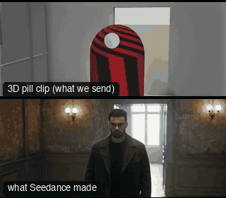

# ONE03-InteriorOner: Interior oner



Family: One-take shots.

**What it says.** We walk the space with them, in real time: no cuts, so nothing is hidden and nobody can leave.

**Use it for.** Arrivals into a room, a reveal of who is waiting, tension that should not be relieved by a cut.

**Camera numbers.** 35 mm throughout. Lead from 1.9 m in front (a real-film lead path), a 4.5 s swing of 180° round her right side (peak 60°/s, held on her eyes), a Steadicam follow 1.9 m behind through a 1.7 m doorway, settling into an OTS on Sam 1.9 m beyond her. 14 s, 11 m walked at 1.2 m/s.

**Avoid.** Losing the subject in the swing, or a camera that fits through the door only because the walls are fake: the rig's path has to clear the frame.

## The three.js code

This is an excerpt of the template (16 lines, from `engine/cinematic/src/templates/oners.ts`). `template.ts` in this folder is the same code with its imports. The helpers it calls (`make`, the actors, the rigs, the set and the post chain) are in `engine/cinematic/src`, so it does not run on its own: render it with `tools/render-pill.sh`.

```ts
import * as THREE from "three";
import { planner, scenePiece, type KitWorld, type SceneSpec, type ShotDef } from "../kit/stage";
import type { ActorSpec, PathKey } from "../kit/actors";
import { GREY, clay, shadeAll } from "../kit/clay";
import { framed, lag, rig, type Subj } from "../kit/rigs";
import { aimFor } from "../framer";
import { barrel, bench, broadTree, building, crate, floorLamp, ground, lampPost, pine, rock, scatter, shelf, sofa, table } from "../kit/props";
import { buildLab } from "./lab";
import { lerp, ramp, rng, smooth, smoother } from "../util";
import type { Marks } from "../marks";
import type { Piece } from "../piece";
import type { Cam } from "../shots";
import { CAMERA_INFO, type TemplateInfo } from "./cameras";

make({ id: "ONE03-InteriorOner", name: "Interior oner", says: "We walk the space with them, in real time: no cuts, so nothing is hidden and nobody can leave.", use: "Arrivals into a room, a reveal of who is waiting, tension that should not be relieved by a cut.", numbers: "35 mm throughout. Lead from 1.9 m in front (a real-film lead path), a 4.5 s swing of 180° round her right side (peak 60°/s, held on her eyes), a Steadicam follow 1.9 m behind through a 1.7 m doorway, settling into an OTS on Sam 1.9 m beyond her. 14 s, 11 m walked at 1.2 m/s.", avoid: "Losing the subject in the swing, or a camera that fits through the door only because the walls are fake: the rig's path has to clear the frame." },
    { sky: "interior", build: buildFlat, keyDir: [0.35, 0.82, 0.45], motes: { center: [0, 1.4, 1], size: [9, 2.8, 15], count: 160, drift: [0.03, 0.01, 0.02] } },
    [human("ALEX", "Alex", "ochre", walk(0.5, [[0.15, 9.6], [0.15, 8.8], [0.1, 3], [0.05, 0], [0.2, -1.8], [0.3, -3.2]], 1.2, 2.8), { look: "SAM", lookFrom: 10.2 }),
      prop("DOOR", "Doorway", "doorway", [0, 0], 0, "stone"),
      human("SAM", "Sam", "slate", [{ t: 0, at: [0.95, -5.0], yaw: -0.35 }], { acts: [{ kind: "clip", clip: "Idle_FoldArms_Loop", t0: 0 }], look: "ALEX", lookFrom: 8.2 })],
    (P) => {
      const A = P("ALEX"), S = P("SAM");
      return [{ start: 0, end: 14, label: "35mm  LEAD > SWING > FOLLOW > OTS", rig: "STEADICAM", subject: (t) => (t < 11.6 ? "ALEX" : "SAM"), size: "MWS", sizeEnd: "MS", stop: 2.8,
        cam: rig.chain([
          { from: 0, cam: reframe(steady(rig.filmPath("lead_front_1", A, { size: "MWS", mm: 35, rise: -0.6 }, 0.5)), A, () => [0, 0.27]) },
          { from: 4.6, cam: (t) => { const k = Math.min(1, Math.max(0, (t - 4.3) / 4.5)), e = k * k * (3 - 2 * k); return framed(A(t), { size: "MS", mm: 35, deg: lerp(14, -165, e), rise: lerp(0.18, 0.15, e), at: [0, 1 / 3] }); } },
          { from: 8.4, cam: rig.follow(A, { size: "MS", mm: 35, deg: -165, rise: 0.15 }) },
          { from: 11.2, cam: rig.ots(A, S, 35, 1, 1.3, 0.75) },
        ], 1.2),
        cut: "Opens the template", flags: ["compound", "enters-moving", "centre", "whip"], note: "Real-film path: lead_front_1 for the opening lead. The end frame is an OTS over Alex's right shoulder onto Sam." }];
    }),
```

**Make it yours.** Change rig: `rig.chain`, `rig.filmPath`, `rig.follow`, `rig.ots`; lens: 35 mm; shot size: MS, MWS. The actor `path` entries say where the pill stands and walks, and the numbers after `rig.` set the move (distance, angle, rise, start and end time).

## The videos

The stand-in in `pill.mp4` is the **capsule** (the single striped capsule of the first gallery clips). Render the other with `--standin pin`.

| What | File |
|---|---|
| The 3D pill clip, the reference video (a re-render: the clip that was uploaded was not kept) | `pill.mp4` |
| What Seedance made from the pill clip (480p draft) | `release-media/ONE03-InteriorOner/result.mp4` (release asset) |

## The prompt

One file per send. `sent.json` says, for each, whether it is the text that was sent, a recovered copy, or a rebuilt copy (`prompt.provenance`):

- `prompts/video.txt`

Keep the lines that say what the pills are and that the set is to be rebuilt as real. Change the person, the place and the light. These prompts come from the gallery runs and many predate the checks in `tools/seedance/`, so rebuild one with the gates before you reuse it.

## How it was sent

`sent.json` holds, for each send: the references in order with their roles, the settings, the credits and the outcome. Request ids are not kept; where one was known, a short hash is stored.

- **video #1**: 14 s, draft (480p preview), 21:9; references: @video1 = pill clip (the 3D blockout), @image1 = person photo (face reference); confirmed: yes; 2041.2 credits.

See `reproduce.md` to render it and send it yourself.
