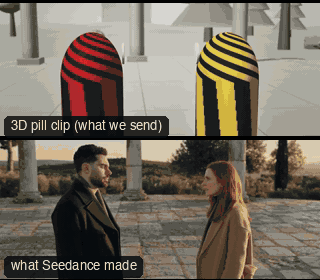

# ONE04-OrbitPushRack: Orbit, push, rack



Family: One-take shots.

**What it says.** We circle a conversation, then close in on her over his shoulder, and when he looks away the focus leaves her for him.

**Use it for.** The turn of a dialogue scene in one take: a confession, a refusal, the moment one person stops looking at the other.

**Camera numbers.** 40 mm at T2. A 0.9 s held two-shot, a real-film orbit of about 115° round the pair over 6 s (steadied, a little above their eyes), a 2 m push to a dirty MCU of Sam over Alex's shoulder in 4 s, a 1.2 s rack focus from her (3.1 m) to him (1.8 m) as he looks down, held 1.8 s.

**Avoid.** Racking with nothing behind: the second face must already be in the frame, soft, before the rack starts.

## The three.js code

This is an excerpt of the template (17 lines, from `engine/cinematic/src/templates/oners.ts`). `template.ts` in this folder is the same code with its imports. The helpers it calls (`make`, the actors, the rigs, the set and the post chain) are in `engine/cinematic/src`, so it does not run on its own: render it with `tools/render-pill.sh`.

```ts
import * as THREE from "three";
import { planner, scenePiece, type KitWorld, type SceneSpec, type ShotDef } from "../kit/stage";
import type { ActorSpec, PathKey } from "../kit/actors";
import { GREY, clay, shadeAll } from "../kit/clay";
import { framed, lag, rig, type Subj } from "../kit/rigs";
import { aimFor } from "../framer";
import { barrel, bench, broadTree, building, crate, floorLamp, ground, lampPost, pine, rock, scatter, shelf, sofa, table } from "../kit/props";
import { buildLab } from "./lab";
import { lerp, ramp, rng, smooth, smoother } from "../util";
import type { Marks } from "../marks";
import type { Piece } from "../piece";
import type { Cam } from "../shots";
import { CAMERA_INFO, type TemplateInfo } from "./cameras";

make({ id: "ONE04-OrbitPushRack", name: "Orbit, push, rack", says: "We circle a conversation, then close in on her over his shoulder, and when he looks away the focus leaves her for him.", use: "The turn of a dialogue scene in one take: a confession, a refusal, the moment one person stops looking at the other.", numbers: "40 mm at T2. A 0.9 s held two-shot, a real-film orbit of about 115° round the pair over 6 s (steadied, a little above their eyes), a 2 m push to a dirty MCU of Sam over Alex's shoulder in 4 s, a 1.2 s rack focus from her (3.1 m) to him (1.8 m) as he looks down, held 1.8 s.", avoid: "Racking with nothing behind: the second face must already be in the frame, soft, before the rack starts." },
    { ...LAB, motes: { center: [0, 2, 0], size: [14, 4, 14], count: 160 } },
    [human("ALEX", "Alex", "ochre", [{ t: 0, at: ALEX4, yaw: Math.PI / 2 }], { look: "SAM", acts: [{ kind: "talk", t0: 0.6, t1: 3.4 }, { kind: "lookDown", t0: 10.6, ease: 0.9 }] }),
      human("SAM", "Sam", "slate", [{ t: 0, at: SAM4, yaw: -Math.PI / 2 }], { look: "ALEX", acts: [{ kind: "talk", t0: 3.6, t1: 10.4 }] })],
    (P) => {
      const A = P("ALEX"), S = P("SAM");
      const pair = pairOf(A, S, V(0, 0, 1));
      // the push: one dolly line from where the orbit ends to Sam's single, on a gentle S-curve
      const push = (t: number): Cam => { const e = smooth((t - 6.8) / 4.0), pos = one04.E.clone().lerp(one04.C, e); return { pos, target: aimFor(pos, S(t).eye, 40, [lerp(0.1, -0.2, e), 1 / 3]), mm: 40 }; };
      return [{ start: 0, end: 14, label: "40mm  ORBIT > PUSH > RACK", rig: "TECHNOCRANE > DOLLY", subject: "SAM", size: "FS", sizeEnd: "MCU", stop: 2,
        cam: rig.chain([
          { from: 0, cam: reframe(steady(rig.filmPath(ORBIT4.name, pair, ORBIT4.f, ORBIT4.t0, ORBIT4.speed, true), 0.8), pair, () => [0, 0.3]) },
          { from: 6.9, cam: push },
        ], 1.2),
        focus: (t) => ["SAM", "ALEX", smoother(ramp(t, 11.0, 12.2))],
        cut: "Opens the template", flags: ["compound"], note: "Real-film path: orbit_left_2 (mirrored to start in front) for the orbit. The push lands on a dirty single of Sam over Alex\u2019s shoulder; Alex looks down at 10.6 s and the focus racks to him." }];
    }),
```

**Make it yours.** Change rig: `rig.chain`, `rig.filmPath`; lens: 40 mm; shot size: FS. The actor `path` entries say where the pill stands and walks, and the numbers after `rig.` set the move (distance, angle, rise, start and end time).

## The videos

The stand-in in `pill.mp4` is the **capsule** (the single striped capsule of the first gallery clips). Render the other with `--standin pin`.

| What | File |
|---|---|
| The 3D pill clip, the reference video (a re-render: the clip that was uploaded was not kept) | `pill.mp4` |
| What Seedance made from the pill clip (480p draft) | `release-media/ONE04-OrbitPushRack/result.mp4` (release asset) |

## The prompt

One file per send. `sent.json` says, for each, whether it is the text that was sent, a recovered copy, or a rebuilt copy (`prompt.provenance`):

- `prompts/video-1.txt`
- `prompts/video-2.txt`

Keep the lines that say what the pills are and that the set is to be rebuilt as real. Change the person, the place and the light. These prompts come from the gallery runs and many predate the checks in `tools/seedance/`, so rebuild one with the gates before you reuse it.

## How it was sent

`sent.json` holds, for each send: the references in order with their roles, the settings, the credits and the outcome. Request ids are not kept; where one was known, a short hash is stored.

- **video #1**: 14 s, draft (480p preview), 21:9; references: @video1 = pill clip (the 3D blockout), @image1 = person photo (face reference); confirmed: no receipt.
- **video #2**: 14 s, draft (480p preview), 21:9; references: @video1 = pill clip (the 3D blockout), @image1 = person photo (face reference); confirmed: yes; 2041.2 credits.

See `reproduce.md` to render it and send it yourself.
