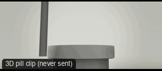

# PRD01-FrozenSplashOrbit: Frozen splash orbit



**What it says.** A bottle or can drops onto a wet table, time stops on the splash, the camera circles it 270 degrees at its own height, then time resumes.

**Use it for.** A drink or splash shot that needs a bullet-time hero frame. The bullet-time orbit for liquids.

**Camera numbers.** 270 degree orbit at the object's own height; the splash is held about 3.8 s at 0.6% of real speed; the move ends on its front.

**Avoid.** Never sent to the model: the first render hid the pill behind the splash. Check the frame at the freeze before you send it.

## The three.js code

This is an excerpt of the template (199 lines, from `engine/cinematic/src/templates/products/p01-frozen-splash-orbit.ts`). `template.ts` in this folder is the same code with its imports. The helpers it calls (`make`, the actors, the rigs, the set and the post chain) are in `engine/cinematic/src`, so it does not run on its own: render it with `tools/render-pill.sh`.

```ts
// PRD01-FrozenSplashOrbit
// Copied from engine/cinematic/src/templates/products/p01-frozen-splash-orbit.ts (all of that file).
// The set builders, rigs and stand-ins it calls live in engine/cinematic/src and kit/.
// Render it: cd engine/cinematic && tools/render-pill.sh PRD01-FrozenSplashOrbit
// PRD01-FrozenSplashOrbit: the pill drops onto a wet tabletop, time stops on the splash, the camera orbits 270° round
// it at the pill's own height, time resumes and the move lands on the pill's front. The product version of bullet time.
import * as THREE from "three";
import { speedRamp } from "../../kit/stage";
import { GREY, clay } from "../../kit/clay";
import { clamp, rng, smooth, smoother } from "../../util";
import type { Cam } from "../../shots";
import type { Piece } from "../../piece";
import { V, makeProduct, pillActor, studioFloor, type KitWorld, type PathKey } from "./shared";

const G = 9.81, TAU = Math.PI * 2;
// ---- the set (metres, real scale): a round table, its top carrying a film of liquid 1 cm deep, flush with the top ----
const TOP = 0.74, R_TABLE = 0.46, R_LIQ = 0.42, POOL_Y = TOP - 0.01, LIQ_Y = TOP - 0.001;

// ---- the fall (world seconds): released from rest above the frame, gravity to the liquid, stopped by the table under it ----
const Y_REL = TOP + 0.74, T_HIT = 0.9;                              // the base touches the liquid at T_HIT
const FALL = Math.sqrt((2 * (Y_REL - LIQ_Y)) / G), V_HIT = G * FALL, T_REL = T_HIT - FALL;
const SINK = (2 * (LIQ_Y - POOL_Y)) / V_HIT;                        // braked through the film: at rest on the table
const pillY = (t: number) => {
  if (t <= T_REL) return Y_REL;
  if (t <= T_HIT) return Y_REL - (G / 2) * (t - T_REL) ** 2;
  const u = clamp((t - T_HIT) / SINK); return POOL_Y + (LIQ_Y - POOL_Y) * (1 - u) ** 2;
};
const PATH: PathKey[] = (() => {
  const keys: PathKey[] = [{ t: 0, at: [0, Y_REL, 0], yaw: 0 }, { t: T_REL - 0.04, at: [0, Y_REL, 0] }];
  for (let k = 0; k <= 32; k++) { const t = T_REL + (FALL * k) / 32; keys.push({ t, at: [0, pillY(t), 0] }); }
  for (let k = 1; k <= 4; k++) { const t = T_HIT + (SINK * k) / 4; keys.push({ t, at: [0, pillY(t), 0] }); }
  keys.push({ t: T_HIT + SINK + 0.02, at: [0, POOL_Y, 0] }, { t: 6, at: [0, POOL_Y, 0], yaw: 0 });
  return keys;
})();

// ---- the clock: real time, eased from 0.01 s after the hit to 0.006 of real time, held 3.8 s, eased back ----
const SLOW = 0.006, T_FREEZE = 1.1, T_THAW = 4.9, T_LIVE = 5.4;
const CLOCK = speedRamp([[0, 1], [T_HIT + 0.01, 1], [T_FREEZE, SLOW], [T_THAW, SLOW], [T_LIVE, 1], [9, 1]]);

// ---- the camera: locked and wide for the fall, then one orbit that ends on the beauty frame (decided first: +z) ----
const MM = 28, ORBIT = 270, T_GO = 0.98, T_ARRIVE = 5.45, T_STILL = 6.1;
/** 0 → 1 between a and b: accelerates over `ein`, cruises, brakes over `eout` (the rate is a smoothstep trapezoid) */
function glide(t: number, a: number, b: number, ein: number, eout: number) {
  if (t <= a) return 0; if (t >= b) return 1;
  const I = (x: number) => { const c = clamp(x); return c * c * c - (c * c * c * c) / 2; };   // the integral of a smoothstep
  const cruise = b - a - ein - eout, x = clamp((t - (b - eout)) / eout);
  return (ein * I((t - a) / ein) + clamp(t - a - ein, 0, cruise) + eout * (x - I(x))) / (ein / 2 + cruise + eout / 2);
}
const sm = (t: number, a: number, b: number) => smoother((t - a) / (b - a));
function camAt(t: number): Cam {
  const a = THREE.MathUtils.degToRad(-ORBIT * (1 - glide(t, T_GO, T_ARRIVE, 0.7, 1.3)));
  const r = 1.5 - 0.62 * sm(t, T_GO, 2.6) - 0.08 * sm(t, 4.5, T_STILL);          // back for the fall, closes in for the orbit, pushes in to settle
  const y = TOP + 0.12 + 0.03 * sm(t, T_GO, 3.0) - 0.02 * sm(t, 3.2, T_STILL);   // the pill's mid-height, a touch up and back
  const ty = TOP + 0.285 - 0.16 * sm(t, T_GO, 2.6) - 0.025 * sm(t, 4.5, T_STILL); // tilted up for the fall, then level on the pill
  return { pos: V(r * Math.sin(a), y, r * Math.cos(a)), target: V(0, ty, 0), mm: MM };
}

// ---- the splash, all of it a function of world seconds since the hit (tau) ----
// the corona: a thin sheet thrown up and out from the pill's foot, low and short, its rim torn into uneven fingers
const R0 = 0.078, UY = 0.88, UR = 0.7, NT = 720, NJ = 23;          // NT round the sheet, NJ along its underside and back along its top
// ... (see template.ts for the rest)
```

## The videos

The stand-in in `pill.mp4` is the **capsule** (the single striped capsule of the first gallery clips). Render the other with `--standin pin`.

| What | File |
|---|---|
| The 3D pill clip, the reference video | `pill.mp4` |
| The contact sheet (sketch route) | `sketch-sheet.jpg` |

No Seedance result is included: never sent: the first render was rejected because the splash half hid the pill; the shot was not taken further. Render it with tools/render-pill.sh and judge it yourself.

The pill clip was rendered for this repo with the current engine. It has not been sent to Seedance, so there is no prompt yet: write one from `docs/prompt-anatomy.md` and the neighbouring templates' prompts.

## The prompt

No prompt was recorded for this template.

## How it was sent

`sent.json` holds, for each send: the references in order with their roles, the settings, the credits and the outcome. Request ids are not kept; where one was known, a short hash is stored.


See `reproduce.md` to render it and send it yourself.
