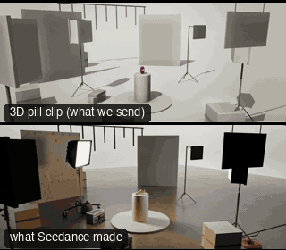

# PRD02-RobotArmSnap: Robot-arm snap



Family: Product shots.

**What it says.** Three angles on three beats: the camera crosses the studio in under a second, stops dead on the product, then snaps twice more.

**Use it for.** Launch films cut to music (sneakers, phones, drinks): any product that should feel fast and exact. The stops land at 2.0, 4.0 and 6.0 s, so a 120 bpm track drops straight under it.

**Camera numbers.** Held wide for 1.28 s: 24 mm, 6.0 m from the pill, lens 2.4 m up. Move 1: 5.7 m in 0.70 s on a descending curve, peak 11.0 m/s, 24 to 50 mm, dead still from 1.98 s on a macro of the dot, 0.40 m off its face. Move 2: 45° round and up in 0.50 s (view turns 57°, peak 159°/s) to 35 mm, 1.25 m out, looking down 39°. Move 3: 0.60 s (66°, peak 157°/s) down to 3 cm above the plinth top, 24 mm, 0.63 m out, looking up 11°, held 2.0 s. Inside the Bolt's 12 m/s and 180°/s.

**Avoid.** A soft landing or a settle after the stop: the frame on the beat is already still. Three stops that look alike: change distance, height and lens every time.

## The three.js code

This is an excerpt of the template (161 lines, from `engine/cinematic/src/templates/products/p02-robot-arm-snap.ts`). `template.ts` in this folder is the same code with its imports. The helpers it calls (`make`, the actors, the rigs, the set and the post chain) are in `engine/cinematic/src`, so it does not run on its own: render it with `tools/render-pill.sh`.

```ts
// PRD02-RobotArmSnap
// Copied from engine/cinematic/src/templates/products/p02-robot-arm-snap.ts (all of that file).
// The set builders, rigs and stand-ins it calls live in engine/cinematic/src and kit/.
// Render it: cd engine/cinematic && tools/render-pill.sh PRD02-RobotArmSnap
// PRD02-RobotArmSnap: a motion-control arm (the Bolt) rockets in from across the studio and stops dead on the pill,
// then snaps to two more angles. Each stop lands on a beat: 2.0, 4.0 and 6.0 s (120 bpm).
import * as THREE from "three";
import { aimFor } from "../../framer";
import { GREY, clay, shadeAll } from "../../kit/clay";
import { crate } from "../../kit/props";
import type { Cam } from "../../shots";
import type { Piece } from "../../piece";
import { clamp, lerp } from "../../util";
import { makeProduct, pillActor, plinth, studioFloor, V, type KitWorld } from "./shared";

// ---------------- the pill and the three stops ----------------
const TOP = 0.9;                                   // plinth top
const MID = V(0, TOP + 0.12, 0);                   // the pill's middle
const DOT = V(0, TOP + 0.24 * 0.62, 0.0624);       // the face of its white dot (the pill faces +z)

type Pose = { az: number; el: number; d: number; mm: number; look: THREE.Vector3; at: [number, number] };
const RAD = Math.PI / 180;
/** a camera position from the pill's middle: `az` degrees round from its front, `el` degrees up, `d` metres out */
const sph = (az: number, el: number, d: number) => MID.clone().add(V(Math.sin(az * RAD) * Math.cos(el * RAD), Math.sin(el * RAD), Math.cos(az * RAD) * Math.cos(el * RAD)).multiplyScalar(d));
const mix = (a: Pose, b: Pose, k: number): Pose => ({ az: lerp(a.az, b.az, k), el: lerp(a.el, b.el, k), d: lerp(a.d, b.d, k), mm: a.mm * Math.pow(b.mm / a.mm, k), look: a.look.clone().lerp(b.look, k), at: [lerp(a.at[0], b.at[0], k), lerp(a.at[1], b.at[1], k)] });
const shoot = (p: Pose, pos = sph(p.az, p.el, p.d)): Cam => ({ pos, target: aimFor(pos, p.look, p.mm, p.at), mm: p.mm });

// A: wide and far, 6 m back and 2.4 m up. 1: macro on the dot, 0.40 m off its face. 2: high three-quarter. 3: low hero.
const WIDE: Pose = { az: -22, el: 13.3, d: 6.0, mm: 24, look: DOT, at: [0, -0.12] };
const MACRO: Pose = { az: 0, el: 3.56, d: 0.4633, mm: 50, look: DOT, at: [0, 0] };
const HIGH: Pose = { az: 45, el: 38, d: 1.25, mm: 35, look: MID, at: [0, 0.1] };
const HERO: Pose = { az: 0, el: -8.3, d: 0.626, mm: 24, look: MID, at: [0, -0.16] };

// ---------------- timing ----------------
// The shutter is 1/48 s centred on each frame, so a move that ends half a frame before its beat leaves the frame on
// the beat fully still.
const LAND = 1 / 48;
const M1 = [2 - LAND - 0.7, 2 - LAND], M2 = [4 - LAND - 0.5, 4 - LAND], M3 = [6 - LAND - 0.6, 6 - LAND];

/** a robot move's progress, 0 to 1: speed ramps up over the first `a` of the move, holds, and ramps down over the last
 *  `b` (smoothstep ramps, so neither speed nor acceleration jumps) */
function snap(t: number, [t0, t1]: number[], a: number, b: number) {
  const x = clamp((t - t0) / (t1 - t0)), area = 1 - a / 2 - b / 2, I = (y: number) => y * y * y - (y * y * y * y) / 2;
  if (x < a) return (a * I(x / a)) / area;
  if (x > 1 - b) return 1 - (b * I((1 - x) / b)) / area;
  return (a / 2 + x - a) / area;
}

// move 1's path: a curve that leaves the wide frame toward the pill's axis, joins it and comes straight in along the
// lens axis, walked by distance so the speed is the profile's
const PATH1 = (() => {
  const p0 = sph(WIDE.az, WIDE.el, WIDE.d), p3 = sph(MACRO.az, MACRO.el, MACRO.d);
  const c = new THREE.CubicBezierCurve3(p0, p0.clone().lerp(V(0, 1.3, 2.5), 0.55), p3.clone().add(V(0, 0, 1.9)), p3);
  const n = 800, pts = c.getPoints(n), len = [0];
  for (let i = 1; i <= n; i++) len.push(len[i - 1] + pts[i].distanceTo(pts[i - 1]));
  const L = len[n];
  return { L, at: (k: number) => { const s = clamp(k) * L; let i = 1; while (i < n && len[i] < s) i++; return pts[i - 1].clone().lerp(pts[i], (s - len[i - 1]) / Math.max(1e-9, len[i] - len[i - 1])); } };
})();

/** a swing from one stop to the next (round the pill, by angle, distance and lens), walked by the turn of the view so
// ... (see template.ts for the rest)
```

## The videos

The stand-in in `pill.mp4` is the **capsule** (the single striped capsule of the first gallery clips). Render the other with `--standin pin`.

| What | File |
|---|---|
| The 3D pill clip, the reference video | `pill.mp4` |
| What Seedance made from the pill clip (480p draft) | `release-media/PRD02-RobotArmSnap/result.mp4` (release asset) |

## The prompt

One file per send. `sent.json` says, for each, whether it is the text that was sent, a recovered copy, or a rebuilt copy (`prompt.provenance`):

- `prompts/video-1.txt`
- `prompts/video-2.txt`

Keep the lines that say what the pills are and that the set is to be rebuilt as real. Change the person, the place and the light. These prompts come from the gallery runs and many predate the checks in `tools/seedance/`, so rebuild one with the gates before you reuse it.

## How it was sent

`sent.json` holds, for each send: the references in order with their roles, the settings, the credits and the outcome. Request ids are not kept; where one was known, a short hash is stored.

- **video #1**: 8 s, draft (480p preview), 21:9; references: @video1 = pill clip (the 3D blockout), @image1 = product photo, @image2 = product photo; confirmed: yes; 1166.4 credits.
- **video #2**: 8 s, draft (480p preview), 21:9; references: @video1 = pill clip (the 3D blockout), @image1 = product photo, @image2 = product photo; confirmed: yes.

See `reproduce.md` to render it and send it yourself.
