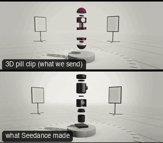

# PRD03-ExplodedBuild: Exploded build



**What it says.** It is made of parts and every part has its place: we go through the middle of it, and it closes into one thing behind us.

**Use it for.** A product whose build is the selling point (layers, ingredients, components). The reveal after the features, ending on the pack shot.

**Camera numbers.** 21 mm probe lens on a motion-control arm, T8. Built 5 times real size so the lens clears the parts; real-scale figures: opens 1.2 m out and holds 0.6 s, pushes 0.23 m in 1.8 s, then accelerates to 1.2 m/s and crosses the pill's axis at 3.4 s through a 10.4 cm gap, 4.6 cm from each cut face. A 180° whip in 0.75 s (peak 474°/s) as it brakes, then a 67° arc out to 0.6 m while the five slices land 0.18 s apart (4.75 to 5.47 s, each closing in 0.42 s to a dead stop). Still from 5.9 s, 12° above the pill, held 2.1 s. Path 2.07 m.

**Avoid.** A tight gap or a slow pass: the fly-through reads only when both cut faces streak past the lens. Never end on a side the front is not facing.

## The three.js code

This is an excerpt of the template (168 lines, from `engine/cinematic/src/templates/products/p03-exploded-build.ts`). `template.ts` in this folder is the same code with its imports. The helpers it calls (`make`, the actors, the rigs, the set and the post chain) are in `engine/cinematic/src`, so it does not run on its own: render it with `tools/render-pill.sh`.

```ts
// PRD03-ExplodedBuild
// Copied from engine/cinematic/src/templates/products/p03-exploded-build.ts (all of that file).
// The set builders, rigs and stand-ins it calls live in engine/cinematic/src and kit/.
// Render it: cd engine/cinematic && tools/render-pill.sh PRD03-ExplodedBuild
// PRD03-ExplodedBuild: the pill hangs over its plinth cut into slices; the camera flies through the widest gap, whips
// round on the far side, and the slices snap shut behind it from the bottom up into the finished pill.
// The lens passes 4.6 cm (real) from the cut faces, so this world is built 5 times real size: the pill is 1.2 m here.
// Every length in this file is in built metres; divide by 5 for the real figure.
import * as THREE from "three";
import { pill } from "../../kit/pill";
import { GREY, clay, shadeAll } from "../../kit/clay";
import { clamp, smoother } from "../../util";
import type { Cam } from "../../shots";
import type { Piece } from "../../piece";
import { V, makeProduct, pillActor, plinth, studioFloor, type KitWorld } from "./shared";

const rad = THREE.MathUtils.degToRad;
const N = 5, H = 0.24 * N, R = 0.06 * N;
const PT = 0.4;                                          // the plinth's top
const CUT = [0, 0.3, 0.45, 0.6, 0.9, 1.2];               // the slices: dome, ring, ring, face ring (it carries the dot), dome
const EX = [0.28, 0.56, 1.08, 1.36, 1.64];               // how far each hangs above its place; the 0.52 gap is the one flown through
const LAND = [4.75, 4.93, 5.11, 5.29, 5.47], CLOSE = 0.42;   // when each lands, and how long its closing takes
const SPIN = [-9, 16, -12, 14, 7], OFF = [25, -35, 30, -27, -22];   // adrift: deg/s, and degrees out of line when the closing starts
const CORE = 0.18;                                       // the rings are hollow: the loose bits end up in this core
const GAP_Y = PT + CUT[2] + (EX[1] + EX[2]) / 2;         // the middle of the flown gap
const FAR = 67, FRONT = 0, AE = rad(FRONT);              // degrees round the pill: the side the camera flies out on, and the beauty angle (the pill's front)

/** slice i at world time t: its height above its place, its turn about the axis, and how much drift it has left */
export function slice(i: number, t: number) {
  const t0 = LAND[i] - CLOSE, u = clamp((t - t0) / CLOSE), free = 1 - smoother(u / 0.85);
  // the closing accelerates all the way and stops dead on contact (a snap, no settle)
  const lift = EX[i] * (1 - Math.pow(u, 2.4)) + 0.02 * Math.sin(t * (1.5 + 0.23 * i) + i * 1.9) * free;
  return { lift, turn: rad(OFF[i] + SPIN[i] * (t - t0)) * free, free };
}

/** the part of a geometry between two heights, cut cleanly (positions, normals and UVs carried across the cut) */
function slab(src: THREE.BufferGeometry, y0: number, y1: number) {
  const g = src.index ? src.toNonIndexed() : src, P = g.attributes.position, Nn = g.attributes.normal, U = g.attributes.uv, out: number[][] = [];
  const cut = (poly: number[][], y: number, above: boolean) => {
    const res: number[][] = [], inside = (v: number[]) => (above ? v[1] >= y - 1e-9 : v[1] <= y + 1e-9);
    poly.forEach((a, i) => {
      const b = poly[(i + 1) % poly.length];
      if (inside(a)) res.push(a);
      if (inside(a) !== inside(b)) { const k = (y - a[1]) / (b[1] - a[1]); res.push(a.map((v, j) => v + (b[j] - v) * k)); }
    });
    return res;
  };
  for (let i = 0; i < P.count; i += 3) {
    const tri = [0, 1, 2].map((j) => [P.getX(i + j), P.getY(i + j), P.getZ(i + j), Nn.getX(i + j), Nn.getY(i + j), Nn.getZ(i + j), U.getX(i + j), U.getY(i + j)]);
    const poly = cut(cut(tri, y0, true), y1, false);
    for (let j = 1; j + 1 < poly.length; j++) out.push(poly[0], poly[j], poly[j + 1]);
  }
  const o = new THREE.BufferGeometry();
  o.setAttribute("position", new THREE.Float32BufferAttribute(out.flatMap((v) => v.slice(0, 3)), 3));
  o.setAttribute("normal", new THREE.Float32BufferAttribute(out.flatMap((v) => v.slice(3, 6)), 3));
  o.setAttribute("uv", new THREE.Float32BufferAttribute(out.flatMap((v) => v.slice(6, 8)), 2));
  return o;
}

/** a small panel light on a stand (a tabletop set at this scale), its face toward +z */
// ... (see template.ts for the rest)
```

> **Kept as a failure example.** The exploded-build shot was removed from the recommended set; its result is shown to explain why.

## The videos

The stand-in in `pill.mp4` is the **capsule** (the single striped capsule of the first gallery clips). Render the other with `--standin pin`.

| What | File |
|---|---|
| The 3D pill clip, the reference video | `pill.mp4` |
| The contact sheet (sketch route) | `sketch-sheet.jpg` |
| Another take from the same template | `release-media/PRD03-ExplodedBuild/video-draft.mp4` |

## The prompt

One file per send. `sent.json` says, for each, whether it is the text that was sent, a recovered copy, or a rebuilt copy (`prompt.provenance`):

- `prompts/video.txt`

Keep the lines that say what the pills are and that the set is to be rebuilt as real. Change the person, the place and the light. These prompts come from the gallery runs and many predate the checks in `tools/seedance/`, so rebuild one with the gates before you reuse it.

## How it was sent

`sent.json` holds, for each send: the references in order with their roles, the settings, the credits and the outcome. Request ids are not kept; where one was known, a short hash is stored.

- **video #1**: 8 s, draft (480p preview), 21:9; references: @video1 = pill clip (the 3D blockout), @image1 = product photo; confirmed: yes; 1166.4 credits.

See `reproduce.md` to render it and send it yourself.
