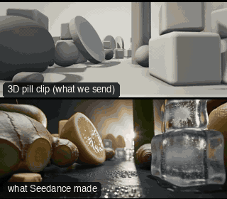

# PRD04-ProbeFlyThrough: Probe fly-through



Family: Product shots.

**What it says.** We are small enough to fly through what it is made of: the ingredients are a landscape, and the product is where it leads.

**Use it for.** Food, drink, supplement and beauty spots where the ingredients are the story; an opening that travels through them and lands on the pack.

**Camera numbers.** Built 5 times life size (the pill is 1.2 m); real figures in brackets. 16 mm at T22, the lens 0.15 m (3 cm) over the table. Held 0.6 s, then a 5.5 m (1.1 m) S-curve at 1.47 m/s (0.29 m/s), banking 11° into each bend, nearest pass 0.14 m (2.8 cm); level again and fastest, 2.0 m/s (0.4 m/s), under the arch at 4.65 s with the pill standing in its opening. In the open it rises to 0.38 m (7.6 cm), swings across the pill's front 2.04 m (41 cm) from it and backs away 1.06 m (21 cm) while the lens lengthens to 24 mm. Dead still from 7.4 s, 3.1 m (62 cm) out, the pill 61% of the frame height; held 1.6 s.

**Avoid.** Flying over an empty table: without things a few centimetres from the lens on both sides it is only a low dolly. Keep the product in the arch's opening, never behind one of its legs.

## The three.js code

This is an excerpt of the template (219 lines, from `engine/cinematic/src/templates/products/p04-probe-fly-through.ts`). `template.ts` in this folder is the same code with its imports. The helpers it calls (`make`, the actors, the rigs, the set and the post chain) are in `engine/cinematic/src`, so it does not run on its own: render it with `tools/render-pill.sh`.

```ts
// PRD04-ProbeFlyThrough
// Copied from engine/cinematic/src/templates/products/p04-probe-fly-through.ts (all of that file).
// The set builders, rigs and stand-ins it calls live in engine/cinematic/src and kit/.
// Render it: cd engine/cinematic && tools/render-pill.sh PRD04-ProbeFlyThrough
// PRD04-ProbeFlyThrough: a probe lens flies low through a canyon of ingredients, slaloms two tall cylinders, passes
// under an arch of two slices and swings out to the hero frame of the pill.
// The world is built 5 times life size (the pill is 1.2 m), so the lens can pass 2 to 3 cm (real) from things without
// the 5 cm near plane cutting them. Every number in this file is built metres; divide by 5 for the real tabletop.
import * as THREE from "three";
import { speedRamp } from "../../kit/stage";
import { GREY, clay } from "../../kit/clay";
import { aimFor } from "../../framer";
import { rng, smoother } from "../../util";
import type { Cam } from "../../shots";
import type { Piece } from "../../piece";
import { V, makeProduct, pillActor, studioFloor, type KitWorld } from "./shared";

const K = 5;                                                        // built size over real size
const UP = V(0, 1, 0), PILL_MID = V(0, 0.6, 0);
const sm = (t: number, a: number, b: number) => smoother((t - a) / (b - a));

// ---- the path, drawn from its curvature so every bend eases in and out ----
// each turn: [degrees (+ is left), where its middle is along the path, how long it takes], metres. A bend right then a
// bend left make the S through the canyon; the arch stands on the straight after them; the last turn is the hook that
// swings across the pill's front and backs away to the hero position.
const TURNS: [number, number, number][] = [[-53, 1.35, 2.5], [36, 3.6, 2.0], [150, 7.2, 2.4]];
const HEAD0 = 41, LEN = 8.55, S_ARCH = 5.5, LENS_Y = 0.15, HERO = V(0, 0.38, 3.1), DS = 0.0005;
const PATH = (() => {
  const rad = THREE.MathUtils.degToRad, n = Math.round(LEN / DS), pts = [V(0, 0, 0)];
  const bend = (s: number) => TURNS.reduce((k, [d, c, w]) => { const u = (s - c) / w + 0.5; return k + (u > 0 && u < 1 ? (rad(d) / w) * (1 - Math.cos(2 * Math.PI * u)) : 0); }, 0);
  for (let i = 0, th = rad(HEAD0), x = 0, z = 0; i < n; i++) { const k = bend((i + 0.5) * DS), m = th + (k * DS) / 2; x -= Math.sin(m) * DS; z -= Math.cos(m) * DS; th += k * DS; pts.push(V(x, 0, z)); }
  // moved so it ends on the hero position; low through the canyon, rising from just past the arch
  const end = pts[n].clone();
  pts.forEach((p, i) => p.sub(end).add(HERO).setY(LENS_Y + (HERO.y - LENS_Y) * smoother((i * DS - S_ARCH - 0.1) / (LEN - S_ARCH - 0.1))));
  return pts;
})();
function along(s: number) { const x = Math.min(LEN, Math.max(0, s)) / DS, i = Math.min(PATH.length - 2, Math.floor(x)); return PATH[i].clone().lerp(PATH[i + 1], x - i); }
/** the path's right-hand side on the table at s */
const rightAt = (s: number) => along(s + 0.02).sub(along(s - 0.02)).setY(0).normalize().cross(UP).normalize();

// ---- the timing: held, eased up to a cruise, fastest under the arch, braked through the hook to a dead stop ----
const T0 = 0.6, T_ARCH = 4.65, T1 = 7.4, END = 9;
const RUN = speedRamp([[T0, 0], [1.5, 1.36], [3.85, 1.36], [T_ARCH, 1.85], [5.1, 1.55], [5.6, 1.2], [6.3, 0.95], [7.0, 0.5], [T1, 0]]);
const sAt = (t: number) => (LEN * RUN(Math.min(Math.max(t, 0), T1))) / RUN(T1);
const posAt = (t: number) => along(sAt(t));

// ---- the camera ----
const MM0 = 16, MM1 = 24, AHEAD = 1.4, BANK = THREE.MathUtils.degToRad(13), A_REF = 1.3;
/** sideways acceleration of the lens (m/s², + to its right), averaged over a quarter second: what the bank follows */
function lateral(t: number) {
  const h = 0.12; let a = 0;
  for (let i = -2; i <= 2; i++) {
    const x = t + i * 0.06, p0 = posAt(x - h), p1 = posAt(x), p2 = posAt(x + h), v = p2.clone().sub(p0).setY(0);
    if (v.lengthSq() < 1e-10) continue;
    a += p2.add(p0).sub(p1.multiplyScalar(2)).multiplyScalar(1 / (h * h)).dot(v.normalize().cross(UP)) / 5;
  }
  return a;
}
function camAt(t: number): Cam {
  const s = sAt(t), pos = along(s), mm = MM0 * Math.pow(MM1 / MM0, sm(t, 5.2, T1));
// ... (see template.ts for the rest)
```

## The videos

The stand-in in `pill.mp4` is the **capsule** (the single striped capsule of the first gallery clips). Render the other with `--standin pin`.

| What | File |
|---|---|
| The 3D pill clip, the reference video | `pill.mp4` |
| What Seedance made from the pill clip (480p draft) | `release-media/PRD04-ProbeFlyThrough/result.mp4` (release asset) |

## The prompt

One file per send. `sent.json` says, for each, whether it is the text that was sent, a recovered copy, or a rebuilt copy (`prompt.provenance`):

- `prompts/video.txt`

Keep the lines that say what the pills are and that the set is to be rebuilt as real. Change the person, the place and the light. These prompts come from the gallery runs and many predate the checks in `tools/seedance/`, so rebuild one with the gates before you reuse it.

## How it was sent

`sent.json` holds, for each send: the references in order with their roles, the settings, the credits and the outcome. Request ids are not kept; where one was known, a short hash is stored.

- **video #1**: 9 s, draft (480p preview), 21:9; references: @video1 = pill clip (the 3D blockout), @image1 = product photo; confirmed: yes; 1312.2 credits.

See `reproduce.md` to render it and send it yourself.
