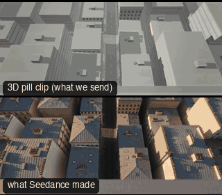

# PRD05-SkylineDive: Skyline dive



Family: Product shots.

**What it says.** The whole city narrows to one object: from the skyline to a table in one breath, and the product is where it lands.

**Use it for.** Launches and reveals where the product is a destination: a venue, a shop, a table worth crossing a city for.

**Camera numbers.** One 134 m FPV path in 11.7 s, 19 mm tightening to 26 mm indoors. Holds 0.7 s, 3.5 m over the edge of an 80 m roof, looking down 62°. Dives 3.8 m off the face for 2.35 s at up to 25 m/s, nose 85° down. Pulls out to 2.4 m over the street, runs level for a second, banks 23° through a 90° turn, crosses a 2 × 2 m window square at 7 m/s with 0.9 m clear all round. Brakes over 4.2 m and stops 0.62 m from the pill at 10.1 s; the pill stands in the low sun that comes in through the same window. Still for 1.6 s.

**Avoid.** Slowing for the window, or cutting anywhere: the frame edge sells the crossing only at speed, and the take only counts unbroken. No drift in the last frame.

## The three.js code

This is an excerpt of the template (235 lines, from `engine/cinematic/src/templates/products/p05-skyline-dive.ts`). `template.ts` in this folder is the same code with its imports. The helpers it calls (`make`, the actors, the rigs, the set and the post chain) are in `engine/cinematic/src`, so it does not run on its own: render it with `tools/render-pill.sh`.

```ts
// PRD05-SkylineDive
// Copied from engine/cinematic/src/templates/products/p05-skyline-dive.ts (all of that file).
// The set builders, rigs and stand-ins it calls live in engine/cinematic/src and kit/.
// Render it: cd engine/cinematic && tools/render-pill.sh PRD05-SkylineDive
// PRD05-SkylineDive: one FPV take. Held over a tower's roof edge, it tips over and dives down the face, pulls out along
// the street, banks into a cafe's open window and stops in front of the pill, which stands in the window's sun.
import * as THREE from "three";
import { aimFor } from "../../framer";
import { GREY, clay } from "../../kit/clay";
import { building, chair, ground, lampPost, table } from "../../kit/props";
import type { Piece } from "../../piece";
import type { Cam } from "../../shots";
import { lerp, rng, smooth, smoother } from "../../util";
import { V, makeProduct, pillActor, type KitWorld } from "./shared";

const rad = THREE.MathUtils.degToRad;

// ---------------- the set (metres) ----------------
// The tower's face is the plane z = 0. The street runs away from it along +z, 12 m wide. The cafe is on its -x side.
const TOWER_H = 80;
const ZW = 56, WALL = -6.15;                          // the window: its centre along the street, the middle of its wall
const G0 = ZW - 7, G1 = ZW + 5;                       // the side street opposite the cafe: the low sun comes down it
const SUN: [number, number, number] = [0.94, 0.342, 0.06];   // 20 degrees up, along the side street and in through the window
const FLOOR = 0.03, TOP = FLOOR + 0.775;              // the cafe floor and the pill's tabletop
const PILL = V(-10.6, TOP, ZW - 0.45);                // the pill's base: 4.3 m inside, in the window's shaft of sun
const FACE = rad(35);                                 // the last frame looks into the room, 35 degrees off the window's axis
const F = V(-Math.cos(FACE), 0, -Math.sin(FACE));
const END = V(PILL.x - 0.62 * F.x, TOP + 0.2, PILL.z - 0.62 * F.z);   // the lens at rest: 0.62 m in front of the dot

/** a box by its extents */
function slab(x0: number, x1: number, y0: number, y1: number, z0: number, z1: number, color: string, name = "") {
  const m = new THREE.Mesh(new THREE.BoxGeometry(x1 - x0, y1 - y0, z1 - z0), clay(color));
  m.position.set((x0 + x1) / 2, (y0 + y1) / 2, (z0 + z1) / 2); m.castShadow = m.receiveShadow = true; m.name = name;
  return m;
}
/** a kit building on a lot, its front turned to the street */
function lot(x0: number, x1: number, z0: number, z1: number, h: number, seed: number, face: "+x" | "-x" | "+z" | "-z", name = "building") {
  const along = face === "+z" || face === "-z";
  const b = building(along ? x1 - x0 : z1 - z0, along ? z1 - z0 : x1 - x0, h, seed, seed % 2 ? GREY.light : GREY.paper);
  b.position.set((x0 + x1) / 2, 0, (z0 + z1) / 2);
  b.rotation.y = { "+z": 0, "+x": Math.PI / 2, "-z": Math.PI, "-x": -Math.PI / 2 }[face];
  b.name = name;
  // something on the roof, so it reads from above
  const r = rng(seed * 7 + 1), hx = lerp(x0 + 3, x1 - 3, r()), hz = lerp(z0 + 3, z1 - 3, r());
  const g = new THREE.Group(); g.name = name;
  g.add(b, slab(hx - 1.6, hx + 1.6, h + 0.5, h + 2.9, hz - 1.3, hz + 1.3, GREY.set), slab(hx + 2.4, hx + 3.6, h + 0.5, h + 1.3, hz - 0.6, hz + 0.6, GREY.mid));
  return g;
}
/** a far block: a box with ribbon windows, a cap and a roof hut */
function block(x0: number, x1: number, z0: number, z1: number, h: number, seed: number) {
  const g = new THREE.Group(); g.name = "far block";
  g.add(slab(x0, x1, 0, h, z0, z1, seed % 2 ? GREY.light : GREY.paper), slab(x0 - 0.2, x1 + 0.2, h, h + 0.5, z0 - 0.2, z1 + 0.2, GREY.set));
  for (let y = 4.4; y < h - 1.5; y += 3.4) g.add(slab(x0 - 0.04, x1 + 0.04, y - 0.45, y + 0.45, z0 - 0.04, z1 + 0.04, GREY.set));
  const r = rng(seed * 5 + 3), hx = lerp(x0 + 3, x1 - 3, r()), hz = lerp(z0 + 3, z1 - 3, r());
  g.add(slab(hx - 2, hx + 2, h + 0.5, h + 3, hz - 1.5, hz + 1.5, GREY.set));
  return g;
}
/** a shop awning on a street wall at x = `wall`, sloping down toward the street */
function awning(wall: number, z0: number, z1: number, y = 3.2) {
  const out = wall > 0 ? -1 : 1;
// ... (see template.ts for the rest)
```

## The videos

The stand-in in `pill.mp4` is the **capsule** (the single striped capsule of the first gallery clips). Render the other with `--standin pin`.

| What | File |
|---|---|
| The 3D pill clip, the reference video | `pill.mp4` |
| What Seedance made from the pill clip (480p draft) | `release-media/PRD05-SkylineDive/result.mp4` (release asset) |

## The prompt

One file per send. `sent.json` says, for each, whether it is the text that was sent, a recovered copy, or a rebuilt copy (`prompt.provenance`):

- `prompts/video-1.txt`
- `prompts/video-2.txt`

Keep the lines that say what the pills are and that the set is to be rebuilt as real. Change the person, the place and the light. These prompts come from the gallery runs and many predate the checks in `tools/seedance/`, so rebuild one with the gates before you reuse it.

## How it was sent

`sent.json` holds, for each send: the references in order with their roles, the settings, the credits and the outcome. Request ids are not kept; where one was known, a short hash is stored.

- **video #1**: 12 s, draft (480p preview), 21:9; references: @video1 = pill clip (the 3D blockout), @image1 = product photo; confirmed: yes; 1749.6 credits.
- **video #2**: 12 s, draft (480p preview), 21:9; references: @video1 = pill clip (the 3D blockout), @image1 = product photo; confirmed: yes.

See `reproduce.md` to render it and send it yourself.
