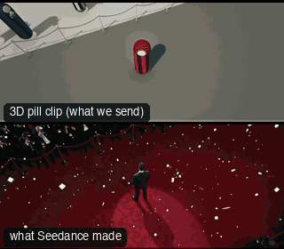

# PRD06-Glambot: Glambot



Family: Product shots.

**What it says.** The red-carpet robot shot: the lens drops in on a pose and time falls into slow motion as it arrives, so the move never stops.

**Use it for.** A person arriving or being revealed at an event, a fashion or beauty moment, a presenter with a product: one gesture, one take.

**Camera numbers.** 20 mm throughout, 15 s. The arm travels 5.5 m in 2.8 s of real time, peaking at 3.8 m/s. It starts 5.5 m up and 2.8 m out, looking down 60° (carpet, rope and the star at 23% of frame height, no horizon), drops first and closes in last so the tilt eases to 32° down at 1.0 s and 10° down at 1.5 s (the horizon enters at 1.2 s), and lands on a hips-up frame at eye height 1.3 m off by 1.9 s. Then 47° round the star to a chest-up frame 1.05 m off. Camera and world share one clock: normal speed to 1.3 s, eased to 0.08 by 2.1 s, so the rest is a steady 0.084 m/s creep, still moving on the last frame. The star turns 50° with the lens from 0.9 s.

**Avoid.** A hold at either end, a level start (it reads as a plain push in) or a second gesture: the arm never stops, and the slow motion has room for one move of the body.

## The three.js code

This is an excerpt of the template (211 lines, from `engine/cinematic/src/templates/products/p06-glambot.ts`). `template.ts` in this folder is the same code with its imports. The helpers it calls (`make`, the actors, the rigs, the set and the post chain) are in `engine/cinematic/src`, so it does not run on its own: render it with `tools/render-pill.sh`.

```ts
// PRD06-Glambot
// Copied from engine/cinematic/src/templates/products/p06-glambot.ts (all of that file).
// The set builders, rigs and stand-ins it calls live in engine/cinematic/src and kit/.
// Render it: cd engine/cinematic && tools/render-pill.sh PRD06-Glambot
// PRD06-Glambot: the red-carpet robot-arm shot, timed from a real Glambot take, with a higher start so the move reads.
// It is one playback speed ramp over one robot move. The lens starts 5.5 m up, almost overhead, looking down 60° at
// carpet, rope and the star small in frame. It drops first and closes in last, so it levels out on the way down (the
// press, the curtain and the horizon rise into frame) and lands on a hips-up frame, then carries on round the star to
// a chest-up. Camera and world share one clock: normal speed for 1.3 s, then slow motion to the end, so the dive is
// fast and the rest is a slow creep that never stops.
// Azimuths are degrees round the star, 0 = +z (the lens side), 90 = +x; the press and the curtain are at -z.
import * as THREE from "three";
import { speedRamp } from "../../kit/stage";
import { GREY, clay, shadeAll } from "../../kit/clay";
import { pill } from "../../kit/pill";
import { CAPSULE } from "../../standins";
import { aimFor } from "../../framer";
import { lerp, rng, smoother } from "../../util";
import type { Cam } from "../../shots";
import type { Piece } from "../../piece";
import { makeProduct, personPill, studioFloor, V, type KitWorld, type PathKey } from "./shared";

const RAD = Math.PI / 180;
const CARPET_Y = 0.015;                        // the carpet's pile: the star stands on it
const EYE_Y = CARPET_Y + 1.75 * 0.925;         // the face dot's centre
const MM = 20;

// ---------------- time: normal speed for 1.3 s, then slow motion to the end ----------------
const SLOW = 0.08, END = 15;
const CLOCK = speedRamp([[0, 1], [1.3, 1], [2.1, SLOW], [END, SLOW]]);
const W_END = CLOCK(END);                      // 2.76 s of world time in 15 s of film

// ---------------- the robot's move, in WORLD seconds ----------------
const AZ0 = -23.5, AZ1 = 23.5;                 // the second leg drifts 47° to the camera's right
const R0 = 2.8, R2 = 1.6, R8 = 1.32;           // metres from the star's axis: the top, the end of the dive, the last frame
const H0 = 5.5, H2 = 1.64, H8 = 1.59;          // lens height at the same three moments
const DIVE = { up: [0.05, 0.45], down: [1.1, 1.7] };        // 0.4 s to reach speed, 0.6 s to brake into the arc
const ARC = { up: [1.45, 1.75] };                           // the arc takes over under the end of the braking
/** the dive's line at q 0..1, as [metres out, metres up]: it drops first and closes in last, so the lens levels out as it comes down */
const line = (q: number): [number, number] => [R0 + (R2 - R0) * q * q, H0 + (H2 - H0) * (1 - (1 - q) * (1 - q))];
// distance along that line, so the arm's speed follows its own timing and nothing else
const LINE = (() => {
  const N = 2000, len = [0]; let prev = line(0);
  for (let i = 1; i <= N; i++) { const p = line(i / N); len.push(len[i - 1] + Math.hypot(p[0] - prev[0], p[1] - prev[1])); prev = p; }
  return (k: number) => { const s = Math.min(1, Math.max(0, k)) * len[N]; let lo = 0, hi = N; while (hi - lo > 1) { const m = (lo + hi) >> 1; if (len[m] < s) lo = m; else hi = m; } return line((lo + (s - len[lo]) / Math.max(1e-9, len[hi] - len[lo])) / N); };
})();
/** time spent at speed by w, for a speed that rises 0 to 1 between a and b and stays there */
const run = (w: number, a: number, b: number) => { const s = Math.min(1, Math.max(0, (w - a) / (b - a))); return (b - a) * (s * s * s - (s * s * s * s) / 2) + Math.max(0, w - b); };
/** how far down the dive the arm is, 0..1 of its length */
const dive = (w: number) => (run(w, DIVE.up[0], DIVE.up[1]) - run(w, DIVE.down[0], DIVE.down[1])) / (DIVE.down[1] - DIVE.up[1] - (DIVE.down[1] - DIVE.down[0]) / 2 + (DIVE.up[1] - DIVE.up[0]) / 2);
/** the arc round the star: it holds its speed to the last frame and past it */
const arc = (w: number) => run(w, ARC.up[0], ARC.up[1]) / run(W_END, ARC.up[0], ARC.up[1]);

// ---------------- the star: a 50° turn that leads the lens round, begun at normal speed and ended in slow motion ----------------
const YAW1 = AZ1 * RAD, YAW0 = YAW1 - 50 * RAD;  // starts 3° off the first camera position, ends facing the last
const TURN = { t0: 0.9, dur: 1.8 };             // world seconds: film 0.9 s to about 14 s, a few degrees ahead of the lens all the way
const yawAt = (w: number) => lerp(YAW0, YAW1, smoother((w - TURN.t0) / TURN.dur));
const STAR_AT: [number, number, number] = [0, CARPET_Y, 0];
// a prop's yaw chases its nearest key (8% each 1/60 s), so two keys give a turn that starts with a jerk. These keys
// sit a step apart and lead the curve by that lag, so the planned facing follows yawAt; tick sets the exact angle
// ... (see template.ts for the rest)
```

## The videos

The stand-in in `pill.mp4` is the **capsule** (the single striped capsule of the first gallery clips). Render the other with `--standin pin`.

| What | File |
|---|---|
| The 3D pill clip, the reference video | `pill.mp4` |
| The contact sheet (sketch route) | `sketch-sheet.jpg` |
| What Seedance made from the pill clip (480p draft) | `release-media/PRD06-Glambot/result.mp4` (release asset) |
| What Seedance made from the contact sheet | `release-media/PRD06-Glambot/sketch-output.mp4` (release asset) |

## The prompt

One file per send. `sent.json` says, for each, whether it is the text that was sent, a recovered copy, or a rebuilt copy (`prompt.provenance`):

- `prompts/sketch.txt`
- `prompts/video-1.txt`
- `prompts/video-2.txt`

Keep the lines that say what the pills are and that the set is to be rebuilt as real. Change the person, the place and the light. These prompts come from the gallery runs and many predate the checks in `tools/seedance/`, so rebuild one with the gates before you reuse it.

## How it was sent

`sent.json` holds, for each send: the references in order with their roles, the settings, the credits and the outcome. Request ids are not kept; where one was known, a short hash is stored.

- **video #1**: 15 s, draft (480p preview), 21:9; references: @video1 = pill clip (the 3D blockout), @image1 = person photo (face reference); confirmed: yes; 2187 credits.
- **video #2**: 15 s, draft (480p preview), 21:9; references: @video1 = pill clip (the 3D blockout), @image1 = person photo (face reference); confirmed: yes; 2187 credits.
- **sketch #1**: 15 s, draft (480p preview), 21:9; references: @image1 = person photo (face reference), @image2 = contact sheet of the pill (a few frames on one image); confirmed: yes; 1833 credits.

See `reproduce.md` to render it and send it yourself.
