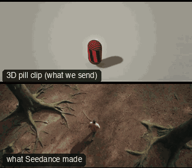

# SC01-ForestClearing: Forest clearing



Family: Scenes.

**What it says.** A person arrives somewhere and finds something.

**Use it for.** Openings, discoveries, any scene where a character enters a new place.

**Camera numbers.** Crane down 28 mm, Steadicam follow 32 mm, push-in 50 mm MCU→CU, reverse OTS 50 mm, crane up 24 mm.

**Avoid.** Showing the discovery before the reaction: the face comes first (rulebook §5).

## The three.js code

This is an excerpt of the template (11 lines, from `engine/cinematic/src/templates/scenes.ts`). `template.ts` in this folder is the same code with its imports. The helpers it calls (`make`, the actors, the rigs, the set and the post chain) are in `engine/cinematic/src`, so it does not run on its own: render it with `tools/render-pill.sh`.

```ts
import * as THREE from "three";
import { planner, scenePiece, type KitWorld, type SceneSpec, type ShotDef } from "../kit/stage";
import type { ActorSpec } from "../kit/actors";
import { GREY, clay } from "../kit/clay";
import { lag, rig } from "../kit/rigs";
import { aimFor } from "../framer";
import { asteroid, bench, broadTree, building, bush, car, carInterior, floorLamp, ground, lampPost, pine, planet, rock, room, scatter, shelf, sofa, table } from "../kit/props";
import { rng } from "../util";
import type { Piece } from "../piece";
import type { TemplateInfo } from "./cameras";

make({ id: "SC01-ForestClearing", name: "Forest clearing", pattern: "Arrival → follow → reaction push → reverse on the discovery → release", says: "A person arrives somewhere and finds something.", use: "Openings, discoveries, any scene where a character enters a new place.", numbers: "Crane down 28 mm, Steadicam follow 32 mm, push-in 50 mm MCU→CU, reverse OTS 50 mm, crane up 24 mm.", avoid: "Showing the discovery before the reaction: the face comes first (rulebook §5)." },
    { sky: "day", build: buildForest, keyDir: [-0.5, 0.72, 0.42], motes: { center: [0, 2.5, 6], size: [30, 6, 30], count: 220 },
      actors: [human("ALEX", "Alex", "ochre", [{ t: 0.3, at: [0.5, 17.6] }, { t: 10.3, at: [0.4, 3.8], yaw: Math.PI }], { acts: [{ kind: "lookUp", t0: 10.6, t1: 13.6 }] }),
        { id: "STONE", name: "Standing stone", kind: "prop", model: "monolith", tint: "plum", path: [{ t: 0, at: [0, -3.5], yaw: 0 }] }] },
    (P) => [
      { start: 0, end: 5, label: "28mm  CRANE DOWN · ARRIVAL", rig: "TECHNOCRANE", subject: "ALEX", size: "EWS", sizeEnd: "WS", stop: 5.6, cam: rig.crane(P("ALEX"), { size: "WS", mm: 28, deg: 200 }, 5.5, 1.2, 0, 5, 1.25), cut: "FADE IN on the forest", flags: ["compound", "exits-moving"] },
      { start: 5, end: 10, label: "32mm  STEADICAM FOLLOW", rig: "STEADICAM", subject: "ALEX", size: "MWS", stop: 2.8, cam: rig.follow(P("ALEX"), { size: "MWS", mm: 32, deg: 180, rise: 0.2 }), cut: "CUT in behind her: same direction of travel", flags: ["enters-moving", "exits-moving", "centre"] },
      { start: 10, end: 13.5, label: "55mm  PUSH IN · REACTION", rig: "DOLLY", subject: "ALEX", size: "MCU", sizeEnd: "CU", stop: 2, cam: rig.dolly(P("ALEX"), { size: "MCU", mm: 55, deg: 18 }, "CU", 10, 13.5, 0.4), cut: "CUT round to her face: she stops and looks up" },
      { start: 13.5, end: 17.5, label: "50mm  REVERSE OTS · THE STONE", rig: "STEADICAM", subject: "STONE", size: "FS", stop: 2.8, ots: "ALEX", cam: rig.ots(P("ALEX"), P("STONE"), 50, 1, 2.4, 0.6), cut: "CUT to what she sees, over her shoulder", flags: ["centre"] },
      { start: 17.5, end: 22, label: "24mm  CRANE UP · RELEASE", rig: "TECHNOCRANE", subject: "ALEX", size: "WS", sizeEnd: "EWS", stop: 5.6, cam: rig.crane(P("ALEX"), { size: "WS", mm: 24, deg: 150 }, 0.8, 11, 17.5, 22, 1.8), cut: "CUT wide: the release", flags: ["compound"] },
    ]),
```

**Make it yours.** Change rig: `rig.crane`, `rig.dolly`, `rig.follow`, `rig.ots`; lens: 24 mm, 28 mm, 32 mm, 55 mm; shot size: EWS, FS, MCU, MWS, WS. The actor `path` entries say where the pill stands and walks, and the numbers after `rig.` set the move (distance, angle, rise, start and end time).

## The videos

The stand-in in `pill.mp4` is the **capsule** (the single striped capsule of the first gallery clips). Render the other with `--standin pin`.

| What | File |
|---|---|
| The 3D pill clip, the reference video (a re-render: the clip that was uploaded was not kept) | `pill.mp4` |
| What Seedance made from the pill clip (480p draft) | `release-media/SC01-ForestClearing/result.mp4` (release asset) |

## The prompt

One file per send. `sent.json` says, for each, whether it is the text that was sent, a recovered copy, or a rebuilt copy (`prompt.provenance`):

- `prompts/video.txt`

Keep the lines that say what the pills are and that the set is to be rebuilt as real. Change the person, the place and the light. These prompts come from the gallery runs and many predate the checks in `tools/seedance/`, so rebuild one with the gates before you reuse it.

## How it was sent

`sent.json` holds, for each send: the references in order with their roles, the settings, the credits and the outcome. Request ids are not kept; where one was known, a short hash is stored.

- **video #1**: 22 s, draft (480p preview), 21:9; references: @video1 = pill clip (the 3D blockout), @image1 = person photo (face reference); confirmed: yes; 3207.6 credits.

See `reproduce.md` to render it and send it yourself.
